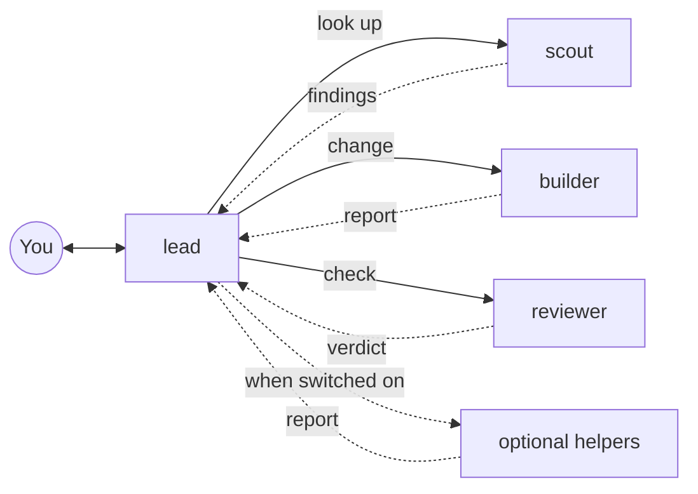

<!--
SPDX-FileCopyrightText: 2026 European Centre for Medium-Range Weather Forecasts (ECMWF)
SPDX-License-Identifier: Apache-2.0
-->

# Design

ecmwf-multi-agents is a multi-agent harness for opencode that ECMWF scientists, analysts and
developers can install in minutes. One agent, `lead`, talks to the user, makes every decision
and hands work to helpers that read, build or check. Each helper runs on the cheapest model that
suits its job, so a session costs less and `lead`'s context stays small.

This page is the entry point. The full design contract is `docs/architecture.md`; the reasons
for each major choice are in `docs/adr/`; what was measured is in `docs/research/` and
`evals/results/`.

## How it works

`lead` sizes each request: it answers, makes a trivial edit, briefs one or more helpers, or
plans with the user first. Helpers start with no memory of the conversation, get one explicit
brief, and report in a fixed format. Nothing approves its own work: an independent reviewer
checks plans and changes under the review policy in force. The principles behind this are in
`docs/architecture.md`, Principles.

## Decisions

| Topic | Decision |
|---|---|
| Agents | `lead` (primary, default), and three helpers on by default: `scout`, `builder`, `reviewer`. Five optional helpers, off by default: `researcher`, `tester`, `designer`, `data-scientist`, `inspector`. Every helper can be switched on or off per project (ADR 0005, ADR 0007) |
| Commands | `/onboard`, `/plan`, `/execute`, `/review`, `/progress`, `/harden`, `/guide`. A command can need a helper: while it is off, the command refuses and says how to switch it on |
| Models | Profiles give each agent a model and an effort: `default` (Anthropic, with GPT through GitHub Copilot for the reviewer, the tester and the inspector, each falling back to Claude Opus), `anthropic`, `copilot`, `inherit`. The settings can change any agent's model, effort, fallback models and step limit |
| Settings | `ecmwf-multi-agents.jsonc`, for the user in `~/.config/opencode/` and per project in `.opencode/`; applied by the plugin |
| Writing | `lead` follows a short writing guidance for readers whose first language may not be English, inspired by ASD-STE100; `writing_guidance: "off"` removes it (ADR 0006) |
| Git | Agents commit only when asked. Push, pull requests, merges, releases and starting workflows always ask first. Helpers never write to git or GitHub |
| Work files | `.ecmwf-multi-agents/` at the top of the repository, kept out of git through `.git/info/exclude` |
| Platform | opencode 2 only, tested on one pinned version (`install.sh`, `V2_PINNED`); other 2.x versions work with a warning (ADR 0004) |
| Distribution | The npm package `@ecmwf.int/multi-agents` (`opencode plugin add`, or `npm install -g` and the installer), a git checkout with `install.sh`, a project's `plugins` line, or a central install on shared machines (ADR 0001, ADR 0003) |
| Tooling | TypeScript on Bun for the generator and the plugin; a POSIX sh installer; the generated `dist/` is committed |
| Prompts | Small: every prompt has a token budget in `src/manifest.jsonc`, raised only to a measured size with the reason |
| Evals | Scenario cases against real models in sandboxes, and the same cases on a stand-in model in the integration tests (`evals/README.md`) |
| Versions | `MAJOR.MINOR.MICRO` without a `v`; `VERSION` is the single source; `make release X.Y.Z` |

## Work and history

Open work, proposals and questions are GitHub issues, labelled `task`, `proposal` or `question`
with a topic label; `CONTRIBUTING.md` says how to take one. What changed in each release is in
`CHANGELOG.md`; how a decision came about is in its ADR and in git history.
