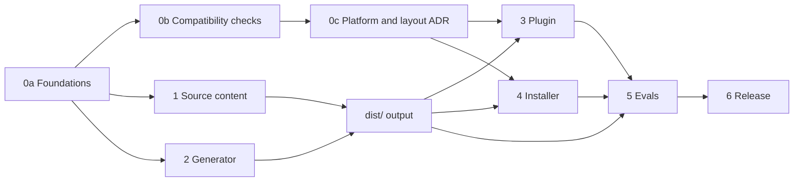

<!--
SPDX-FileCopyrightText: 2026 European Centre for Medium-Range Weather Forecasts (ECMWF)
SPDX-License-Identifier: Apache-2.0
-->

# Plan and progress

This file tracks how ecmwf-multi-agents gets built. It is the only place where phase numbers
appear: code, prompts, docs and commit messages describe what things are, not when they were
done.

Legend: `[ ]` to do, `[~]` in progress, `[x]` done, `[!]` blocked. Tasks marked **(par)** can run
in parallel with their siblings.

## Goal

A multi-agent harness for opencode that ECMWF scientists, analysts and developers can install in
minutes. One agent, `lead`, talks to the user, makes every decision and hands work to helpers
that read, build or check. Each helper runs on the cheapest model that suits its job, so a
session costs less and `lead`'s context stays small. Roles are generic; ECMWF-specific job
support waits in `TODO.md` until approved.

## Decisions

| Topic | Decision |
|---|---|
| Name | `ecmwf-multi-agents` |
| Agents | `lead` (primary, default), `scout`, `scout-deep`, `builder`, `builder-deep`, `reviewer` |
| Default models | `lead`: `anthropic/claude-opus-5-5` xhigh. `builder`: `anthropic/claude-sonnet-5-5` high. `scout`: `anthropic/claude-sonnet-5-5` medium. `reviewer`: `github-copilot/gpt-6.1-sol` medium |
| Deep tiers (inferred, to confirm) | `builder-deep`: `anthropic/claude-opus-5-5` high. `scout-deep`: `anthropic/claude-sonnet-5-5` high |
| Profiles | `default` (above), `anthropic` (Anthropic API only), `copilot` (GitHub Copilot only), `inherit` (session model everywhere). ECMWF's internal endpoint deferred, see `TODO.md` |
| Planning | `lead` interviews the user, sends scouts, writes the plan, has it reviewed, waits for approval |
| Review policy | `auto` (default), `ask`, `always`, `never`, set in the settings file |
| Git | Agents commit only when asked. Push, PR and merge always prompt |
| Built-in agents | Kept and reachable by the user. `lead` cannot delegate to them |
| Work files | `.ecmwf-multi-agents/{plans,context,notes}/`, excluded through `.git/info/exclude` |
| Settings | `ecmwf-multi-agents.jsonc`, global in `~/.config/opencode/`, per project in `.opencode/`; applied by the optional plugin |
| opencode v1 | Main, stable target: 1.18.35 and later 1.x. Tested on 1.18.35 and 1.19.0 |
| opencode v2 | Pinned to 2.0.16, the version weave's v2 adapter uses. Moves only after a deliberate re-test |
| Tooling | TypeScript on Bun for the generator and plugin; POSIX sh installer; generated `dist/` is committed |
| Distribution | git clone + `install.sh`; central install through environment variables; npm plugin |
| Evals | Small scenario suite before the first release |

## Dependencies between phases

Source content and generator code are written in parallel against the contracts in
`docs/architecture.md` and `tools/types.ts`; they meet when `bun run build` produces `dist/`.

## Parallel waves

| Wave | Runs in parallel | Joins on | State |
|---|---|---|---|
| 1 | Command clash check; v1 check + v1 emitter; v2 check + v2 emitter | Three research notes, ADR 0001 | done |
| 2 | Generator core; `lead` prompt + `onboard`, `plan`, `go` + plan skill; helper prompts + `review`, `progress`, `guide` + guide skill; plugin + bundler; installer + install guide | `bun run build` and `bun run check` green | done |
| 3 | Independent prompt review; install and load tests on 1.18.35, 1.19.0 and 2.0.16; fixes | Installs and loads in isolated v1 and v2 configs | done |
| 4 | Eval fixtures, eval cases, eval runner | Baseline numbers per profile | next |
| 5 | npm package, CI, v2 central install, docs polish | Release 0.1.0 | |

Ownership rule for parallel work: every task owns a disjoint set of files; shared contracts
(`docs/architecture.md`, `docs/adr/`, `src/manifest.jsonc`, `tools/types.ts`, this plan) change
only between waves.

## Phase 0: foundations and compatibility

0a. Foundations

- [x] Repository scaffold: git, licence, REUSE, `.gitignore`
- [x] `PLAN.md`, `AGENTS.md`, `README.md`, `TODO.md`
- [x] `docs/architecture.md`: roles, routing, hand-off contract, work files, settings
- [x] Generator contract: `src/manifest.jsonc`, `src/profiles/`, `tools/types.ts`, `package.json`

0b. Compatibility checks (wave 1)

- [x] **(par)** Command name clashes with opencode built-ins (v1 1.18.35 and 1.19.0, v2 2.0.16),
  weave, and commands already in the user's config, into `docs/research/command-clashes.md`
- [x] **(par)** v1 mechanics, into `docs/research/opencode-v1.md`: agents from a config dir, JSON
  vs Markdown precedence, `permission.task` filtering, question deny, `steps`, `variant`,
  replacing the built-in `scout`, skill permissions, plugin `config` hook, plugin auto-discovery
- [x] **(par)** v2 mechanics at 2.0.16, into `docs/research/opencode-v2.md`: agent file format,
  `model#variant`, permissions list, commands, skills, plugin agent registration, whether v1
  and v2 can share `~/.config/opencode`, central install mechanism

0c. Decision record

- [x] `docs/adr/0001-platforms-and-install-layout.md` from the three checks; contracts updated
  (`execute` action, notes path pair, `progress` command, permission semantics)

Exit: every check question has an answer backed by a command run or a source reference.

## Phase 1: source content

- [x] **(par)** `lead` prompt; commands `onboard`, `plan`, `go`; skill `ecmwf-multi-agents-plan`
  (planning and execution procedure, plan file format)
- [x] **(par)** Helper prompts: `scout`, `scout-deep` (addendum), `builder`, `builder-deep`
  (addendum), `reviewer`; commands `review`, `progress`, `guide`; skill
  `ecmwf-multi-agents-guide` (user guide)
- [x] Command names final: `onboard`, `plan`, `go`, `review` (replaces the built-in), `progress`
  (instead of `status`, a TUI built-in), `guide`
- [x] Profiles: `default`, `anthropic`, `copilot`, `inherit`
- [x] Independent review of all prompts against `docs/architecture.md`, by scenario walk-through;
  nine blockers and six improvements applied, contract updated to match

Exit: every prompt within its budget; review verdict APPROVE. Budgets are nearly full:
`lead` 1,789 of 1,800, plan skill 1,197 of 1,200, guide skill 1,192 of 1,200.

## Phase 2: generator

- [x] Core: JSONC loader, manifest validation, prompt budgets, settings schema output,
  `dist/` writer with support files (`schema.json`, `profiles/`, `files.txt`), `--check` mode
- [x] **(par)** v1 emitter: agents, commands, skills in v1 format (unit and integration tests)
- [x] **(par)** v2 emitter: agents, commands, skills in v2 format (unit and integration tests)
- [x] `bun run check`: build, typecheck, tests, budgets, `dist/` up to date, `reuse lint`,
  `shellcheck`

Exit: `dist/` loads in v1 (`opencode debug agent`) and v2 in isolated configs.

## Phase 3: plugin

- [x] Core: read settings (site, global, project), resolve profile and per-agent models,
  rewrite the review policy line in `lead`, set the default agent
- [x] **(par)** v1 entry: `config` hook; guard re-applying helper shell rules in
  `tool.execute.before` (verified end to end with a stand-in model server)
- [x] **(par)** v2 entry: agent transform re-registered on `plugin.updated`
- [x] Bundler `tools/bundle-plugin.ts`: one ES module for both platforms, profiles embedded
- [x] Tests, including "the harness works without the plugin"

## Phase 4: installer

- [x] `install.sh`: global (links) and `--project DIR` (copies), `--central DIR`, `--profile`,
  `--review`, `--platform`, `--dry-run`, `doctor`, `uninstall`; detects the opencode version
- [x] Central install on opencode 1.x (read-only copy plus `OPENCODE_CONFIG_DIR`), verified
  read-only on 1.18.35 and 1.19.0; `docs/install.md`
- [x] Tests in sandboxes for 1.18.35, 1.19.0 and 2.0.16; `shellcheck` (containers move to CI)

Integration suites (opt-in, `ECMWF_MULTI_AGENTS_INTEGRATION=1`): 49 tests pass on 1.18.35,
1.19.0 and 2.0.16 across emitters, plugin and installer.

## Phase 5: evals

- [ ] **(par)** Fixture repositories
- [ ] **(par)** About 12 scenarios: direct answer, trivial edit, bounded fix, cross-module
  feature, quick vs deep investigation, parallel lookups, reject-and-fix loop, ambiguous
  brief (helper must not ask), approval gate, no push, `/onboard` accuracy, `/progress`
  accuracy
- [ ] **(par)** Runner: agents used, commands run, hidden-test pass, cost per agent, `lead`
  peak context
- [ ] Baseline against the plain `build` agent per profile; set targets

## Phase 6: release

- [ ] npm package (plugin that also carries agents, commands and skills)
- [ ] Central install on opencode 2 (generated `opencode.json` through `OPENCODE_CONFIG`)
- [ ] CI: `bun run check` plus the integration suites in containers per opencode version
- [ ] README quickstart for scientists; `/guide` content final
- [ ] Version 0.1.0

## Open questions

- Deep-tier default models were inferred, not specified. Confirm or change.
- Repository home (GitHub organisation, npm scope) for the README and the npm package.
- Prompt budgets (`lead` 1,800 tokens, helpers 700, commands 500, skills 1,200) are nearly
  full; raise them or trim prompts, informed by eval results.
- `/onboard` is shadowed in projects that define their own `onboard` command (three of the
  owner's repositories do). Kept as requested; renaming to `survey` would avoid it.

## Log

- 2026-10-11: Design agreed through interview. Scaffold, plan and contracts written.
- 2026-10-11: Compatibility checks done for 1.18.35, 1.19.0 and 2.0.16; both emitters written
  and tested against the real binaries. ADR 0001 records platforms and install layout.
  `status` renamed `progress`; `execute` (Code Mode) action added and denied to read-only
  helpers. The generator core and helper prompt tasks produced no output and were restarted.
- 2026-10-11: Generator core, all prompts, plugin and installer done. Independent prompt review
  applied. `bun run check` green (297 tests); 49 integration tests green on all three opencode
  versions. Central install verified read-only on opencode 1.x. Next: evals.
