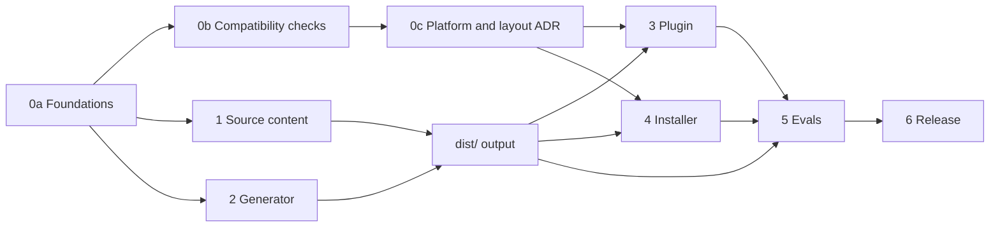

<!--
SPDX-FileCopyrightText: 2026 European Centre for Medium-Range Weather Forecasts (ECMWF)
SPDX-License-Identifier: Apache-2.0
-->

# Plan and progress

This file tracks how ecmwf-multi-agents gets built. It is the only place where phase numbers
appear: code, prompts, docs and commit messages describe what things are, not when they were
done.

Legend: `[ ]` to do, `[~]` in progress, `[x]` done, `[!]` blocked. Tasks marked **(par)** can run
in parallel with their siblings.

Who does what: a task that starts with a first name (`Tiago:` or `Samet:`) belongs to that
person, and nobody else picks it up. A task without a name is free. To take one, claim it in
this file first and push the claim, as `AGENTS.md` (Working together) describes.

## Goal

A multi-agent harness for opencode that ECMWF scientists, analysts and developers can install in
minutes. One agent, `lead`, talks to the user, makes every decision and hands work to helpers
that read, build or check. Each helper runs on the cheapest model that suits its job, so a
session costs less and `lead`'s context stays small. Roles are generic; ECMWF-specific job
support waits in `TODO.md` until approved.

## Decisions

| Topic | Decision |
|---|---|
| Name | `ecmwf-multi-agents` |
| Agents | Four: `lead` (primary, default), `scout`, `builder`, `reviewer`. No separate deep tiers: each agent has a default effort, which users change per agent in the settings file |
| Default models | `lead`: `anthropic/claude-opus-5-5` xhigh. `builder`: `anthropic/claude-sonnet-5-5` high. `scout`: `anthropic/claude-sonnet-5-5` medium. `reviewer`: `github-copilot/gpt-6.1-sol` medium |
| Versions | `MAJOR.MINOR.MICRO` without a `v`, single source in `VERSION`, tag equals version; one step: `make release X.Y.Z` |
| Profiles | `default` (above), `anthropic` (Anthropic API only), `copilot` (GitHub Copilot only), `inherit` (session model everywhere). ECMWF's internal endpoint deferred, see `TODO.md` |
| Planning | `lead` interviews the user, sends scouts, writes the plan, has it reviewed, waits for approval |
| Review policy | `auto` (default), `ask`, `always`, `never`, set in the settings file |
| Git | Agents commit only when asked. Push, PR and merge always prompt |
| Built-in agents | Kept and reachable by the user. `lead` cannot delegate to them |
| Work files | `.ecmwf-multi-agents/{plans,context,notes}/`, excluded through `.git/info/exclude` |
| Settings | `ecmwf-multi-agents.jsonc`, global in `~/.config/opencode/`, per project in `.opencode/`; applied by the optional plugin |
| opencode v1 | Dropped (Phase 9). Supported up to 0.5.x on 1.18.35 and later 1.x |
| opencode v2 | The only platform from Phase 9. Pinned (2.0.29); moves only after a deliberate re-test |
| Tooling | TypeScript on Bun for the generator and plugin; POSIX sh installer; generated `dist/` is committed |
| Distribution | git clone + `install.sh`; central install through environment variables; npm plugin |
| Evals | Scenario suite against real models; results feed 0.2.0 (0.1.0 released before the first eval run, at the owner's choice) |

## Dependencies between phases

Source content and generator code are written in parallel against the contracts in
`docs/architecture.md` and `tools/types.ts`; they meet when `make build` produces `dist/`.

## Parallel waves

| Wave | Runs in parallel | Joins on | State |
|---|---|---|---|
| 1 | Command clash check; v1 check + v1 emitter; v2 check + v2 emitter | Three research notes, ADR 0001 | done |
| 2 | Generator core; `lead` prompt + `onboard`, `plan`, `go` + plan skill; helper prompts + `review`, `progress`, `guide` + guide skill; plugin + bundler; installer + install guide | Build and gate green | done |
| 3 | Independent prompt review; install and load tests on 1.18.35, 1.19.0 and 2.0.16; fixes | Installs and loads in isolated v1 and v2 configs | done |
| 4 | Four agents with per-agent effort (generator and plugin; prompts and docs); Makefile and version tool; eval harness | Release 0.1.0 | done |
| 5 | Eval runs, baseline, prompt fixes from the results | Release 0.2.0 (done); the open tasks feed the next release | in progress |
| 6 | npm package, CI, v2 central install, docs polish | | |
| 7 | Background helpers, steering and cancel: evidence and contract first; then plugin tools, 1.x enablement and prompts in parallel; then tests, evals and docs | Contract agreed (7a); gate and integration green on 1.18.35, 1.19.0 and 2.0.16; evals show the cost of a wake and of a steer | released in 0.3.0 |
| 8 | `/execute` (named `/go` up to and including 0.4.0) carries out parallel tasks in the background: skill change, then evals | `execute-chat` and `plan-execute` pass on 1.18.35 (the evals drive 1.x only); wall clock and cost against 0.1.0 recorded | released in 0.5.0, with a known issue fixed in 0.5.1 (8c) |

Ownership rule for parallel work: every task owns a disjoint set of files; shared contracts
(`docs/architecture.md`, `docs/adr/`, `src/manifest.jsonc`, `tools/types.ts`, this plan) change
only between waves. Between the two developers, a change to a shared contract goes in its own
small commit, pushed promptly.

## Phase 0: foundations and compatibility

0a. Foundations

- [x] Repository scaffold: git, licence, REUSE, `.gitignore`
- [x] `PLAN.md`, `AGENTS.md`, `README.md`, `TODO.md`
- [x] `docs/architecture.md`: roles, routing, hand-off contract, work files, settings
- [x] Generator contract: `src/manifest.jsonc`, `src/profiles/`, `tools/types.ts`, `package.json`

0b. Compatibility checks (wave 1)

- [x] **(par)** Command name clashes with opencode built-ins (v1 1.18.35 and 1.19.0, v2 2.0.16),
  weave, and commands already in the user's config, into `docs/research/command-clashes.md`
- [x] **(par)** v1 mechanics, into `docs/research/opencode-v1.md`: agents from a config dir, JSON
  vs Markdown precedence, `permission.task` filtering, question deny, `steps`, `variant`,
  replacing the built-in `scout`, skill permissions, plugin `config` hook, plugin auto-discovery
- [x] **(par)** v2 mechanics at 2.0.16, into `docs/research/opencode-v2.md`: agent file format,
  `model#variant`, permissions list, commands, skills, plugin agent registration, whether v1
  and v2 can share `~/.config/opencode`, central install mechanism

0c. Decision record

- [x] `docs/adr/0001-platforms-and-install-layout.md` from the three checks; contracts updated
  (`execute` action, notes path pair, `progress` command, permission semantics)

Exit: every check question has an answer backed by a command run or a source reference.

## Phase 1: source content

- [x] **(par)** `lead` prompt; commands `onboard`, `plan`, `go`; skill `ecmwf-multi-agents-plan`
  (planning and execution procedure, plan file format)
- [x] **(par)** Helper prompts: `scout`, `builder`, `reviewer`; commands `review`, `progress`,
  `guide`; skill `ecmwf-multi-agents-guide` (user guide)
- [x] Four agents: the deep tiers merged into `scout` (investigations, notes file) and
  `builder` (hard fixes); per-agent effort in profiles and settings
- [x] Command names final: `onboard`, `plan`, `go`, `review` (replaces the built-in), `progress`
  (instead of `status`, a TUI built-in), `guide`
- [x] Profiles: `default`, `anthropic`, `copilot`, `inherit`
- [x] Independent review of all prompts against `docs/architecture.md`, by scenario walk-through;
  nine blockers and six improvements applied, contract updated to match

Exit: every prompt within its budget; review verdict APPROVE. Budgets are nearly full:
`lead` 1,792 of 1,800, plan skill 1,186 of 1,200, guide skill 1,198 of 1,200.

## Phase 2: generator

- [x] Core: JSONC loader, manifest validation, prompt budgets, settings schema output,
  `dist/` writer with support files (`schema.json`, `profiles/`, `files.txt`), `--check` mode
- [x] **(par)** v1 emitter: agents, commands, skills in v1 format (unit and integration tests)
- [x] **(par)** v2 emitter: agents, commands, skills in v2 format (unit and integration tests)
- [x] The gate, now `make check`: versions, `dist/` up to date (with manifest validation and
  budgets), typecheck, `reuse lint`, `shellcheck`, unit tests
- [x] Makefile (`help`, `setup`, `build`, `check`, `lint`, `test`, `integration`, `evals`,
  `version`, `release`, `clean`) and `tools/version.ts`; `VERSION` is the single source

Exit: `dist/` loads in v1 (`opencode debug agent`) and v2 in isolated configs.

## Phase 3: plugin

- [x] Core: read settings (site, global, project), resolve profile and per-agent models,
  rewrite the review policy line in `lead`, set the default agent
- [x] **(par)** v1 entry: `config` hook; guard re-applying helper shell rules in
  `tool.execute.before` (verified end to end with a stand-in model server)
- [x] **(par)** v2 entry: agent transform re-registered on `plugin.updated`
- [x] Bundler `tools/bundle-plugin.ts`: one ES module for both platforms, profiles embedded
- [x] Tests, including "the harness works without the plugin"

## Phase 4: installer

- [x] `install.sh`: global (links) and `--project DIR` (copies), `--central DIR`, `--profile`,
  `--review`, `--platform`, `--dry-run`, `doctor`, `uninstall`; detects the opencode version
- [x] Central install on opencode 1.x (read-only copy plus `OPENCODE_CONFIG_DIR`), verified
  read-only on 1.18.35 and 1.19.0; `docs/install.md`
- [x] Tests in sandboxes for 1.18.35, 1.19.0 and 2.0.16; `shellcheck` (containers move to CI)

Integration suites (opt-in, `ECMWF_MULTI_AGENTS_INTEGRATION=1`): 49 tests pass on 1.18.35,
1.19.0 and 2.0.16 across emitters, plugin and installer.

## Phase 5: evals

- [x] **(par)** Fixture repository (`evals/fixtures/stations`, standard-library Python)
- [x] **(par)** Twelve cases: answer, trivial edit, bug fix, feature, investigate, inventory,
  review reject and approve, no push, `/onboard`, plan and go, `/progress`
- [x] **(par)** Runner: sandboxed `opencode serve`, permission and question answering, per-agent
  cost, tokens and child sessions, `lead` peak context, checks, summary
- [x] First real-model run of the full suite on 0.1.0, default profile, opencode 1.18.35
  (Anthropic login through `ECMWF_MULTI_AGENTS_EVAL_PLUGINS`): 19 runs, $4.10, 15 minutes.
  Summary in `evals/results/0.1.0.md`
- [x] Fix from the results: `lead` chained commit and push in one command, so refusing the push
  lost the commit (`no-push` failed); fixed, and passes three out of three
- [x] Tiago: `/review` and `/progress` without the extra `lead` turn (see the first finding
  below); measure cold and warm sessions before and after
- [x] Tiago: One release command: fold `make version X.Y.Z` into `make release X.Y.Z` (set the
  version, roll the changelog, rebuild, check, commit, push, tag, publish), resumable and
  with `DRY_RUN=1`
- [ ] A larger eval fixture, or cases that need broad reading, to test whether delegation saves
  cost at scale (see the second finding below)
- [ ] Baseline for the `copilot` and `anthropic` profiles; repeats (`--repeat 3`) for variance
- [ ] Set targets once variance is known
- [x] Tiago: Release 0.2.0

Baseline on 0.1.0 (one run each):

| | Harness | Baseline (`build`, same model as `lead`) |
|---|---|---|
| Passed | 11 of 12 | 7 of 7 |
| Mean cost, the seven shared cases | $0.161 | $0.160 |
| Peak context, `feature` | 25,750 | 32,005 |

Findings to act on for 0.2.0:

- Done: `/review` and `/progress` ran their helper in a child session, and opencode 1.x then
  gave `lead` a turn to report the result, costing three to four times the helper's own work.
  On opencode 1.x the helper now answers in the user's session (`subtask: false`); the TUI
  keeps `lead` selected because it lists only primary agents, and the plugin keeps the earlier
  conversation out of the helper's requests. On opencode 2 a helper command still needs a child
  session, because running it inline switches the whole session to the helper. Cost of the
  command turn, mean of two runs each, opencode 1.18.35, default profile:

  | Case | Before | After | Helper's first request, tokens |
  |---|---|---|---|
  | `review-reject` (cold session) | $0.104 | $0.025 | 3,595 before and after |
  | `review-warm` (after one question) | $0.050 | $0.021 | 3,595 before and after |
  | `progress` (cold) | $0.096 | $0.029 | 7,490 before and after |
  | `progress-warm` | $0.046 | $0.029 | 7,490 before and after |

  All 16 runs passed. Equal first requests confirm the helper works from its command alone.
- The sample repository is small: `lead` answered, investigated and fixed bugs itself, without
  helpers, and still matched the baseline's cost. Delegation only showed in `feature`,
  `onboard` and `plan-go`. Add a larger fixture, or cases that need broad reading, to test
  whether delegation saves cost at scale.
- The baseline pushed to the remote without asking in `no-push`, which shows what the
  approval rules protect against.

## Phase 6: release

- [x] Tiago: One central checkout, switched on per project with one line in the project's
  `opencode.json`, `"plugin": ["{env:HOME}/.local/share/ecmwf-multi-agents"]`, on opencode
  1.x: the plugin brings its own agents, commands and skills when they are not installed, and
  the checkout's `package.json` names the plugin. Upgrading the checkout upgrades every
  project that has the line. Groundwork for the npm package below. Verified on 1.18.35 and
  1.19.0: the four agents resolve exactly as installed ones (apart from the folder the skills
  come from), the six commands replace the built-in `/review`, both skills load from the
  checkout, settings apply, `/review` and the shell guard work end to end with the stand-in
  model, opencode writes nothing into the checkout, and a project without the line sees none
  of it. opencode 2.0.16 ignores the line. ADR 0003
- [x] Tiago: Release 0.4.0
- [x] Tiago: npm package (plugin that also carries agents, commands and skills):
  `@ecmwf.int/multi-agents`, public, in ECMWF's npm organisation `ecmwf.int` from the account
  `ecmwf` (software@ecmwf.int), with `dist/`, `install.sh` and `VERSION` (the installer
  records the version from it). Its command `ecmwf-multi-agents` (`bin/ecmwf-multi-agents.js`)
  runs `install.sh` from the package's real folder, since npm installs it as a symlink.
  `.github/workflows/release.yml` publishes from each version tag through npm trusted
  publishing (GitHub OIDC, no token, with provenance) after the gate and `make pack-check`
  (the files npm would pack against those git tracks, also run by `make release` before it
  pushes), and skips a version npm already has; run by hand it is a dry run that fails unless
  npm got a token for the OIDC token
- [x] Tiago: once #4 is merged, in a terminal on the server (npm prints each login and
  approval link; open it in a browser elsewhere): `npm login --browser=false`; publish once by
  hand from a clean `main`, `npm publish --access public --provenance=false` (npm sets up
  trusted publishing only for a package that exists, and provenance needs CI); add the trusted
  publisher, `npx -y npm@11 trust github --file release.yml --repo ecmwf/ecmwf-multi-agents
  --allow-publish` (or on npmjs.com with "npm publish" ticked under "Allowed actions"); the
  first `make release` within 2 days, since a new trusted publisher expires unless it has
  published by then; then `npm access set mfa=publish` (require two-factor authentication,
  disallow tokens) and `npm logout`. npm refused the publish until the account `ecmwf` had
  two-factor authentication, which npm now offers as a security key only; Tiago set one up on
  npmjs.com. 0.5.2 was published by hand on 2026-10-15, and 0.5.3 validated the trusted
  publisher. npm added a placeholder version `0.0.0-stage` itself, not tagged `latest`
- [ ] `install.sh` names itself `./install.sh` in its help and advice, also when run as the npm
  command `ecmwf-multi-agents`; name the command it was run as
- [ ] A project's plugin line naming the npm package (`"plugin": ["@ecmwf.int/multi-agents"]`)
  on opencode 1.x: test that the plugin brings the agents, commands and skills from the package
- [ ] Central install on opencode 2 (generated `opencode.json` through `OPENCODE_CONFIG`)
- [x] Tiago: opencode 2.0.28 (on Tiago's machine since 2026-10-14, with no 1.x beside it): the
  pin moved from 2.0.16 to 2.0.28 (`V2_VERSION`, the installer's `V2_PINNED`, tests and docs;
  ADR 0001 amended). The agent and model schemas and the plugin API are unchanged; the
  emitter's integration test now expects the `browser * deny` rule that 2.0.28's browser
  plugin appends after every agent's own rules. Helpers get no permission prompts for
  opencode's tool-output, tmp and config folders: 2.0.28 dropped the `external_directory *
  ask` default together with those exceptions, so nothing asks outside the project for any
  agent, and Tiago chose to keep that default (no rule added). Integration on 1.18.35, 1.19.0
  and 2.0.28: 120 pass. `docs/research/opencode-v2.md`, Addendum: 2.0.28
- [x] Tiago: Release 0.5.2
- [x] Tiago: CI: `make check` and `make pack-check` on every push and pull request
  (`.github/workflows/ci.yml`); a pull request from a branch here is checked by the branch's
  push, so only one from a fork runs as a pull request
- [x] Tiago: Release 0.5.3: the npm package and CI, while Phase 9 heads for 0.6.0. Its tag is
  the first publish from GitHub Actions, due before 2026-10-17, when the trusted publisher
  expires unless it has published
- [ ] CI: the integration suites on the pinned opencode 2, once Phase 9 has removed 1.x
- [ ] README quickstart for scientists; `/guide` content final
- [ ] `tests/install.test.ts`: the "no opencode at all" test, and since 0.4.0 "with only
  opencode 2 the line does nothing" too, find a distro-packaged `/usr/bin/opencode` through
  the system PATH and fail on such machines; give the installer a PATH of only the tools it
  needs, and have `make setup` or `lint` name `reuse` and `shellcheck` when they are missing
  instead of failing with "command not found". The PATH half is done on `release/0.6.0`
  (Samet: the unit tests give the installer a PATH without any `opencode`); the `reuse` and
  `shellcheck` hint is still open
- [x] Version 0.1.0

## Phase 7: background helpers, steering and cancel

Today every hand-off blocks `lead`: it calls the task tool and waits, sees nothing of the
helper's work, and can stop nothing. The user sees a helper go wrong and can only wait. This
phase lets helpers run in the background, lets `lead` and the user see, redirect and stop
them, and keeps a redirected helper's context and prompt cache instead of restarting it.

Verified on 2026-10-12 with a scripted stand-in model (no hosted model), opencode 1.18.35 and,
as a signal only, 2.0.23 (2.0.16, the pinned version, is re-verified in 7a):

| Mechanism | opencode 1.18.35 | opencode 2.x |
|---|---|---|
| Background start | `task(background: true)` returns at once with `state="running"`; needs `OPENCODE_EXPERIMENTAL_BACKGROUND_SUBAGENTS=true`, otherwise the parameter is not in the tool schema | `subagent(background: true)`, no flag |
| Completion | A synthetic user message `<task id state="completed">` with the helper's final text wakes `lead`; the message carries `agent: lead` | Same, as `<subagent sessionID state="completed">` |
| Steer a running helper | `session.prompt_async` on the child: the loop re-reads messages each step, so the text reaches the model at the next step boundary (2.0 s after sending, after 3 of 6 tool steps); the run ends at the steer, nothing runs twice | `session.prompt` with `delivery: "steer"`: same timing; `delivery: "queue"` waits for the run to end |
| `task(task_id)` on a running helper | Chained after the run ends (`BackgroundJob.extend`), so it is "when you are done, also X", not a redirect | `subagent(sessionID)` steers a running child |
| Cancel | `session.abort`: the helper stops; **`lead` is not told** | `session.interrupt`: the helper stops and `lead` wakes with `state="cancelled"` |
| User promotes a blocking task | TUI keybind `session.background` (`POST /experimental/session/:id/background`): `lead`'s blocked call returns `state="running"`, `lead` continues and is woken later | `POST /api/session/:id/background`, same effect |
| Hazard: a steer without the child's agent | The rest of the run switches to the message's agent and model; the 1.x TUI sends the composer's primary agent (`lead`, Opus) when the user types into a helper's session (`packages/tui/src/component/prompt/index.tsx:322-326,1087`) | The session owns its agent; no switch |

Other agent tools offer background subagents and steering, so users will expect it. What is
specific to this harness: a steer amends a written brief and the report still answers every
DONE WHEN item; helpers' limits survive a steer; the reviewer stays on another model family.

Decisions to agree with Tiago before 7c starts (shared contracts change):

| Topic | Proposal |
|---|---|
| Mechanism | Build on the platforms' own background mode and session API. No task manager, poller or queue in the plugin: the wake-the-parent problem belongs inside the session loop, where opencode already solves it |
| Tools | Three plugin tools for `lead` only, same on both platforms: `helpers_status` (children of this session: agent, title, state, steps, elapsed, last tool call), `helpers_steer(id, text)`, `helpers_cancel(id or all)`. Helpers are denied all three in the manifest and by the plugin guard |
| Steer semantics | The brief stays the contract; a steer amends it. Helpers follow the latest message, keep earlier LIMITS unless lifted, and report what changed under ASSUMPTIONS. A steer is never an approval and never changes permissions. `helpers_steer` is for a running helper; a finished one is continued through the delegation tool's continuation parameter, which both platforms handle well and which the plugin cannot do on 2.0.16 (no messages through the plugin context) |
| When `lead` steers | Reactively: the user asks, or `helpers_status` (run only when the user asks or before a steer, never polled) shows a helper off its brief. Steer when the helper's reading so far is still useful and the correction is small; cancel and brief again when the direction was wrong |
| When `lead` uses background | When it has other work meanwhile (answer the user, next plan task) or the user may want to keep talking. Each completion wakes `lead` once, so three background scouts cost up to three `lead` turns where three parallel foreground scouts cost one; `/onboard` stays foreground |
| 1.x child pinning | The plugin's `chat.message` hook rewrites `agent`, `model` and `variant` of a message that lands in a helper's child session to that helper's own, so typing into a running helper steers it instead of switching it to `lead`. Never applied to the user's own session (`/review` and `/progress` run there by design) |
| 1.x cancel gap | `helpers_cancel` reports the cancel in its own result; a user-side cancel shows in `helpers_status`. No injected wake |
| Budgets | `lead` is at 1,792 of 1,800 tokens and the skills within 14; the new rules need room. Raised with the prompts to the measured size, rounded up to the next 50: `lead` 2,050 (measured 2,010, the background section nets 218 after trims), helpers 750 (712), skills 1,450 (the guide, 1,439). Each `lead` request grows by about 1.5 percent; a cached prefix on Anthropic and OpenAI models |

Tasks, in order; **(par)** marks what can run side by side once 7a is done:

7a. Evidence and contract

- [x] Samet: `docs/research/background-helpers.md`: the table above with command runs on
  1.18.35, 1.19.0 and 2.0.16 (the stand-in experiment becomes a script under `tools/` or a
  suite in `plugin/plugin.integration.test.ts`), source references for each claim, the TUI
  hazard, and two checks that decide 7c: how a plugin tool surfaces on 2.0.16 (a tool of its
  own, or only through Code Mode `execute`) and whether an agent's `permissions` can deny it;
  and what happens on 1.x when a wake lands while a helper answers in the user's own session
  (`/review`, `/progress`): the wake carries `agent: lead`, so it may cut the helper's run.
  Also the tool id check: the `helpers_*` ids against the tool lists of 1.18.35, 1.19.0 and
  2.0.16 (`GET /experimental/tool` and `GET /api/tool`), as `command-clashes.md` did for
  commands
- [x] Samet: `docs/adr/0002-background-helpers-and-steering.md` with the decisions table above
  as agreed, and the tool shape settled there: three tools, or one `helpers` tool with an
  `action` argument, chosen by what the 2.0.16 check above allows and by which gives the
  simplest permission rules
- [x] Samet: `docs/architecture.md`: principle 3 amended (brief is the contract, a steer
  amends it); the three tools in the permission table; routing rules for background,
  steer and cancel; the notification as a report form; budgets raised. `src/manifest.jsonc`:
  budgets and permission rules for the tools, with the generator mapping the new actions to
  tool ids on both platforms (`tools/load.ts`, `tools/emit-v1.ts`, `tools/emit-v2.ts`)

7b. Platform enablement

- [x] Samet: **(par)** opencode 1.x: `install.sh` prints and `docs/install.md` explains
  `OPENCODE_EXPERIMENTAL_BACKGROUND_SUBAGENTS=true` (shell profile or module file; the plugin
  cannot set it, the flag is read before plugins load); `doctor` checks it through
  `opencode debug config` or the tool schema; without it everything degrades to foreground
  and the `lead` prompt must still read correctly

7c. Plugin

- [x] Samet: **(par)** `helpers_status`, `helpers_steer`, `helpers_cancel` registered through
  the plugin `tool` hook on both platforms, with the client calls per platform (1.x:
  `session.children`, `session.status`, `session.prompt_async` naming the child's agent,
  `session.abort`; 2.0.16: the event stream for children and state, `prompt` with
  `delivery: steer`, `interrupt`); refuse a target that is not a helper child
  of the caller's session; output of `helpers_status` at most twelve lines
- [x] Samet: **(par)** Guard: helpers denied the three tools in `tool.execute.before` whatever
  was approved, like the shell guard; unit tests
- [x] Samet: 1.x child pinning in `chat.message`; test that the isolation hook leaves a
  steered child session alone and that `/review` in the user's session is unaffected; decide
  from the 7a check what to do with a wake that lands during an inline `/review` (hold it,
  or tell `lead` not to start background work before a `/review`)

7d. Prompts

- [x] Samet: **(par)** `lead`: background rule, reading `<task>` and `<subagent>` wakes as
  reports (check DONE WHEN as for any report, never re-run the helper's checks twice), steer
  versus cancel rule, no polling, the two safety limits; a running helper is reached only
  through `helpers_steer`, never through `task_id` or `sessionID` on the delegation tool, so
  every redirect passes the guard and carries the helper's own agent and model
- [x] Samet: **(par)** `scout`, `builder`, `reviewer`: a later message amends the brief;
  report what changed and what was already done before it; on 1.x the step limit counts the
  whole run, so a steer near the limit gets "stop and report"
- [x] Samet: **(par)** `/guide` skill and README: the user's path (open the helper's session
  and type; the `session.background` keybind; "ask `lead` to redirect or stop it")

7e. Verification and release

- [x] Samet: Integration suite on 1.18.35, 1.19.0 and 2.0.16: background start and wake,
  steer mid-run, `task_id` chaining, cancel, promotion, 1.x pinning, helpers denied the
  tools
- [x] Samet: Evals: `background-scouts` (two independent questions while the user keeps
  talking), `steer` (the user redirects a running scout; the report names the amendment;
  cost against cancel-and-restart), `cancel`; the shared cases re-run to show no regression
- [x] Samet: `CHANGELOG.md` entries and `docs/install.md`
- [x] Tiago: Release 0.3.0 (Tiago agreed; the branch is merged as #2): `make release 0.3.0`

First real-model run of the three new cases (2026-10-12, default profile, opencode 1.18.35,
one repeat each): all pass, $0.62 in total.

| Case | Cost | `lead` requests | What `lead` did |
|---|---|---|---|
| `background-scouts` | $0.24 (lead $0.17, two scouts $0.07) | 14 | Two background hand-offs in one turn; answered the interim question; gave both answers after the second wake. Each wake cost a `lead` turn, as expected |
| `steer` | $0.23 (lead $0.15, scout $0.08) | 10 | One hand-off, one `helpers_steer` naming the two files, no status call, no restart; the scout's narrowed report came through the wake |
| `cancel` | $0.15 (lead $0.13, builder $0.03) | 8 | One hand-off, one `helpers_cancel`, then `git status` and `git diff` to report what the builder had touched |

The shared cases rerun the same day (`answer`, `trivial-edit`, `bug-fix`, `feature`, `no-push`,
both variants, one repeat, $1.71): all pass, `no-push` included (it failed on 0.1.0). Over
the four comparable cases the harness mean went from $0.195 to $0.199 (+1.8 percent), the
size of the prompt growth, while the baseline moved -1 percent on the same day; the one
outlier, `trivial-edit` +20 percent, had the same eight requests but read more files
(`README.md`, `git ls-files`), which is variance in diligence, not the new rules. Both
summaries: `evals/results/background-helpers.md`. Caveat found in review: that run had the
1.x background flag on for every run, the baseline included; the runner now sets it per
case, and the shared cases are to be rerun before the release.

- [x] Samet: Measure a steer against cancel-and-restart: the `steer` and `restart` cases
  with `--repeat 3`; until then the docs say a redirected helper keeps its work, not that it
  is cheaper. Rerun the shared cases with the flag off for the baseline.

Measured (2026-10-12, three repeats each, all pass): `steer` $0.31, $0.25, $0.26 (mean
$0.27, 10 `lead` requests each); `restart` $0.28, $0.26, $0.24 (mean $0.26, 11 to 14 `lead`
requests, two scouts). On this fixture a steer is not cheaper than a restart: the restart
costs `lead` more turns (a cancel, a new hand-off, a second wake) but its fresh scout, with
a narrow brief, costs less than the continued one that carries the wide reading. The claim
would need a large job to show; the docs keep saying that a redirected helper keeps its work.
The shared cases rerun with the baseline as plain opencode: harness mean $0.190 over the four
comparable cases against $0.195 on 0.1.0, baseline $0.188 against $0.190; no difference.
All three summaries: `evals/results/background-helpers.md`.

7f. Inline helper commands on opencode 1.x (found while verifying the review fixes)

Both come from `/review` and `/progress` answering in the user's own session on 1.x (0.2.0).

- [x] Tiago: A background helper that finishes after an inline `/review` or `/progress` wakes
  that helper instead of `lead`: opencode writes the completion as the session's current
  agent (`task.ts:234` at v1.18.35), and the inline command left it as the helper. Seen with
  the stand-in model: the reviewer answered the builder's report, and `lead` saw it only with
  the user's next message
- [x] Tiago: `/review` or `/progress` sent while `lead` is working takes over `lead`'s turn: the
  session loop continues as the agent of the newest user message, so `lead` never gets the
  result it was waiting for (seen with `lead` blocked on a foreground builder). In 0.2.0
  already; 0.1.0 ran these commands in a child session, and `lead` carried on afterwards

Fixed in the plugin's `chat.message` hook (`plugin/inline.ts`), on 1.x only: a helper command
sent while another agent works becomes the subtask form opencode gives a command that runs in
a child session, on a message of the working agent, so `lead` finishes its step, the helper
runs, and opencode tells `lead` to go on; a completion goes to the session's owner (the agent
of its latest request that was not a helper's); either waits while a helper answers inline, so
no answer is cut short. A command sent while the session is idle still answers inline, so
0.2.0's saving stays for the common case. Verified with the stand-in on 1.18.35 and 1.19.0:
the four scenarios failed before the change and pass after it, three rounds each, and the
command-during-work case also without the background flag. With real models (2026-10-13,
default profile, 1.18.35): the new `review-background` case (a background scout, then `/review`
on a seeded bug) passes three of three, $0.29 each, every completion answered by `lead`; the
four inline command cases pass, with the command turn at $0.021 to $0.029 as in 0.2.0 and no
child session. Summaries: `evals/results/inline-commands.md`. Its first run exposed a check
that read only each session's final text, which after an inline review is `lead`'s; the
`verdict` check now reads the reviewer's own messages.

Exit: gate and integration green on all three versions; the eval summary shows what a wake
and a steer cost; `/guide` explains it in plain words.

## Phase 8: `/execute` in the background

Today the plan skill briefs the tasks of a parallel wave together and waits for all of them:
`lead` is blocked until the slowest builder finishes, a question from the user waits, and the
next wave starts only when the whole wave is done. With background hand-offs (Phase 7)
`lead` can tick each task as its completion arrives, start the next task whose dependencies
just became satisfied, and answer the user in between. This is a change to the plan skill's
execution procedure and to the `lead` prompt's background rule, not to the plugin.

What it costs and what it gains, from the Phase 7 measurements: each completion is one `lead`
turn ($0.02 to $0.04 on the sample repository), so N tasks cost up to N short turns where a
wave costs one long one; against that the pipeline stays full, wall clock drops with the
slowest task of each wave, and `lead` stays reachable. The rule in the `lead` prompt
("background only when you have other work meanwhile") holds for `/execute`, where the other work
is the next task.

Decisions (built on this basis; Tiago reviews them with the pull request):

| Topic | Proposal |
|---|---|
| When | Background when two or more tasks are ready at once, or when the user may want to keep talking; otherwise one task runs in the foreground, so the result comes back in the same turn. Ready means dependencies ticked and no file shared with a running or taken task; the plan's `Parallel` line names the safe sets. Without the 1.x flag the tool refuses `background`, and the skill falls back to the wave as today |
| On a completion | A question from the user is answered first; completions wait. Then read every pending completion before starting new work; check its DONE WHEN items, re-run cheap checks, tick, log; then fill the free helper slots from the ready tasks not yet running, at most three helpers at once. Keep the turn short: one line to the user per task |
| On a failure | The stop conditions come first (a second failure of the task, or a third failed report in a row), so a retry never starts after a stop; otherwise brief the same agent again with the gap, the same way as the first attempt. After a stop nothing new starts; running helpers finish and those that pass are ticked (a running helper's task cannot depend on a failed one: a task starts only when its dependencies are ticked). A check that reads the whole repository waits until no builder is running |
| Resuming | On `/execute` in a new session, `helpers_status` shows no helpers (they belonged to the old session); unfinished work is found from the log and `git status` as today. Mid-session, a task whose helper is running stays in flight: never re-brief a running task |
| Final verification and review | Foreground, as today: they are the last things and nothing runs beside them |
| What the user sees | Each wake makes `lead` speak; the skill asks for one line per ticked task so a plan with five tasks does not read as five reports |

8a. Contract

- [x] Samet: `docs/architecture.md`, Planning and execution: the `/execute` steps rewritten for
  background hand-offs with the decisions above; the ADR 0002 consequences note that `/execute`
  uses the background; budgets measured after the skill change
- [x] Samet: `src/skills/ecmwf-multi-agents-plan/SKILL.md`, Carrying out a plan, and the
  `lead` prompt's background rule (one clause: `/execute` hands parallel tasks off in the
  background); within budget: the plan skill 1,186 to 1,359 of 1,450, `lead` 2,010 to 2,018

8b. Verification

- [x] Samet: Integration: not added. The stand-in suite scripts `lead`'s moves by hand, so a
  scripted `/execute` would test the script, not the skill; the platform facts the skill relies on
  (several background hand-offs in one turn, each completion a wake, refusal without the 1.x
  flag) are already pinned there. The skill is prose a model follows, which only the evals
  can check
- [x] Samet: Evals: `plan-execute` (then `plan-go`) rerun on the default profile three times, with wall clock, cost
  and requests against the 0.1.0 run ($1.12, 43 requests, 5m 28s); an `execute-chat` case (then `go-chat`) where
  the user asks a question while the tasks run and `lead` answers it before the next
  completion (checked in the session's messages, not by word-matching reports)
- [x] Samet: `CHANGELOG.md`, `/guide`, README line on `/execute`

Measured (2026-10-13, default profile, 1.18.35, three repeats each, all pass, $5.78):

| Case | Cost | Wall clock | Requests, all agents | Background hand-offs | What happened |
|---|---|---|---|---|---|
| `execute-chat` (then named `plan-go-chat`) | $0.80, $0.82, $0.76 | 2m 45s, 3m 10s, 2m 30s | 45, 39, 43 | 5 of 5 each | T1 and T2 together in the background, the user's question answered while they ran (read from the transcripts; the check that proves it was added after this run), every completion ticked in one line, the plan done |
| `plan-execute` (then `plan-go`) | $1.05, $1.28, $1.08 | 5m 06s, 6m 17s, 5m 19s | 44, 56, 48 | 2 of 5, 2 of 6, 0 of 4 | The plans `lead` wrote were chains (function, then command, then tests, then README) with at most two independent tasks, so the skill ran most tasks in the foreground, as its rule says; against 0.1.0 ($1.12, 43 requests, 5m 28s) no difference |

So the background `/execute` pays when a plan has parallel tasks or the user wants to talk, and
costs nothing on a chain. The one-line-per-task rule held: the `lead` turns of `execute-chat`
read as a short progress log, not five reports. The `plan-execute` check for a background
hand-off is recorded only, since a plan may have none. Measured on 1.18.35; the run on
2.0.16 is open below.

- [x] Samet: `execute-chat` once more on 1.18.35 with the `answered-during-plan` check in place:
  pass, 5 of 5, $0.78, 2m 48s; and again with that check requiring a real later completion
  and the new `overlapping-handoffs` check (both hand-offs began before the first completion,
  so a sequential run would fail): pass, 6 of 6, $0.88. A later single run then failed that
  check: `lead` began a lookup for the user's question, a completion queued behind the turn,
  and `lead` processed it and the next one before answering, two completions and fifteen
  steps later. The `lead` prompt now says: when the user has asked something, answer first,
  completions wait. Three runs after that rule: all pass, the answer at `lead`'s first step
  every time, before any completion ($0.79 to $0.91; `evals/results/go-background.md`).
  Then, from review: the stop conditions are checked before any retry (a third failed report
  in a row no longer starts a retry first), a repository-wide check waits until no builder
  is running, and the answer check judges the first answering turn on its own. One more run
  after that: pass, 6 of 6, $0.75 On 2.0.16 the evals cannot
  run: the runner drives the 1.x API only and refuses a 2.x binary; a 2.x eval runner is its
  own task (below), and the skill's 2.0.16 side rests on the integration suite's pinned
  facts (the `subagent` tool's `background`, each completion a wake)
- [ ] Eval runner for opencode 2.0.16: the 2.x API routes (`/api/session`, `prompt` with
  `text`, `location[directory]`, the password header), so the cases can run on both platforms
- [ ] `evals/checks.ts`: `recordOnly` is a list of variants on `backgroundHandoffs`,
  `remoteUnchanged` and `pushRefused`, so `backgroundHandoffs(1, ["harness"])` reads as a
  variant filter; a `recordOnly: boolean` option would say what it means

- [x] Samet: `/go` renamed `/execute`, everywhere the command is named (manifest, template,
  prompts, skills, docs, evals, tests); the clash check redone for the new name; history in
  this file and in `evals/results/` keeps the old name
- [ ] `/execute` is also the name of opencode 2's Code Mode tool; a command and a tool are
  different namespaces and nothing clashed on 2.0.16, but watch for a built-in `/execute`
  command in later versions (the clash note lists where to look). Checked on 2.0.29: no clash,
  the built-in commands are still `init` and `review` (`docs/research/command-clashes.md`)

8c. Follow-ups from the review of #3, and release

- [x] Tiago: The `answered-during-plan` check: `execute-chat` asks the quality check's range,
  which no task update can contain, and the answer is `lead`'s first message that names every
  term, with at most one completion before it; unit tests for a task update that uses the
  term and for a preamble before the answer; `execute-chat` rerun three times. With the range
  question it failed 0 of 3 ($2.55): in every run `lead` read `stations/quality.py`, a
  completion arrived during the read, and `lead` turned to the plan and never answered. The
  unit question had passed because `lead` could answer it with no lookup
- [x] Tiago: The `lead` prompt and the plan skill say to answer the user before acting on any
  completion, even one that arrives during the lookup; the skill no longer puts reading every
  completion first. `execute-chat` 1 of 3 ($2.55): the pass was the one run where no
  completion arrived during the lookup. In every run where one did, 5 of 5 over both rounds,
  `lead` acted on it and dropped the question: a rule in the prompt does not outweigh the
  newest message. Released as a known issue in 0.5.0
- [x] Tiago: For 0.5.1: the plugin makes `lead` answer the user before it acts on a
  completion that arrives while it is still answering, since a rule in the prompt does not
  hold; on opencode 2, where production runs (2.0.28 on Tiago's machine), and on 1.x, where
  the evals run. A note after such a completion, in what the model sees, was built first and
  did not hold either: `execute-chat` 1 of 3 ($2.33), the question dropped in both runs where
  a report arrived during the lookup. So the plugin holds the report back until `lead` has
  answered (`plugin/answer-first.ts`): on 1.x it waits in `chat.message` until the session is
  idle (the `session.idle` event, polling as a fallback) and arrives dated at delivery, as a
  turn of its own; on opencode 2 the `context` hook leaves it out of `lead`'s requests and a
  queued synthetic message wakes `lead` after the turn. `execute-chat` 3 of 3 ($2.43), T1's
  report arriving during the lookup in every run; integration tests on 1.18.35, 1.19.0,
  2.0.16 and 2.0.28 (the last with the suite's version check set to it); contract and
  research note, section 12. `execute-chat` also counts a plan that needed a nudge to finish
- [x] Tiago: Upgrade note: the changelog and the README say to run `./install.sh` after
  updating, since `git pull` alone leaves a linked install with a dangling `commands/go.md`
  and no `execute.md`; `docs/install.md` names an update as a cause of a broken link
- [x] Tiago: Resuming: for a plan still `in progress` from another session, whose helpers may
  still be running there (another session of the same opencode keeps them, and
  `helpers_status` cannot see them), `/execute` asks the user and carries on only once they
  have finished; skill and architecture. No log line per start, as first proposed: the status
  already says a session was carrying the plan out, and normal runs stay as they are. The
  skill budget goes from 1,450 to 1,500 (measured 1,470)
- [x] Tiago: The clash note names 1.19.0
- [x] Tiago: `make integration` gives the eval runner suite the first of `OPENCODE_V1_BINS`
  as `OPENCODE_V1_BIN`; it used the `opencode` on PATH, which on Tiago's machine is 2.0.28
  since 2026-10-14, so the suite failed its "opencode 1.x" test there
- [ ] An eval case with two code-writing tasks in parallel, so the rule that a
  whole-repository check waits for running builders is measured (`execute-chat` overlaps T1
  only with the README-only T2)
- [x] Tiago: Release 0.5.0
- [x] Tiago: Release 0.5.1

Exit: `execute-chat` and `plan-execute` pass on 1.18.35 (the evals run on 1.x only); the eval summary
shows the wall clock and cost against 0.1.0; `/guide` says what the user will see.

## Phase 9: opencode 2 only

The project supports opencode 2 only. It is a young project, so there is no deprecation
release and no migration notice: the release that lands this phase says "opencode 2 only".
Every feature that works on 1.x today works on 2 before that release. Research behind each
row: `docs/research/opencode-v2.md` (sections added in this phase), ADR 0004.

| Feature | On opencode 2 |
|---|---|
| Per-project line, npm package | `"plugins": ["@ecmwf.int/multi-agents@X.Y.Z"]` or a checkout path in a project's config; the plugin registers agents (`agent.transform`, `update`), skills (`skill.transform`, `add`), commands (`command.transform`, `add`) and the default agent. User and project files still win. `exports` points at the v2 bundle |
| Inline `/review` and `/progress` | The plugin owns both commands: switch the session to the helper, prompt, wait, switch back, wake `lead` if reports were held; the `context` hook hides the earlier conversation from the helper. The file commands stay `subagent: true`, the fallback without the plugin |
| Settings problems on screen | A plugin RPC (`problems`, and an event), shown as a toast by a TUI entry; the plugin becomes a folder (`index.js`, `tui.js`) |
| `doctor` live checks | `opencode api --standalone POST /api/rpc/ecmwf-multi-agents/doctor` (the plain agent list does not wait for plugins) |
| Central install | The module file sets `OPENCODE_CONFIG` to a generated read-only `opencode.json` (agents and commands inline through `{file:}`, absolute `skills` and `plugins`); the installer offers `opencode service set env`, since the per-user service reads the variable at start; `doctor` warns about the shared service port on login nodes |
| Eval runner | `serve --stdio --port 0`, Basic auth with `OPENCODE_PASSWORD`, `/api/...` routes, a 2.x to 1.x message adapter so the checks barely change. Login: an eval-only database (`make eval-login`), piped per run with `opencode auth export` into `opencode auth import --server`; the runner never reads a credential |
| Not needed on 2 | Shell guard after "Allow always", child pinning, the background flag, `todo` and `list` rules |

Order: research and ADR, eval runner, removal of v1, plugin features, installer, docs and
release. The removal comes early so the new work is built for one platform. The work
collects on the branch `release/0.6.0`; `main` keeps 0.5.x patch releases until 0.6.0
merges.

- [x] Samet: Research addendum (`docs/research/opencode-v2.md`, sections 11 to 15) and ADR
  0004 "opencode 2 only", superseding ADR 0003 and amending ADR 0001 and 0002
- [x] Samet: Eval runner on opencode 2: server, routes, permissions and forms, message
  adapter, tool names (`shell`, `subagent`), the eval login (`make eval-login`) and the
  `AGENTS.md` rule for it; `evals/run.integration.test.ts` on the stand-in model. 10 of 10 on 2.0.28 and 2.0.29; messages go through an adapter to the old shape
  (`evals/messages.ts`); the login is `evals/login.ts`
- [x] Samet: Remove opencode 1.x: plugin core (`plugin.ts` to `{ id, setup }`, guard helpers
  moved, pinning and v1 modules deleted), the embedded `v1` block, `emit-v1`,
  `dist/opencode-v1`, installer (`--platform`, version detection, background flag; old
  `opencode-v1` links still count as ours), tests, prompt lines, Makefile, `exports`. About
  6,300 source lines and 4,600 generated lines gone; the plugin is `{ id, setup }`, the
  command splitter lives in `plugin/command-parts.ts`, `todo` and `list` rules are gone, and
  only 1.x installed stops with `opencode upgrade --major`. Removed until their opencode 2
  form lands: the per-project line, central install, inline `/review` and `/progress`,
  `doctor`'s live checks, settings problems on screen. The guide's "Allow always" and Ctrl+B
  notes were dropped and need checking on 2
- [x] Samet: Plugin registers agents, skills, commands and the default agent, so a project's
  `plugins` line or the npm package brings the harness; a test compares registered agents with
  agents loaded from files; `doctor` warns when a global install masks a project line. Also
  done here: the plugin as a folder (`index.js`, `tui.js`; `server.js` and `tui.js` at the
  checkout root re-export them), the RPC (`doctor`, `problems`) and the toast entry, and
  `install.sh doctor` through the RPC (the task "Plugin RPC `doctor` and `problems`" below)
- [~] Samet: Agents brought by a `plugins` line keep their own rules over the user's global
  `permissions`: opencode appends a config's top-level `permissions` after a
  plugin-registered agent's rules but before an agent file's, so a global "allow all shell"
  would loosen `scout`'s read-only shell rules only when the harness comes from the line.
  Candidate: the plugin's `permission` `evaluate` hook (it sees allow and ask decisions)
  re-applies the agent's own rules; integration test with a global allow-all
- [x] Samet: Inline `/review` and `/progress` owned by the plugin, with the `context` hook
  isolation and the switch back; integration tests on the stand-in (idle, busy, report during
  the review); also in a project switched on by a `plugins` line
  alone (`plugin/inline.ts`; 47 of 47 integration tests on 2.0.29). Not yet measured with a
  real model: the cost against the 1.x numbers is in the evals task
- [x] Samet: Plugin RPC `doctor` and `problems`, the TUI toast entry, the plugin as a folder;
  `install.sh doctor` through the RPC (with the registration task; the toast is unit-tested only,
  since it needs a terminal)
- [~] Samet: The published package works as a `plugins` line: an integration test runs
  `npm pack` on the branch and names the tarball in a project's `plugins`, so opencode's own
  npm install path proves the `./server` and `./tui` entries before a release
- [~] Samet: Central install on opencode 2 through `OPENCODE_CONFIG`, module file lines (Lmod,
  Tcl), the service step and the port check
- [x] Samet: Answer-first ignores the 2.0.29 output-limit and incomplete-stream notes; pin
  2.0.29: the notes (and the server-restart note) are no request and the cut-off step before
  one ends no turn; pinned to 2.0.29, integration suites pass on it
- [~] Samet: Docs for opencode 2 only (README, install, architecture, guide skill), changelog
- [~] Samet: Real-model evals on opencode 2 (`plan-execute`, `execute-chat`,
  `review-background`, inline `/review` cost against the 1.x numbers)

Exit: `make check` and the integration suites pass on 2.0.29 with no 1.x code left; every row
above works on the stand-in; the real-model evals pass on opencode 2.

## Open questions

- Prompt budgets are ceilings raised only to a measured change (see Phase 7, Budgets). The
  evals after Phase 7 show whether the `lead` additions cost more than their size explains.
- `/onboard` is shadowed in projects that define their own `onboard` command (some local
  projects do). Kept as requested; renaming to `survey` would avoid it.

## Log

- 2026-10-11: Design agreed through interview. Scaffold, plan and contracts written.
- 2026-10-11: Compatibility checks done for 1.18.35, 1.19.0 and 2.0.16; both emitters written
  and tested against the real binaries. ADR 0001 records platforms and install layout.
  `status` renamed `progress`; `execute` (Code Mode) action added and denied to read-only
  helpers. The generator core and helper prompt tasks produced no output and were restarted.
- 2026-10-11: Generator core, all prompts, plugin and installer done. Independent prompt review
  applied. Gate green (297 tests); 49 integration tests green on all three opencode
  versions. Central install verified read-only on opencode 1.x. Next: evals.
- 2026-10-11: Repository published at github.com/ecmwf/ecmwf-multi-agents. Simplified to four
  agents with per-agent effort. Makefile and version tooling added; 0.1.0 released. Eval
  harness built and run on 0.1.0 with real models: 18 of 19 runs passed for $4.10; the
  failure led to the commit-and-push fix.
- 2026-10-11: Rules for two developers added (`AGENTS.md`, Working together). `/review` and
  `/progress` answer in the user's session on opencode 1.x: the command turn costs 24 to 30%
  of what it did in a new session, 42 to 63% after a first question. Releasing is one
  command, `make release X.Y.Z`.
- 2026-10-11: 0.2.0 released with `make release 0.2.0`, the first release made with it: gate
  twice, release commit, tag and GitHub release in one run.
- 2026-10-12: Phase 7 planned by Samet after checking the platforms' background and steering
  mechanics against their source and a stand-in model on 1.18.35 and 2.0.23 (table in the
  phase). opencode's own background mode is enough; the plugin adds status, steer and cancel
  for `lead` and pins 1.x child sessions to their helper.
- 2026-10-13: Phase 8 built and measured by Samet on a branch, on 1.18.35: `/execute` hands ready
  tasks off in the background (skill and contract, no plugin change). On a seeded plan with
  two independent tasks the user's question is answered while they run and the plan finishes
  in about three minutes; on the plans `lead` writes for the sample repository, which are
  chains, nothing changes against 0.1.0. Summaries in `evals/results/go-background.md`.
  Independent review before the pull request: the stop rule had a clause that could never
  apply (no running task can depend on a failed one) and lacked the one that matters (start
  nothing after a stop); the interim-answer check matched a helper's report, now it reads the
  session's messages; the command's description still said "task by task"; two restated
  numbers were wrong. All fixed on the branch.
- 2026-10-12: Tiago's review of the branch. Blocking: a session that starts with `/review`
  or `/progress` on 1.x was pinned to that helper for good, because the plugin took a session
  whose first message is a helper's for a child; children now come from the `session.created`
  event, with a server lookup for sessions older than the plugin, and nothing is pinned when
  the parent is unknown. Also: a completion during an inline `/review` no longer costs the
  reviewer its request (the isolation hook skips messages opencode wrote itself); the evals
  set the 1.x flag per case, not for the baseline; the steer-versus-restart cost claim is
  softened until measured, and a `restart` case exists for the measurement; the guide names
  Ctrl+B. Process note taken: a research-and-ADR pull request first, then the build.
- 2026-10-12: Independent review of the branch (five criteria: simplification, naming, comments
  and docs, duplicate sources of truth, the gate). Fixed: the tools lost a pinned helper because
  opencode updates the session record before the `chat.message` hook, so the plugin's own record
  now wins; contract and ADR said a steer reaches a finished helper, the code says running only;
  the ADR table described the planned mechanism, not the built one; the manifest's tool ids
  and the plugin's had no guard, now a unit test; `cancel all` stopped children that are not
  helpers; secrets in a helper's last command were echoed into `lead`'s context, now redacted;
  `doctor` let the blanket experimental flag override an explicit false. Shared pieces moved
  into `plugin/helpers.ts`; the research note gained the 2.0.16 event stream section.
- 2026-10-12: Phase 7a and 7c done by Samet on a branch: research note, ADR 0002, the
  contract, `tool` rules in the generator and manifest, and the plugin's three tools, guard
  and 1.x pinning, verified on 1.18.35, 1.19.0 and 2.0.16 (`plugin/background.integration.test.ts`,
  60 integration tests with the plugin suite). Found on the way: 2.0.16's plugin context has
  no session list or messages, so children come from the event stream there; a steer is for
  running helpers only, a finished one is continued through the delegation tool.
- 2026-10-13: Branch merged as #2 after Tiago's review and a second check. Two problems found
  in that check, both from `/review` and `/progress` answering inline on 1.x (7f), fixed on
  `main`: a command sent while another agent works no longer takes over its run, and a
  background helper's completion wakes `lead`, not the helper that answered inline.
- 2026-10-13: 0.3.0 released with `make release 0.3.0`: background helpers with status, steer
  and cancel for `lead`, and the two inline `/review` and `/progress` fixes. Gate passed twice
  (554 tests each); release commit, tag and GitHub release in one run.
- 2026-10-13: A project can switch the harness on with one plugin line naming a checkout, on
  opencode 1.x: the plugin brings agents, commands and skills when they are not installed, and
  every project with the line follows the checkout. `doctor --project` checks such projects.
- 2026-10-13: 0.4.0 released with `make release 0.4.0` (gate passed twice, 573 tests each).
  Checked from a fresh clone of the tag: a project with the line gets `lead` as default agent
  and the six commands, `doctor --project` reports version 0.4.0, the checkout stays clean.
- 2026-10-14: Phase 8 merged as #3 after Tiago's review of `80e5298` and `46c3109`; the four
  follow-ups the review named are taken on `main` (8c).
- 2026-10-14: 0.5.0 released with `make release 0.5.0` (gate passed twice, 582 tests each):
  `/execute` replaces `/go` and runs ready tasks in the background, with the follow-ups from
  the review of #3. Known issue: a question that needs a lookup can go unanswered when a task
  reports during it; the plugin-side fix is the 0.5.1 task in 8c. Checked from a fresh clone:
  an install of 0.4.0 updated to 0.5.0 with `./install.sh` swaps `go.md` for `execute.md`,
  and opencode 1.18.35 shows `lead` as default with the six commands.
- 2026-10-14: The known issue of 0.5.0 fixed for 0.5.1: the plugin holds a helper's report
  back until `lead` has answered the user, on 1.x in `chat.message` and on opencode 2 out of
  `lead`'s requests with a queued wake. Rules in the prompt and a note after the report did
  not hold with a real model; the hold passed `execute-chat` 3 of 3.
- 2026-10-14: 0.5.1 released with `make release 0.5.1` (gate passed twice, 603 tests each).
  Checked from a fresh clone: an install of 0.5.0 updated to 0.5.1 with `./install.sh` keeps
  its 19 files, the installed plugin holds reports, opencode 1.18.35 shows `lead` as default
  with the six commands, and `doctor` finds no problems; on opencode 2.0.28 the install works,
  with the warning that the harness is tested with 2.0.16.
- 2026-10-14: 0.5.2 released with `make release 0.5.2` (gate passed twice, 603 tests each):
  opencode 2 is tested on 2.0.28. Checked from a fresh clone: an install of 0.5.1 updated to
  0.5.2 keeps its 19 files, opencode 1.18.35 shows `lead` and the six commands, and `doctor`
  finds no problems; on opencode 2.0.28 the install gives no warning and `doctor` reports
  `OK opencode 2.0.28`.
- 2026-10-15: The npm package merged as #4: `@ecmwf.int/multi-agents`, in ECMWF's npm
  organisation `ecmwf.int` like `@ecmwf.int/tensogram` (`ecmwf` is the account that publishes
  them, not an organisation). Version tags publish it through npm trusted publishing once
  Tiago has published 0.5.2 by hand and added the trusted publisher. tensogram still publishes
  with a token from a self-hosted runner, which trusted publishing does not support; its skip
  of published versions and its package contents check were borrowed, the check as
  `make pack-check`, which `make release` runs too. Checked: gate 617 pass; `npm install -g`
  of the packed tarball with npm 11.21.0 installs 19 files and `doctor` finds no problems;
  integration on 1.18.35, 1.19.0 and 2.0.28: 120 pass.
- 2026-10-15: 0.5.3 released with `make release 0.5.3` (gate passed twice, 617 tests each):
  the npm package, and CI, which passed on `main` first. The tag's workflow published
  `@ecmwf.int/multi-agents@0.5.3` through the trusted publisher, with provenance (SLSA v1,
  in the Sigstore transparency log), which validated the trusted publisher. Checked from the
  registry in a sandbox: `npm audit signatures` verifies the signature and the attestation,
  and `npm install -g` then `ecmwf-multi-agents` installs 19 files on opencode 1.18.35,
  records 0.5.3, and `doctor` finds no problems.
