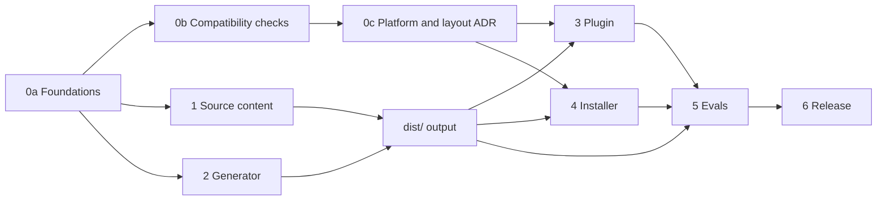

<!--
SPDX-FileCopyrightText: 2026 European Centre for Medium-Range Weather Forecasts (ECMWF)
SPDX-License-Identifier: Apache-2.0
-->

# Plan and progress

This file tracks how ecmwf-multi-agents gets built. It is the only place where phase numbers
appear: code, prompts, docs and commit messages describe what things are, not when they were
done.

Legend: `[ ]` to do, `[~]` in progress, `[x]` done, `[!]` blocked. Tasks marked **(par)** can run
in parallel with their siblings.

Who does what: a task that starts with a first name (`Tiago:` or `Samet:`) belongs to that
person, and nobody else picks it up. A task without a name is free. To take one, claim it in
this file first and push the claim, as `AGENTS.md` (Working together) describes.

## Goal

A multi-agent harness for opencode that ECMWF scientists, analysts and developers can install in
minutes. One agent, `lead`, talks to the user, makes every decision and hands work to helpers
that read, build or check. Each helper runs on the cheapest model that suits its job, so a
session costs less and `lead`'s context stays small. Roles are generic; ECMWF-specific job
support waits in `TODO.md` until approved.

## Decisions

| Topic | Decision |
|---|---|
| Name | `ecmwf-multi-agents` |
| Agents | Four: `lead` (primary, default), `scout`, `builder`, `reviewer`. No separate deep tiers: each agent has a default effort, which users change per agent in the settings file |
| Default models | `lead`: `anthropic/claude-opus-5-5` xhigh. `builder`: `anthropic/claude-sonnet-5-5` high. `scout`: `anthropic/claude-sonnet-5-5` medium. `reviewer`: `github-copilot/gpt-6.1-sol` medium |
| Versions | `MAJOR.MINOR.MICRO` without a `v`, single source in `VERSION`, tag equals version; one step: `make release X.Y.Z` |
| Profiles | `default` (above), `anthropic` (Anthropic API only), `copilot` (GitHub Copilot only), `inherit` (session model everywhere). ECMWF's internal endpoint deferred, see `TODO.md` |
| Planning | `lead` interviews the user, sends scouts, writes the plan, has it reviewed, waits for approval |
| Review policy | `auto` (default), `ask`, `always`, `never`, set in the settings file |
| Git | Agents commit only when asked. Push, PR and merge always prompt |
| Built-in agents | Kept and reachable by the user. `lead` cannot delegate to them |
| Work files | `.ecmwf-multi-agents/{plans,context,notes}/`, excluded through `.git/info/exclude` |
| Settings | `ecmwf-multi-agents.jsonc`, global in `~/.config/opencode/`, per project in `.opencode/`; applied by the optional plugin |
| opencode v1 | Main, stable target: 1.18.35 and later 1.x. Tested on 1.18.35 and 1.19.0 |
| opencode v2 | Pinned to 2.0.16, the version weave's v2 adapter uses. Moves only after a deliberate re-test |
| Tooling | TypeScript on Bun for the generator and plugin; POSIX sh installer; generated `dist/` is committed |
| Distribution | git clone + `install.sh`; central install through environment variables; npm plugin |
| Evals | Scenario suite against real models; results feed 0.2.0 (0.1.0 released before the first eval run, at the owner's choice) |

## Dependencies between phases

Source content and generator code are written in parallel against the contracts in
`docs/architecture.md` and `tools/types.ts`; they meet when `make build` produces `dist/`.

## Parallel waves

| Wave | Runs in parallel | Joins on | State |
|---|---|---|---|
| 1 | Command clash check; v1 check + v1 emitter; v2 check + v2 emitter | Three research notes, ADR 0001 | done |
| 2 | Generator core; `lead` prompt + `onboard`, `plan`, `go` + plan skill; helper prompts + `review`, `progress`, `guide` + guide skill; plugin + bundler; installer + install guide | Build and gate green | done |
| 3 | Independent prompt review; install and load tests on 1.18.35, 1.19.0 and 2.0.16; fixes | Installs and loads in isolated v1 and v2 configs | done |
| 4 | Four agents with per-agent effort (generator and plugin; prompts and docs); Makefile and version tool; eval harness | Release 0.1.0 | done |
| 5 | Eval runs, baseline, prompt fixes from the results | Release 0.2.0 (done); the open tasks feed the next release | in progress |
| 6 | npm package, CI, v2 central install, docs polish | | |
| 7 | Background helpers, steering and cancel: evidence and contract first; then plugin tools, 1.x enablement and prompts in parallel; then tests, evals and docs | Contract agreed (7a); gate and integration green on 1.18.35, 1.19.0 and 2.0.16; evals show the cost of a wake and of a steer | planned |

Ownership rule for parallel work: every task owns a disjoint set of files; shared contracts
(`docs/architecture.md`, `docs/adr/`, `src/manifest.jsonc`, `tools/types.ts`, this plan) change
only between waves. Between the two developers, a change to a shared contract goes in its own
small commit, pushed promptly.

## Phase 0: foundations and compatibility

0a. Foundations

- [x] Repository scaffold: git, licence, REUSE, `.gitignore`
- [x] `PLAN.md`, `AGENTS.md`, `README.md`, `TODO.md`
- [x] `docs/architecture.md`: roles, routing, hand-off contract, work files, settings
- [x] Generator contract: `src/manifest.jsonc`, `src/profiles/`, `tools/types.ts`, `package.json`

0b. Compatibility checks (wave 1)

- [x] **(par)** Command name clashes with opencode built-ins (v1 1.18.35 and 1.19.0, v2 2.0.16),
  weave, and commands already in the user's config, into `docs/research/command-clashes.md`
- [x] **(par)** v1 mechanics, into `docs/research/opencode-v1.md`: agents from a config dir, JSON
  vs Markdown precedence, `permission.task` filtering, question deny, `steps`, `variant`,
  replacing the built-in `scout`, skill permissions, plugin `config` hook, plugin auto-discovery
- [x] **(par)** v2 mechanics at 2.0.16, into `docs/research/opencode-v2.md`: agent file format,
  `model#variant`, permissions list, commands, skills, plugin agent registration, whether v1
  and v2 can share `~/.config/opencode`, central install mechanism

0c. Decision record

- [x] `docs/adr/0001-platforms-and-install-layout.md` from the three checks; contracts updated
  (`execute` action, notes path pair, `progress` command, permission semantics)

Exit: every check question has an answer backed by a command run or a source reference.

## Phase 1: source content

- [x] **(par)** `lead` prompt; commands `onboard`, `plan`, `go`; skill `ecmwf-multi-agents-plan`
  (planning and execution procedure, plan file format)
- [x] **(par)** Helper prompts: `scout`, `builder`, `reviewer`; commands `review`, `progress`,
  `guide`; skill `ecmwf-multi-agents-guide` (user guide)
- [x] Four agents: the deep tiers merged into `scout` (investigations, notes file) and
  `builder` (hard fixes); per-agent effort in profiles and settings
- [x] Command names final: `onboard`, `plan`, `go`, `review` (replaces the built-in), `progress`
  (instead of `status`, a TUI built-in), `guide`
- [x] Profiles: `default`, `anthropic`, `copilot`, `inherit`
- [x] Independent review of all prompts against `docs/architecture.md`, by scenario walk-through;
  nine blockers and six improvements applied, contract updated to match

Exit: every prompt within its budget; review verdict APPROVE. Budgets are nearly full:
`lead` 1,792 of 1,800, plan skill 1,186 of 1,200, guide skill 1,198 of 1,200.

## Phase 2: generator

- [x] Core: JSONC loader, manifest validation, prompt budgets, settings schema output,
  `dist/` writer with support files (`schema.json`, `profiles/`, `files.txt`), `--check` mode
- [x] **(par)** v1 emitter: agents, commands, skills in v1 format (unit and integration tests)
- [x] **(par)** v2 emitter: agents, commands, skills in v2 format (unit and integration tests)
- [x] The gate, now `make check`: versions, `dist/` up to date (with manifest validation and
  budgets), typecheck, `reuse lint`, `shellcheck`, unit tests
- [x] Makefile (`help`, `setup`, `build`, `check`, `lint`, `test`, `integration`, `evals`,
  `version`, `release`, `clean`) and `tools/version.ts`; `VERSION` is the single source

Exit: `dist/` loads in v1 (`opencode debug agent`) and v2 in isolated configs.

## Phase 3: plugin

- [x] Core: read settings (site, global, project), resolve profile and per-agent models,
  rewrite the review policy line in `lead`, set the default agent
- [x] **(par)** v1 entry: `config` hook; guard re-applying helper shell rules in
  `tool.execute.before` (verified end to end with a stand-in model server)
- [x] **(par)** v2 entry: agent transform re-registered on `plugin.updated`
- [x] Bundler `tools/bundle-plugin.ts`: one ES module for both platforms, profiles embedded
- [x] Tests, including "the harness works without the plugin"

## Phase 4: installer

- [x] `install.sh`: global (links) and `--project DIR` (copies), `--central DIR`, `--profile`,
  `--review`, `--platform`, `--dry-run`, `doctor`, `uninstall`; detects the opencode version
- [x] Central install on opencode 1.x (read-only copy plus `OPENCODE_CONFIG_DIR`), verified
  read-only on 1.18.35 and 1.19.0; `docs/install.md`
- [x] Tests in sandboxes for 1.18.35, 1.19.0 and 2.0.16; `shellcheck` (containers move to CI)

Integration suites (opt-in, `ECMWF_MULTI_AGENTS_INTEGRATION=1`): 49 tests pass on 1.18.35,
1.19.0 and 2.0.16 across emitters, plugin and installer.

## Phase 5: evals

- [x] **(par)** Fixture repository (`evals/fixtures/stations`, standard-library Python)
- [x] **(par)** Twelve cases: answer, trivial edit, bug fix, feature, investigate, inventory,
  review reject and approve, no push, `/onboard`, plan and go, `/progress`
- [x] **(par)** Runner: sandboxed `opencode serve`, permission and question answering, per-agent
  cost, tokens and child sessions, `lead` peak context, checks, summary
- [x] First real-model run of the full suite on 0.1.0, default profile, opencode 1.18.35
  (Anthropic login through `ECMWF_MULTI_AGENTS_EVAL_PLUGINS`): 19 runs, $4.10, 15 minutes.
  Summary in `evals/results/0.1.0.md`
- [x] Fix from the results: `lead` chained commit and push in one command, so refusing the push
  lost the commit (`no-push` failed); fixed, and passes three out of three
- [x] Tiago: `/review` and `/progress` without the extra `lead` turn (see the first finding
  below); measure cold and warm sessions before and after
- [x] Tiago: One release command: fold `make version X.Y.Z` into `make release X.Y.Z` (set the
  version, roll the changelog, rebuild, check, commit, push, tag, publish), resumable and
  with `DRY_RUN=1`
- [ ] A larger eval fixture, or cases that need broad reading, to test whether delegation saves
  cost at scale (see the second finding below)
- [ ] Baseline for the `copilot` and `anthropic` profiles; repeats (`--repeat 3`) for variance
- [ ] Set targets once variance is known
- [x] Tiago: Release 0.2.0

Baseline on 0.1.0 (one run each):

| | Harness | Baseline (`build`, same model as `lead`) |
|---|---|---|
| Passed | 11 of 12 | 7 of 7 |
| Mean cost, the seven shared cases | $0.161 | $0.160 |
| Peak context, `feature` | 25,750 | 32,005 |

Findings to act on for 0.2.0:

- Done: `/review` and `/progress` ran their helper in a child session, and opencode 1.x then
  gave `lead` a turn to report the result, costing three to four times the helper's own work.
  On opencode 1.x the helper now answers in the user's session (`subtask: false`); the TUI
  keeps `lead` selected because it lists only primary agents, and the plugin keeps the earlier
  conversation out of the helper's requests. On opencode 2 a helper command still needs a child
  session, because running it inline switches the whole session to the helper. Cost of the
  command turn, mean of two runs each, opencode 1.18.35, default profile:

  | Case | Before | After | Helper's first request, tokens |
  |---|---|---|---|
  | `review-reject` (cold session) | $0.104 | $0.025 | 3,595 before and after |
  | `review-warm` (after one question) | $0.050 | $0.021 | 3,595 before and after |
  | `progress` (cold) | $0.096 | $0.029 | 7,490 before and after |
  | `progress-warm` | $0.046 | $0.029 | 7,490 before and after |

  All 16 runs passed. Equal first requests confirm the helper works from its command alone.
- The sample repository is small: `lead` answered, investigated and fixed bugs itself, without
  helpers, and still matched the baseline's cost. Delegation only showed in `feature`,
  `onboard` and `plan-go`. Add a larger fixture, or cases that need broad reading, to test
  whether delegation saves cost at scale.
- The baseline pushed to the remote without asking in `no-push`, which shows what the
  approval rules protect against.

## Phase 6: release

- [ ] npm package (plugin that also carries agents, commands and skills)
- [ ] Central install on opencode 2 (generated `opencode.json` through `OPENCODE_CONFIG`)
- [ ] CI: `make check` plus the integration suites in containers per opencode version
- [ ] README quickstart for scientists; `/guide` content final
- [x] Version 0.1.0

## Phase 7: background helpers, steering and cancel

Today every hand-off blocks `lead`: it calls the task tool and waits, sees nothing of the
helper's work, and can stop nothing. The user sees a helper go wrong and can only wait. This
phase lets helpers run in the background, lets `lead` and the user see, redirect and stop
them, and keeps a redirected helper's context and prompt cache instead of restarting it.

Verified on 2026-10-12 with a scripted stand-in model (no hosted model), opencode 1.18.35 and,
as a signal only, 2.0.23 (2.0.16, the pinned version, is re-verified in 7a):

| Mechanism | opencode 1.18.35 | opencode 2.x |
|---|---|---|
| Background start | `task(background: true)` returns at once with `state="running"`; needs `OPENCODE_EXPERIMENTAL_BACKGROUND_SUBAGENTS=true`, otherwise the parameter is not in the tool schema | `subagent(background: true)`, no flag |
| Completion | A synthetic user message `<task id state="completed">` with the helper's final text wakes `lead`; the message carries `agent: lead` | Same, as `<subagent sessionID state="completed">` |
| Steer a running helper | `session.prompt_async` on the child: the loop re-reads messages each step, so the text reaches the model at the next step boundary (2.0 s after sending, after 3 of 6 tool steps); the run ends at the steer, nothing runs twice | `session.prompt` with `delivery: "steer"`: same timing; `delivery: "queue"` waits for the run to end |
| `task(task_id)` on a running helper | Chained after the run ends (`BackgroundJob.extend`), so it is "when you are done, also X", not a redirect | `subagent(sessionID)` steers a running child |
| Cancel | `session.abort`: the helper stops; **`lead` is not told** | `session.interrupt`: the helper stops and `lead` wakes with `state="cancelled"` |
| User promotes a blocking task | TUI keybind `session.background` (`POST /experimental/session/:id/background`): `lead`'s blocked call returns `state="running"`, `lead` continues and is woken later | `POST /api/session/:id/background`, same effect |
| Hazard: a steer without the child's agent | The rest of the run switches to the message's agent and model; the 1.x TUI sends the composer's primary agent (`lead`, Opus) when the user types into a helper's session (`packages/tui/src/component/prompt/index.tsx:322-326,1087`) | The session owns its agent; no switch |

Other agent tools offer background subagents and steering, so users will expect it. What is
specific to this harness: a steer amends a written brief and the report still answers every
DONE WHEN item; helpers' limits survive a steer; the reviewer stays on another model family.

Decisions to agree with Tiago before 7c starts (shared contracts change):

| Topic | Proposal |
|---|---|
| Mechanism | Build on the platforms' own background mode and session API. No task manager, poller or queue in the plugin: the wake-the-parent problem belongs inside the session loop, where opencode already solves it |
| Tools | Three plugin tools for `lead` only, same on both platforms: `helpers_status` (children of this session: agent, title, state, steps, elapsed, last tool call), `helpers_steer(id, text)`, `helpers_cancel(id or all)`. Helpers are denied all three in the manifest and by the plugin guard |
| Steer semantics | The brief stays the contract; a steer amends it. Helpers follow the latest message, keep earlier LIMITS unless lifted, and report what changed under ASSUMPTIONS. A steer is never an approval and never changes permissions. `helpers_steer` is for a running helper; a finished one is continued through the delegation tool's continuation parameter, which both platforms handle well and which the plugin cannot do on 2.0.16 (no messages through the plugin context) |
| When `lead` steers | Reactively: the user asks, or `helpers_status` (run only when the user asks or before a steer, never polled) shows a helper off its brief. Steer when the helper's reading so far is still useful and the correction is small; cancel and brief again when the direction was wrong |
| When `lead` uses background | When it has other work meanwhile (answer the user, next plan task) or the user may want to keep talking. Each completion wakes `lead` once, so three background scouts cost up to three `lead` turns where three parallel foreground scouts cost one; `/onboard` stays foreground |
| 1.x child pinning | The plugin's `chat.message` hook rewrites `agent`, `model` and `variant` of a message that lands in a helper's child session to that helper's own, so typing into a running helper steers it instead of switching it to `lead`. Never applied to the user's own session (`/review` and `/progress` run there by design) |
| 1.x cancel gap | `helpers_cancel` reports the cancel in its own result; a user-side cancel shows in `helpers_status`. No injected wake |
| Budgets | `lead` is at 1,792 of 1,800 tokens and the skills within 14; the new rules need room. Raise in 7a with the prompt diff as the justification |

Tasks, in order; **(par)** marks what can run side by side once 7a is done:

7a. Evidence and contract

- [x] Samet: `docs/research/background-helpers.md`: the table above with command runs on
  1.18.35, 1.19.0 and 2.0.16 (the stand-in experiment becomes a script under `tools/` or a
  suite in `plugin/plugin.integration.test.ts`), source references for each claim, the TUI
  hazard, and two checks that decide 7c: how a plugin tool surfaces on 2.0.16 (a tool of its
  own, or only through Code Mode `execute`) and whether an agent's `permissions` can deny it;
  and what happens on 1.x when a wake lands while a helper answers in the user's own session
  (`/review`, `/progress`): the wake carries `agent: lead`, so it may cut the helper's run.
  Also the tool id check: the `helpers_*` ids against the tool lists of 1.18.35, 1.19.0 and
  2.0.16 (`GET /experimental/tool` and `GET /api/tool`), as `command-clashes.md` did for
  commands
- [x] Samet: `docs/adr/0002-background-helpers-and-steering.md` with the decisions table above
  as agreed, and the tool shape settled there: three tools, or one `helpers` tool with an
  `action` argument, chosen by what the 2.0.16 check above allows and by which gives the
  simplest permission rules
- [x] Samet: `docs/architecture.md`: principle 3 amended (brief is the contract, a steer
  amends it); the three tools in the permission table; routing rules for background,
  steer and cancel; the notification as a report form; budgets raised. `src/manifest.jsonc`:
  budgets and permission rules for the tools, with the generator mapping the new actions to
  tool ids on both platforms (`tools/load.ts`, `tools/emit-v1.ts`, `tools/emit-v2.ts`)

7b. Platform enablement

- [ ] Samet: **(par)** opencode 1.x: `install.sh` prints and `docs/install.md` explains
  `OPENCODE_EXPERIMENTAL_BACKGROUND_SUBAGENTS=true` (shell profile or module file; the plugin
  cannot set it, the flag is read before plugins load); `doctor` checks it through
  `opencode debug config` or the tool schema; without it everything degrades to foreground
  and the `lead` prompt must still read correctly

7c. Plugin

- [x] Samet: **(par)** `helpers_status`, `helpers_steer`, `helpers_cancel` registered through
  the plugin `tool` hook on both platforms, with the client calls per platform (1.x:
  `session.children`, `session.status`, `session.messages`, `session.prompt_async` with the
  child's agent, model and variant, `session.abort`; 2.0.16: `GET /api/session` by parent,
  `prompt` with `delivery: steer`, `interrupt`); refuse a target that is not a helper child
  of the caller's session; output of `helpers_status` at most twelve lines
- [x] Samet: **(par)** Guard: helpers denied the three tools in `tool.execute.before` whatever
  was approved, like the shell guard; unit tests
- [x] Samet: 1.x child pinning in `chat.message`; test that the isolation hook leaves a
  steered child session alone and that `/review` in the user's session is unaffected; decide
  from the 7a check what to do with a wake that lands during an inline `/review` (hold it,
  or tell `lead` not to start background work before a `/review`)

7d. Prompts

- [~] Samet: **(par)** `lead`: background rule, reading `<task>` and `<subagent>` wakes as
  reports (check DONE WHEN as for any report, never re-run the helper's checks twice), steer
  versus cancel rule, no polling, the two safety limits; a running helper is reached only
  through `helpers_steer`, never through `task_id` or `sessionID` on the delegation tool, so
  every redirect passes the guard and carries the helper's own agent and model
- [~] Samet: **(par)** `scout`, `builder`, `reviewer`: a later message amends the brief;
  report what changed and what was already done before it; on 1.x the step limit counts the
  whole run, so a steer near the limit gets "stop and report"
- [~] Samet: **(par)** `/guide` skill and README: the user's path (open the helper's session
  and type; the `session.background` keybind; "ask `lead` to redirect or stop it")

7e. Verification and release

- [ ] Samet: Integration suite on 1.18.35, 1.19.0 and 2.0.16: background start and wake,
  steer mid-run, `task_id` chaining, cancel, promotion, 1.x pinning, helpers denied the
  tools
- [ ] Samet: Evals: `background-scouts` (two independent questions while the user keeps
  talking), `steer` (the user redirects a running scout; the report names the amendment;
  cost against cancel-and-restart), `cancel`; the shared cases re-run to show no regression
- [ ] Samet: `CHANGELOG.md` entries and `docs/install.md`; release when Tiago agrees

Exit: gate and integration green on all three versions; the eval summary shows what a wake
and a steer cost; `/guide` explains it in plain words.

## Open questions

- npm scope for the plugin package (the repository is github.com/ecmwf/ecmwf-multi-agents).
- Prompt budgets (`lead` 1,800 tokens, helpers 700, commands 500, skills 1,200) are nearly
  full; raise them or trim prompts, informed by eval results.
- `/onboard` is shadowed in projects that define their own `onboard` command (some local
  projects do). Kept as requested; renaming to `survey` would avoid it.

## Log

- 2026-10-11: Design agreed through interview. Scaffold, plan and contracts written.
- 2026-10-11: Compatibility checks done for 1.18.35, 1.19.0 and 2.0.16; both emitters written
  and tested against the real binaries. ADR 0001 records platforms and install layout.
  `status` renamed `progress`; `execute` (Code Mode) action added and denied to read-only
  helpers. The generator core and helper prompt tasks produced no output and were restarted.
- 2026-10-11: Generator core, all prompts, plugin and installer done. Independent prompt review
  applied. Gate green (297 tests); 49 integration tests green on all three opencode
  versions. Central install verified read-only on opencode 1.x. Next: evals.
- 2026-10-11: Repository published at github.com/ecmwf/ecmwf-multi-agents. Simplified to four
  agents with per-agent effort. Makefile and version tooling added; 0.1.0 released. Eval
  harness built and run on 0.1.0 with real models: 18 of 19 runs passed for $4.10; the
  failure led to the commit-and-push fix.
- 2026-10-11: Rules for two developers added (`AGENTS.md`, Working together). `/review` and
  `/progress` answer in the user's session on opencode 1.x: the command turn costs 24 to 30%
  of what it did in a new session, 42 to 63% after a first question. Releasing is one
  command, `make release X.Y.Z`.
- 2026-10-11: 0.2.0 released with `make release 0.2.0`, the first release made with it: gate
  twice, release commit, tag and GitHub release in one run.
- 2026-10-12: Phase 7 planned by Samet after checking the platforms' background and steering
  mechanics against their source and a stand-in model on 1.18.35 and 2.0.23 (table in the
  phase). opencode's own background mode is enough; the plugin adds status, steer and cancel
  for `lead` and pins 1.x child sessions to their helper.
- 2026-10-12: Phase 7a and 7c done by Samet on a branch: research note, ADR 0002, the
  contract, `tool` rules in the generator and manifest, and the plugin's three tools, guard
  and 1.x pinning, verified on 1.18.35, 1.19.0 and 2.0.16 (`plugin/background.integration.test.ts`,
  60 integration tests with the plugin suite). Found on the way: 2.0.16's plugin context has
  no session list or messages, so children come from the event stream there; a steer is for
  running helpers only, a finished one is continued through the delegation tool.
