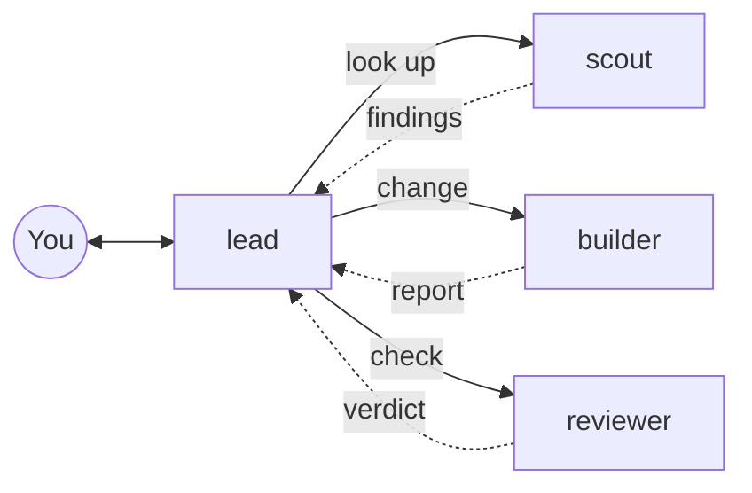

<!--
SPDX-FileCopyrightText: 2026 European Centre for Medium-Range Weather Forecasts (ECMWF)
SPDX-License-Identifier: Apache-2.0
-->

# ecmwf-multi-agents

A multi-agent harness for [opencode](https://opencode.ai), made for ECMWF scientists, analysts
and developers.

You talk to one agent, `lead`. It works out what you need, asks questions when your request is
unclear, and hands the reading, building and checking to three helpers. Each helper runs on a
model and effort suited to its job, so routine work goes to cheaper models and `lead` keeps a
small context for the conversation with you.

> Status: early releases (0.x). See `CHANGELOG.md` for what changed and `PLAN.md` for what
> comes next.

## The agents

| Agent | What it does | Default model and effort |
|---|---|---|
| `lead` | Talks to you, plans, hands out work, checks results, commits when asked | Claude Opus 5.5, xhigh |
| `scout` | Read-only lookups and investigations in code, docs and the web | Claude Sonnet 5.5, medium |
| `builder` | Makes one clearly specified change, from a small edit to a hard fix, and runs its checks | Claude Sonnet 5.5, high |
| `reviewer` | Independent review of plans and changes, answers APPROVE or REJECT | GPT 6.1 Sol through GitHub Copilot, medium |

Effort is how hard a model thinks before it answers: more effort is slower and costs more.
You can change each agent's effort, and its model, in the settings file. The reviewer uses a
different model family on purpose: it is more likely to catch mistakes the other agents share.



Only `lead` talks to you. Helpers never ask you questions and never hand work on.

## Commands

| Command | What it does |
|---|---|
| `/onboard [focus]` | Surveys the repository and keeps a short summary for later sessions |
| `/plan <goal>` | Asks you questions, investigates, writes a plan and waits for your approval |
| `/go [plan]` | Carries out an approved plan task by task, checking each one |
| `/review [target]` | Independent review of your uncommitted changes, a branch, a commit, a pull request or a plan |
| `/progress [plan]` | Shows progress on the current plan |
| `/guide [question]` | Explains how the harness works, in plain words |

`/review` replaces opencode's own review command with one that uses the independent reviewer.
A command defined in a project's `.opencode/commands/` takes precedence over these.

Plans, notes and summaries live in `.ecmwf-multi-agents/` inside your project. That folder is
kept out of git through `.git/info/exclude`, so nothing extra appears in your commits.

## Requirements

- opencode 1.18.35 or later in the 1.x series. opencode 2.0.16 is also supported.
- Access to the models in your chosen profile. The default profile needs Anthropic and GitHub
  Copilot, connected with `opencode auth login`.
- A POSIX shell for the installer.

## Install

Clone this repository anywhere, then run the installer:

```sh
git clone https://github.com/ecmwf/ecmwf-multi-agents.git ~/.local/share/ecmwf-multi-agents
cd ~/.local/share/ecmwf-multi-agents
./install.sh
```

To stay on a release, check out its tag (for example `git checkout 0.1.0`) before running the
installer. Versions are `MAJOR.MINOR.MICRO` without a `v`.

The installer finds your opencode version, links the agents, commands, skills and plugin into
`~/.config/opencode/`, and writes a settings file. Restart opencode afterwards. To update, run
`git pull` and restart opencode. It never overwrites files it did not create.

Other ways to install:

- One project only: `./install.sh --project /path/to/repo` copies the files into that
  project's `.opencode/` folder.
- Shared machines with opencode 1.x: `./install.sh --central /shared/path` prepares a copy
  that can be made read-only; users load it by setting `OPENCODE_CONFIG_DIR` (for example
  from a module file).

Check an installation with `./install.sh doctor`. Remove it with `./install.sh uninstall`.
`docs/install.md` covers every option, updating, both opencode versions on one machine, the
central install with module file examples, and troubleshooting.

## Settings

`~/.config/opencode/ecmwf-multi-agents.jsonc` holds your settings. A project can override them
in `.opencode/ecmwf-multi-agents.jsonc`.

```jsonc
{
  // When the reviewer runs: auto, ask, always or never.
  "review": "auto",
  // Which models the agents use: default, anthropic, copilot or inherit.
  "profile": "default",
  // Optional per-agent overrides, applied after the profile: model, effort and steps.
  "agents": {
    "builder": { "effort": "xhigh" },
    "reviewer": { "model": "openai/gpt-6.1-sol", "effort": "high" }
  }
}
```

Effort values are `low`, `medium`, `high`, `xhigh` and `max` (some models also offer `none`).
The defaults are `lead` xhigh, `builder` high, `scout` and `reviewer` medium. An effort needs a
model to apply to, so with the `inherit` profile give the agent a `model` as well. `steps`
caps how many turns an agent may take, which limits its cost.

| Review policy | Effect |
|---|---|
| `auto` | Reviews plans before you approve them, and changes beyond trivial ones |
| `ask` | `lead` asks you before each review |
| `always` | Reviews every plan and every change |
| `never` | Reviews only when you ask, for example with `/review` |

| Profile | Models |
|---|---|
| `default` | Anthropic for `lead`, `scout` and `builder`; GitHub Copilot GPT for the reviewer |
| `anthropic` | Anthropic models only |
| `copilot` | GitHub Copilot models only |
| `inherit` | Every agent uses the model you pick in the session |

Settings are applied by a small plugin that ships with the harness, when opencode starts:
restart opencode after a change. If the plugin cannot load, the agents still work with the
default settings.

## Safety

- Agents commit only when you ask. Pushing, opening a pull request and merging always ask for
  your approval first. Answer such prompts with "Allow once".
- Helpers cannot commit, push or rewrite git history. On opencode 1.x the plugin keeps these
  limits in place even after an "Allow always" answer, which opencode would otherwise apply to
  every agent.
- The harness never asks for, prints or stores credentials.

## Development

See `AGENTS.md` for the rules and `PLAN.md` for progress. With [Bun](https://bun.sh), `reuse`
and `shellcheck` installed:

```sh
make setup      # install the development dependencies
make build      # regenerate dist/ from src/
make check      # the gate before every commit: versions, dist/, lint, unit tests
make help       # every target
```

`make integration` runs the suites against real opencode binaries without calling a model.
`make evals` runs scenario evals with real models and uses your provider quota; see
`evals/README.md`. `make release X.Y.Z` releases a version in one step (`DRY_RUN=1` previews).

## Licence

Apache-2.0. See `LICENSE`.
