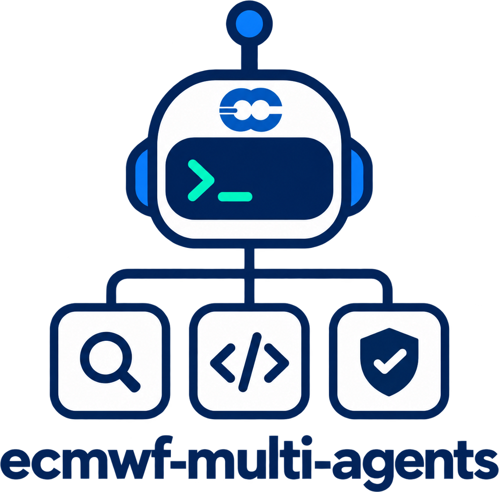
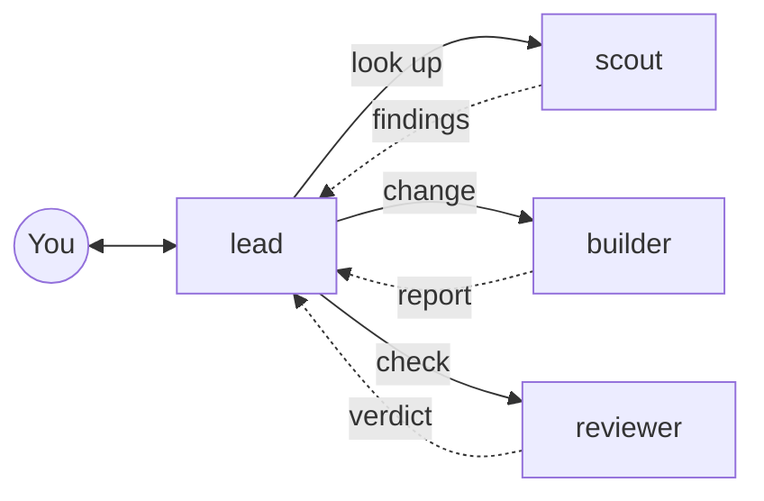

<!--
SPDX-FileCopyrightText: 2026 European Centre for Medium-Range Weather Forecasts (ECMWF)
SPDX-License-Identifier: Apache-2.0
-->

<p align="center">
  
</p>

<p align="center">
  <a href="https://www.npmjs.com/package/@ecmwf.int/multi-agents"></a>
  <a href="https://github.com/ecmwf/codex/raw/refs/heads/main/ESEE"></a>
  <a href="https://github.com/ecmwf/codex/raw/refs/heads/main/Project%20Maturity"></a>
</p>

> [!IMPORTANT]
> This software is **Emerging** and subject to ECMWF's guidelines on [Software Maturity](https://github.com/ecmwf/codex/raw/refs/heads/main/Project%20Maturity).

A multi-agent harness for [opencode](https://opencode.ai), made for ECMWF scientists, analysts
and developers.

You talk to one agent, `lead`. It works out what you need, asks questions when your request is
unclear, and hands the reading, building and checking to three helpers, and to four optional
ones where a project switches them on. Each helper runs on a model and effort suited to its
job.

## The agents

| Agent | What it does | Default model and effort |
|---|---|---|
| `lead` | Talks to you, plans, hands out work, checks results, commits when asked | Claude Opus 5.5, xhigh |
| `scout` | Read-only lookups and investigations in code, docs and the web | Claude Sonnet 5.5, medium |
| `builder` | Makes one clearly specified change, from a small edit to a hard fix, and runs its checks | Claude Sonnet 5.5, high |
| `reviewer` | Independent review of plans and changes, answers APPROVE or REJECT | GPT 6.1 Sol via GH Copilot, medium |

Effort is how hard a model thinks before it answers: more effort is slower and costs more.
You can change each agent's effort, and its model, in the settings file. The reviewer uses a
different model family on purpose: it is more likely to catch mistakes the other agents share.



Only `lead` talks to you. Helpers never ask you questions and never hand work on.

### Optional helpers

Four more helpers are off until a settings file switches them on, for you or for one project:

| Agent | What it does | Default model and effort |
|---|---|---|
| `researcher` | Deep investigation of a hard question: compares options, may run experiments in a scratch folder, writes a report | Claude Opus 5.5, xhigh |
| `tester` | Tries to break code with edge cases and new tests, never fixes product code, drafts issues that `lead` files only when you approve | GPT 6.1 Sol via GH Copilot, high |
| `designer` | Interface specs, interaction flows and prototypes you open in a browser; a builder implements the agreed design | Claude Opus 5.5, high |
| `data-scientist` | Answers questions about datasets with scripts it runs, without reading the data into its context | Claude Sonnet 5.5, high |

```jsonc
// .opencode/ecmwf-multi-agents.jsonc in a project
{
  "agents": {
    "tester": { "enabled": true },
    "data-scientist": { "enabled": true }
  }
}
```

You ask `lead` in plain words, as before; it hands the work to the helper that fits. `scout`,
`builder` and the reviewer can be switched off the same way (`"enabled": false`): `lead` then
does that work itself, and with the reviewer off nothing is reviewed and `/review` says so. The
optional helpers come with the plugin, which every install brings; `./install.sh doctor` shows
which helpers are on.

## Commands

| Command | What it does |
|---|---|
| `/onboard [focus]` | Surveys the repository and keeps a short summary for later sessions |
| `/plan <goal>` | Asks you questions, investigates, writes a plan and waits for your approval |
| `/execute [plan]` | Carries out an approved plan: briefs a helper for each task, runs ready tasks in the background, checks every result, and stops when it needs you |
| `/review [target]` | Independent review of your uncommitted changes, a branch, a commit, a pull request or a plan |
| `/progress [plan]` | Shows progress on the current plan |
| `/guide [question]` | Explains how the harness works, in plain words |

`/review` replaces opencode's own review command with one that uses the independent reviewer.
A command defined in a project's `.opencode/commands/` takes precedence over these, except
`/review` and `/progress`, which the plugin answers in your session (see
[Switch it on per project](#switch-it-on-per-project) for this and the other exception).

Plans, notes and summaries live in `.ecmwf-multi-agents/` inside your project. That folder is
kept out of git through `.git/info/exclude`, where the plugin adds it when a session starts, so
nothing extra appears in your commits.

## Helpers in the background

`lead` usually waits for a helper. When it has other work meanwhile, or you may want to keep
talking, it hands off in the background and the helper's report arrives later in your
conversation. If `lead` is waiting on a helper and you want it back, press Ctrl+B to move the
hand-off to the background. If a helper is doing something you do not want, tell `lead` to
redirect it ("stay in `src/`") or to stop it: a redirected helper keeps everything it has read
and done instead of starting over. `lead` steers it with `helpers_steer`; you cannot type in a helper's
session yourself.

## Requirements

- opencode 2, tested on 2.2.5 (another 2.x version works with a warning). With opencode 1,
  upgrade first with `opencode upgrade --major`.
- Access to the models in your chosen profile. The default profile needs Anthropic and GitHub
  Copilot, connected with `opencode auth login`.
- A POSIX shell for the installer.

## Install

Clone this repository anywhere, then run the installer:

```sh
git clone https://github.com/ecmwf/ecmwf-multi-agents.git ~/.local/share/ecmwf-multi-agents
cd ~/.local/share/ecmwf-multi-agents
./install.sh
```

To stay on a release, check out its tag (for example `git checkout 0.1.0`) before running the
installer. Versions are `MAJOR.MINOR.MICRO` without a `v`.

The installer finds your opencode version, links the agents, commands, skills and plugin into
`~/.config/opencode/`, and writes a settings file. Restart opencode afterwards. To update, run
`git pull` and `./install.sh` again, then restart opencode. It never overwrites files it did
not create.

Or install it with npm, which needs Node.js:

```sh
npm install -g @ecmwf.int/multi-agents
ecmwf-multi-agents
```

`ecmwf-multi-agents` runs the same installer from the package folder, with the same commands
and options: where this README says `./install.sh`, type `ecmwf-multi-agents`. To update, run
both commands again, then restart opencode.

For one project only, `./install.sh --project /path/to/repo` copies the files into that
project's `.opencode/` folder.

On a shared machine such as an HPC login node, an administrator can install it once for
everyone with `./install.sh --central DIR`; each user loads a module that sets
`OPENCODE_CONFIG=DIR/opencode.json` and runs `./install.sh central-enable DIR` once. See
"Shared machines" in `docs/install.md`.

Check an installation with `./install.sh doctor`, and a project with
`./install.sh doctor --project /path/to/repo`. Remove an installation with
`./install.sh uninstall`. `docs/install.md` covers every option, updating and troubleshooting.

## Switch it on per project

A project can bring the harness without installing any file: one line in its `opencode.json`
names the npm package with a pinned version, and opencode fetches it.

```json
{
  "plugins": ["@ecmwf.int/multi-agents@latest"]
}
```

Or name a checkout of this repository instead (`{env:HOME}` is your home folder; `~` does not
work here):

```json
{
  "plugins": ["{env:HOME}/.local/share/ecmwf-multi-agents"]
}
```

The plugin then brings the agents, commands and skills, and makes `lead` the default agent, in
that project only. Your own agent files, commands, skills and `default_agent` still win, with
two exceptions. The plugin replaces `/review` and `/progress` after opencode has loaded the
command files, so they answer in your session; a command file of your own with either name is
not used. And the settings decide which helpers are on, the model, effort and step limit of
every harness agent, and `lead`'s review line, helper limit and helper list: an agent file of
yours with one of those names can change its other fields, but change these in the settings
file. The settings files work as
below. To update, change the version in the line (or `git pull` the
checkout) and restart opencode; an entry without a version is updated only by
`opencode plugin update`.

If the harness is also installed in `~/.config/opencode/`, that copy wins and opencode ignores
the project's line ("Duplicate plugin ID"): use one or the other. `./install.sh doctor
--project /path/to/repo` checks a project switched on this way and warns about this case.

## Settings

`~/.config/opencode/ecmwf-multi-agents.jsonc` holds your settings. A project can override them
in `.opencode/ecmwf-multi-agents.jsonc`.

```jsonc
{
  // When the reviewer runs: auto, ask, always or never.
  "review": "auto",
  // Which models the agents use: default, anthropic, copilot or inherit.
  "profile": "default",
  // Helpers lead may run at once: an integer of at least 1, default 4.
  "max_helper_slots": 4,
  // Optional per-agent overrides, applied after the profile: enabled (helpers only), model,
  // effort, fallback and steps.
  "agents": {
    "builder": { "effort": "xhigh" },
    "reviewer": { "model": "openai/gpt-6.1-sol", "effort": "high", "fallback": ["anthropic/claude-opus-5-5"] },
    "tester": { "enabled": true }
  }
}
```

`enabled` switches a helper on or off; a project's file can switch on a helper your own file
leaves off, or the other way round. `lead` is always on.

Effort values are `low`, `medium`, `high`, `xhigh` and `max` (some models also offer `none`).
The defaults are `lead` xhigh, `builder` high, `scout` and `reviewer` medium. An effort needs a
model to apply to, so with the `inherit` profile give the agent a `model` as well. `steps`
caps how many turns an agent may take, which limits its cost.

`fallback` lists other models, in order, for when an agent's `model` is not set up in opencode:
each is `"provider/model"` or `{ "model": "provider/model", "effort": "high" }`. The plugin uses
the first one opencode lists as available, at startup and whenever providers change, and shows
a notice when it does. It does not switch on rate limits or outages during a run.

| Review policy | Effect |
|---|---|
| `auto` | Reviews plans before you approve them, and changes beyond trivial ones |
| `ask` | `lead` asks you before each review |
| `always` | Reviews every plan and every change |
| `never` | Reviews only when you ask, for example with `/review` |

| Profile | Models |
|---|---|
| `default` | Anthropic for `lead`, `scout` and `builder`; GitHub Copilot GPT for the reviewer |
| `anthropic` | Anthropic models only |
| `copilot` | GitHub Copilot models only |
| `inherit` | Every agent uses the model you pick in the session |

`max_helper_slots` tells `lead` how many helpers may run at once, including during `/execute`
and `/onboard`. More slots can run more builders, databases, dev servers and builds on the
same machine, so raise it with care. `./install.sh doctor` shows the setting and the helper
limit in the loaded lead's instructions.

Settings are applied by a small plugin that ships with the harness, when opencode starts:
restart opencode after a change. A settings file with a mistake is ignored, and opencode shows
why in a warning. If the plugin cannot load, installed agents still work with the default
settings.

## Safety

- Agents commit only when you ask. Pushing, opening a pull request, merging and filing an
  issue always ask for your approval first. Answer such prompts with "Allow once".
- Helpers cannot commit, push or rewrite git history. The researcher, designer and data
  scientist write only their own folders in `.ecmwf-multi-agents/`; the tester changes only
  tests, and `lead` checks what each of them changed.
- The harness never asks for, prints or stores credentials.

## Development

See `AGENTS.md` for the rules and `PLAN.md` for progress. With [Bun](https://bun.sh), `reuse`
and `shellcheck` installed:

```sh
make setup      # install the development dependencies
make build      # regenerate dist/ from src/
make check      # the gate before every commit: versions, dist/, lint, unit tests
make help       # every target
```

`make integration` runs the suites against a real opencode 2 without calling a model.
`make evals` runs scenario evals with real models and uses your provider quota; see
`evals/README.md`. `make release X.Y.Z` releases a version in one step (`DRY_RUN=1` previews)
and needs npm, to check the package's files first (`make pack-check`); the tag it pushes
publishes the npm package through GitHub Actions. GitHub Actions also runs `make check` and
`make pack-check` on every push and pull request.

## Licence

Apache-2.0. See `LICENSE`.
