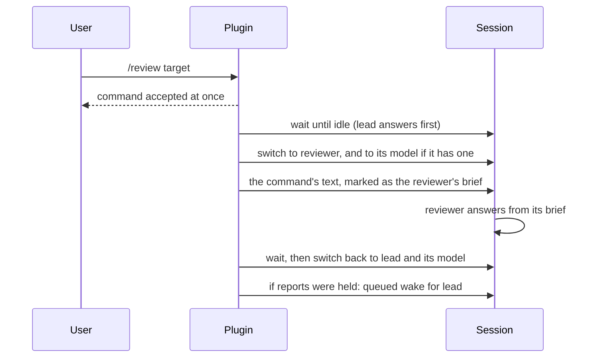
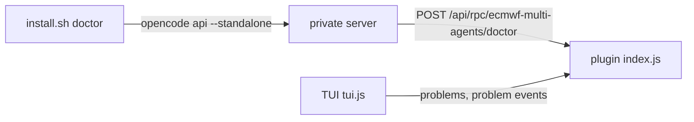

<!--
SPDX-FileCopyrightText: 2026 European Centre for Medium-Range Weather Forecasts (ECMWF)
SPDX-License-Identifier: Apache-2.0
-->

# Architecture

This is the design contract for ecmwf-multi-agents. Prompts, generator, plugin and installer
must agree with it. Where a platform detail is still being checked, the text says so; the
answers land in `docs/research/` and `docs/adr/`.

## Principles

1. One agent decides. `lead` holds the conversation, the plan and every decision. Helpers are
   leaves: they never ask the user anything and never hand work on.
2. Delegate to save money and context. A helper is worth calling when its work would cost
   `lead` more context or a more expensive model than the hand-off costs.
3. Every hand-off is an explicit brief. A helper starts with no memory of the conversation; the
   brief is all it knows. A later message from `lead` or the user amends the brief, and the
   helper's report still answers it: every DONE WHEN item, plus what the amendment changed.
4. Few agents, each with one job. How hard an agent thinks is a setting, its model and effort,
   not a separate agent. A failed task gets one more try with the gap stated, then goes to the
   user.
5. Reads run in parallel freely. Writes run in parallel only on disjoint files.
6. Memory lives in files. Plans, notes and summaries survive compaction and new sessions.
   Long findings go to a file; only a path and a short summary come back.
7. Nothing approves its own work. `lead` re-runs cheap checks itself before reporting success,
   and an independent reviewer checks non-trivial work.
8. Small prompts. Procedures that are only needed sometimes live in commands and skills, which
   cost nothing until used.
9. Plain language. Users include scientists and analysts who are not software-process experts.

## Roles

| Agent | Mode | Job | Steps |
|---|---|---|---|
| `lead` | primary, default | Talk to the user, size the work, plan, brief helpers, verify, commit when asked | no limit |
| `scout` | subagent | Read-only lookups and investigations in code, docs and the web, from "where is X" to "why does X happen"; long findings go to a notes file | 30 |
| `builder` | subagent | One clearly specified change, from a small edit to a hard fix, then its checks; never commits | 60 |
| `reviewer` | subagent | Independent APPROVE or REJECT on a plan or a change | 30 |

Steps cap the number of model turns a helper may take. They act as a cost limit. Each agent
also gets a model and an effort from the active profile (see Profiles), and users can change
`model`, `effort` and `steps` per agent in the settings file.

### Permissions

Rules are ordered and the last matching rule wins. opencode places agent rules after the
user's own rules, so an agent rule overrides the user's policy in both directions; the plugin
keeps that order for the agents it registers (see [Registration](#registration)). The harness
therefore adds mostly `deny` rules, and only these deliberate `allow` and `ask` rules: `lead`
may ask questions and delegate to the three helpers; `lead` asks before publishing or
destructive git commands; `scout` may run a short list of read-only inspection commands and
write its notes folder; the reviewer may read pull requests. One consequence: a user who
denies `git push` globally gets an approval prompt in `lead` instead.

| Capability | lead | scout | builder | reviewer |
|---|---|---|---|---|
| Read, search | user policy | user policy | user policy | user policy |
| Edit files | user policy | only `.ecmwf-multi-agents/notes/` | user policy | deny |
| Shell | user policy, with approval for push, PR, merge and history rewrites | read-only commands only | user policy, git and `gh` writes denied | user policy, git and `gh` writes denied |
| Web fetch and search | user policy | user policy | user policy | user policy |
| Delegate | the three helpers only | deny | deny | deny |
| Ask the user | allow | deny | deny | deny |
| Harness skills (`ecmwf-multi-agents-*`) | user policy | deny | deny | deny |
| Code Mode | user policy | deny | user policy | deny |
| Helper tools (`helpers_status`, `helpers_steer`, `helpers_cancel`) | user policy | deny | deny | deny |

Files outside the project follow opencode's default, since the harness sets no rule for them:
opencode 2.0.16 asks before an agent reads or edits one, and opencode 2.0.28 asks for no agent
(`docs/research/opencode-v2.md`, Addendum: 2.0.28).

The helper tools come from the plugin (see Background helpers). A `tool` rule in the manifest
names one tool id; the emitter writes it as that id's own permission key, which removes a
denied tool from the agent's requests. The plugin also refuses, at execution time and
independently of those rules, every call to these tools that does not come from `lead`: a
helper's call, whatever was approved, and any other agent's call, because opencode's default
rules would let such an agent reach a plugin tool. Without the plugin the tools do not exist and the rules are inert.

Code Mode is the `execute` tool through which MCP tools and a few others are
reached; denying it saves about 2,200 tokens per request for helpers that never need them.

"Approval" means the rule is `ask`, so opencode prompts the user. `lead` asks before
`git push` (also through `git -C`), amending commits, `git reset --hard`, `git clean`,
`git rebase`, `git restore`, deleting branches, dropping stashes, and creating, merging or
closing pull requests. Helpers are denied every git subcommand that can change history, the
index, branches, remotes or the working tree, in all its forms: `git branch` is denied even
for listing, so helpers use `git rev-parse` and `git show` instead, and `git -C` is denied
whole. They are also denied all `gh` commands except reading pull requests (reviewer only).

Read-only commands for `scout`: `git log`, `git show`, `git diff`, `git blame`, `git status`,
`git grep`, `git ls-files`, `git rev-parse`, `ls`, `wc`, `file`, `tree`.

Permissions are a guard rail, not a sandbox. Shell patterns match command text, so wrappers
can bypass them. The prompts state the same rules.

## Routing

`lead` sizes every request before acting:

| Size | Signal | Action |
|---|---|---|
| Answer | Answerable from the conversation, the onboarding summary, general knowledge or a quick look at one or two files | Answer directly |
| Trivial edit | A few lines in a file `lead` has already read; no design choice | Edit, then run the relevant check |
| Delegated | Needs reading beyond a couple of files, or a contained change | Brief one helper, or several in parallel |
| Plan-sized | Several steps, a design choice, or more than a few files | Plan first (see below), then carry it out |

Choosing a helper:

- `scout`: any read-only question, from a precise lookup (where is X, what calls Y) to an
  investigation of unfamiliar code or several sources (why does X happen).
- `builder`: any change whose files and checks are known, from a small edit to a hard fix.
- `reviewer`: a verdict on a plan or a change, as the review policy says.

Escalation on a failed or partial task: `builder` again with the gap stated exactly, then the
user. The retry's CONTEXT says what the earlier attempt changed and why it fell short; the
builder may build on or replace that attempt. When the second attempt fails too, `lead` stops
and takes the task to the user with what was tried. The user may raise the builder's effort
in the settings file, or ask `lead` to take the task over. A scout that cannot answer is
briefed again with what it missed and a wider scope; if that fails too, `lead` asks the user.
A check that already failed before the change is not a failed task: `lead` tells the user
instead of retrying. Scouts cannot run code; when an answer needs code run, `lead` runs it or
briefs a builder to run it without changing anything.

Parallelism: at most three helpers at once. Scouts in parallel whenever their questions are
independent. Builders in parallel only when their file sets do not overlap.

## Background helpers

A hand-off normally blocks `lead` until the helper reports. opencode can also run a helper in
the background: the delegation tool returns at once, `lead` goes on, and when the helper
finishes opencode writes its final text into `lead`'s session as a user message
(`<subagent ...>`) and gives `lead` a turn. Evidence and limits:
`docs/research/background-helpers.md`; decisions: `docs/adr/0002-background-helpers-and-steering.md`.

`lead` uses the background when it does not need the result before its next step and has
other work meanwhile, or when the user may want to keep talking. Each completion wakes `lead`
once, so three background scouts can cost three `lead` turns where three parallel foreground
scouts cost one; `/onboard` stays in the foreground. A wake is read like any report: `lead`
checks the DONE WHEN items and does not re-run the helper's checks twice.

A completion that arrives while `lead` is still replying to the user, for example while it looks
something up, would join that reply at its next step, as the newest message `lead` sees, and
the model then acts on the report and drops the question; neither a rule in the prompt nor a
note after the report prevented that. So the plugin holds such a report back until `lead` has
answered (`plugin/answer-first.ts`). opencode has no hook that can delay a message, so the
`context` session hook leaves the report out of `lead`'s requests while the reply runs, and a short message queued
for after the turn wakes `lead` to act on it; if that message cannot be queued, the report stays
in view. `lead` is replying when a message from the user to `lead` came after its last step that
ended a turn; a report that arrives otherwise, also one that wakes `lead`, is delivered at once.

Three tools from the plugin let `lead` see, redirect and stop its helpers; helpers never
have them:

| Tool | Does |
|---|---|
| `helpers_status` | The helpers of this session: agent, title, state, steps taken, elapsed time, last tool call. At most twelve lines |
| `helpers_steer(id, text)` | Sends an amendment to a running helper. The text reaches it at its next step; its context and prompt cache stay. A finished helper is continued through the delegation tool's continuation parameter instead |
| `helpers_cancel(id or all)` | Stops a helper and says so in the result |

A steer amends the brief (principle 3): the helper follows the latest message, keeps the
earlier LIMITS unless the steer lifts them, and reports what changed in the section its
report has for it (ASSUMPTIONS for the builder, ANSWER for a scout, CHECKED for the reviewer). A
steer is never an approval and never changes permissions. `lead` steers when the helper's
reading so far is still useful and the correction is small; it cancels and briefs again when
the direction was wrong. It steers reactively, when the user asks or when a status check it
ran for a reason shows a helper off its brief; it never polls, because each status call and
each steer is a turn of the most expensive agent. `lead` reaches a running helper only through
`helpers_steer`, never through `sessionID` on the delegation tool.

The user may also open a helper's session and type into it.

## Hand-off brief

`lead` sends every helper a brief with these sections. Empty sections are left out.

```text
GOAL: the outcome in one sentence.
CONTEXT: what the helper needs from the conversation: decisions, constraints, findings.
FILES: paths to read first. For builders: the paths they may change.
DONE WHEN: numbered, checkable acceptance criteria.
CHECKS: exact commands to run.
LIMITS: what not to touch; when to stop and report instead.
```

## Reports

Helpers reply in a fixed format so `lead` can act without re-reading their work.

Scout:

```text
ANSWER: the direct answer, at most five lines.
EVIDENCE: up to eight items, each `path:line` or URL, with what it shows.
NOTES: path to a notes file, if one was written.
NOT CHECKED: what was out of reach or skipped.
```

When findings do not fit this format, the scout writes them to
`.ecmwf-multi-agents/notes/<slug>.md`, starting with the question and the commit it looked at,
keeps ANSWER short and gives the path under NOTES.

Builder:

```text
STATUS: DONE, PARTIAL or BLOCKED.
CHANGED: one line per file: path and what changed.
CHECKS: one line per command: pass or fail, with the key failure line.
CRITERIA: each DONE WHEN item: met or not met.
ASSUMPTIONS: choices the brief left open.
NOT VERIFIED: what was not tested.
```

Reviewer:

```text
VERDICT: APPROVE or REJECT.
BLOCKERS: on REJECT only, at most three: `path:line`, the problem, the direction of a fix.
NOTES: at most three non-blocking suggestions.
CHECKED: what was examined and which commands ran.
```

A background helper's report arrives wrapped by opencode (`<subagent ... state="completed">`
with the report inside; `state="error"` or `state="cancelled"` when it did not finish). `lead` reads the inside as the
helper's report.

The reviewer rejects only for real problems: wrong behaviour, missing acceptance criteria,
broken checks, security issues, or a plan that does not reach its goal. Style preferences are
notes, not blockers. A report may leave out NOTES when there is nothing to note, and a request
may ask for another format (as `/progress` does). When `/review` finds nothing to review, or
cannot resolve its target, the reviewer says so in a line or two instead of giving a verdict.

`/review` and `/progress` are the two commands the user sends straight to a helper. With the
plugin, the helper answers inline: in the user's own session, from the command's text alone, and
the report stays there as its reply. That saves the turn `lead` would take to relay a child's
report (24 to 30% cheaper, measured on opencode 1.x). Without the plugin, the command files run
the helper in a child session, and opencode wakes `lead` with the report as a `<subagent ...>`
message, which `lead` relays briefly, without re-running its checks. Either way `lead` acts on a
REJECT or on a plan's state only when the user asks.

A native command for a helper cannot answer inline: it would switch the session to the helper for
good, so the user's next message would go to the helper, and the helper would see the whole
conversation. So the plugin registers its own `review` and `progress` (`plugin/inline.ts`), in a
command transform registered again after each plugin activation, like the agent transform, so
that it comes after the command files and the plugin's own first registration and wins over both.
A project switched on by a `plugins` line alone gets the same. A run:



The `context` hook keeps the helper to its brief: its requests start at the marked brief, and
background reports that arrive meanwhile are left out of them, counted by message id. They stay in
the session for `lead`, and when any were held a short queued message wakes `lead` after the run.
If such a report is the only news after the helper's answer, a one-line note asks the helper to
end there. A helper request in the session after a run, in the few milliseconds before the switch
back, is treated the same way, and the session is given back to `lead` at once. `lead`'s own
requests go through the answer-first rule above, and both wakes count as the end of a reply, so a
held report wakes `lead` once.

## Planning and execution

`/plan` and plan-sized requests:

1. `lead` asks the user about goals, scope and constraints until the intent is clear.
2. Scouts gather facts in parallel.
3. `lead` writes the plan file (format in the plan skill).
4. The reviewer checks the plan, depending on the review policy.
5. `lead` explains the plan in plain words and stops for approval.

`/execute` carries out an approved plan:

1. Read the plan file; the open tasks whose dependencies are done are ready. Take as many
   of them as there are free helper slots, at most three helpers at once, and never two
   whose file sets overlap (the rule under Routing): a ready task that shares a file with a
   running or taken task waits for it. The plan's `Parallel` line names the sets that may
   run together.
2. Brief each taken task's agent (`builder` or `scout`) with the task's files, criteria and
   checks. When two or more are taken, or the user may want to keep talking, hand them off
   in the background; otherwise one task runs in the foreground, so its result comes back in
   the same turn.
3. A question from the user is answered first, even if a completion arrives while `lead`
   looks up the answer; the plugin holds such a completion back until `lead` has answered (see
   Background helpers). Then, on each completion, check the report against the criteria and
   re-run cheap checks; a check that reads the whole repository waits until no builder is
   running. Read every completion that has arrived before starting new work.
4. On a failure, the stop conditions come first: a task that has failed twice, or a third
   failed report in a row, stops the plan. Otherwise log it and brief the same agent again
   with the gap stated exactly, the same way as the first attempt. On success, tick the
   task, add a line to the plan's log, tell the user in one line, and fill the free helper
   slots from the ready tasks that are not running yet, with the same file rule. A task
   whose helper is still running is never briefed again.
5. The plan also stops when all tasks are done or a task is blocked. After a stop nothing
   new starts; running helpers finish and those that pass are ticked.
6. Run the plan's final verification in the foreground, then one review of the whole change
   if the policy calls for it. Tasks get no review of their own.

`/execute` works in a fresh session because the plan file carries everything needed;
unfinished work is found from the log and `git status`. Helpers of an earlier session are gone
after a restart, but another session of the same running opencode keeps its helpers running,
and `helpers_status` cannot see them. So for a plan still `in progress` from another session,
`lead` asks the user and carries on only once those helpers have finished.

## Review policy

| Policy | Plans | Changes |
|---|---|---|
| `auto` | Reviewed before the user approves | Reviewed when beyond a trivial edit |
| `ask` | `lead` asks before each review `auto` would do | `lead` asks before each review `auto` would do |
| `always` | Reviewed | Every change reviewed |
| `never` | Not reviewed | Not reviewed |

On REJECT, the builder fixes the blockers and the reviewer checks again, at most two rounds.
After that, `lead` takes the open blockers to the user. `/review` works under every policy.

The active policy appears in the `lead` prompt as one line, `Review policy: <value>`. The
generator writes `auto`; the plugin rewrites the line from the settings file.

## Work files

All harness files in a project live under `.ecmwf-multi-agents/` at the top of the repository
(`git rev-parse --show-toplevel`), or in the current directory outside git:

| Path | Content |
|---|---|
| `plans/<slug>.md` | Plans with task checklists and a log |
| `context/onboard.md` | Onboarding summary, stamped with the commit it describes |
| `notes/<slug>.md` | Long findings from `scout` |

Before writing the first file, `lead` makes sure `.ecmwf-multi-agents/` is listed in the file
that `git rev-parse --git-path info/exclude` names. The folder then never shows up in
`git status` or commits. Because search tools skip ignored files, prompts refer to work files
by exact path.

## Onboarding summary

`/onboard` sends three scouts in parallel (docs and intent; layout and the build, test and
lint commands; conventions and current direction). With a focus argument, one more scout
studies that area in depth after the others have finished, to keep within three helpers at
once. `lead` writes `context/onboard.md`:

1. Purpose
2. Architecture
3. Main data or control flow
4. Rules that constrain edits
5. How to build, test and lint
6. Current direction and open work
7. Stale or contradictory docs

The summary starts with `Commit: <hash> (<date>)`, or `Commit: none` outside git or before
the first commit. While the hash matches `HEAD` (or both have none), later sessions reuse it
instead of surveying again. A focus argument on a current summary sends only the focus scout,
and its findings are added to the existing sections.

## Settings

`ecmwf-multi-agents.jsonc`, read at startup from up to four places, each overriding the one
before, with `agents` entries merged per agent and per field:

1. the site file a central install names in the plugin's `site` option
   (`DIR/ecmwf-multi-agents.jsonc`, site defaults; see "Central install");
2. `$OPENCODE_CONFIG_DIR/ecmwf-multi-agents.jsonc`, when the variable is set;
3. `${XDG_CONFIG_HOME:-$HOME/.config}/opencode/ecmwf-multi-agents.jsonc` (the user's own);
4. `<project root>/.opencode/ecmwf-multi-agents.jsonc` (the project's).

Changes take effect when opencode restarts.

```jsonc
{
  "review": "auto",           // auto | ask | always | never
  "profile": "default",       // a profile name from src/profiles/
  "default_agent": true,      // make lead the default agent
  "agents": {                 // per-agent overrides, applied after the profile
    "builder": { "effort": "xhigh" },
    "reviewer": { "model": "openai/gpt-6.1-sol", "effort": "high", "steps": 40 }
  }
}
```

An `agents` entry may set `model` (`provider/model`), `effort` and `steps`. An override
`model` replaces the profile's model and effort together, so the agent runs at the effort the
entry names, or at the model's own default when it names none. An override `effort` alone
applies to the profile's model. `steps` replaces the agent's step limit.

The generator writes a JSON Schema for this file; the plugin validates with the same patterns.
A file with unknown keys or invalid values is ignored as a whole and reported on standard
error and through the plugin's RPC, which the TUI entry shows as a warning toast (see
[The plugin](#the-plugin)). `install.sh doctor` checks the review and profile values and lists
the problems the plugin found. There is no
setting that returns a single agent to the session model; the `inherit` profile does that for
all agents.

## Profiles

A profile gives every agent a model and an effort, except `inherit`, which gives none, so
every agent uses the model chosen in the session. Effort is how hard the model thinks before
it answers: `low`, `medium`, `high`, `xhigh` or `max`, and on some models `none`. More effort
is slower and costs more. opencode calls it the model's variant, and the generator and the
plugin write it under that name.

| Profile | `lead` | `scout` | `builder` | `reviewer` |
|---|---|---|---|---|
| `default` | Claude Opus 5.5, xhigh | Claude Sonnet 5.5, medium | Claude Sonnet 5.5, high | GPT 6.1 Sol through GitHub Copilot, medium |
| `anthropic` | Claude Opus 5.5, xhigh | Claude Sonnet 5.5, medium | Claude Sonnet 5.5, high | Claude Opus 5.5, high |
| `copilot` | Claude Opus 5.5, xhigh | Claude Sonnet 5.5, medium | Claude Sonnet 5.5, high | GPT 6.1 Sol, medium |
| `inherit` | session model | session model | session model | session model |

`lead` runs on the strongest model with the most effort, `scout` and `builder` on cheaper
ones. The reviewer runs on a different model family, to catch mistakes the others share,
except in `anthropic`, which has no other family and gives it the strongest model instead.
`copilot` reaches every model through GitHub Copilot.

Per-agent overrides from the settings file apply after the profile. An effort applies only
while the agent has a model, from the profile or from the same settings entry, so under
`inherit` an effort alone has no effect; the plugin reports it and leaves it out.

The generator bakes the `default` profile into the agent files, so a fresh install works
without the plugin. The plugin applies the chosen profile and the per-agent overrides at
startup, through an agent transform registered after the plugin is active, because transforms
registered during setup run before agent files load. The plugin registers that
transform again on every `plugin.updated` event (with a timer as a fallback for a missed first
event), so it stays last after reloads.

The plugin also makes `lead` the default agent unless `default_agent` is false in the settings.
Without the plugin, opencode starts on its own `build` agent and the user switches with Tab.

## The plugin

The plugin is the folder `plugins/ecmwf-multi-agents/` of `dist/opencode-v2/`, with two
entries bundled from `plugin/`:

```text
plugins/ecmwf-multi-agents/index.js   server entry: registration, settings, helper tools, RPC
plugins/ecmwf-multi-agents/tui.js     TUI entry: shows the plugin's problems as toasts
```

opencode finds them in three ways. An install puts the folder in a config folder's `plugins/`
(linked as a whole, since opencode loads a folder plugin only when its entry's real path is
inside it). The npm package exports them as `./server` and `./tui`, which opencode resolves for
a `plugins` entry naming the package. A checkout carries `server.js` and `tui.js` at its root,
which re-export the two entries, for a `plugins` entry naming the checkout.

### Registration

`index.js` embeds what the generated files define: each agent's frontmatter and body, each
command's frontmatter and template, and each skill's frontmatter and text, taken from the same
emitter that writes `dist/opencode-v2/`. During setup, before anything else, it registers:

- every agent, with `agent.transform` and `update`, converted as opencode's loader converts an
  agent file: the model `provider/model#variant` as a model reference, and `~` and `$HOME`
  expanded in the resources of `read`, `edit` and `external_directory` rules;
- `lead` as the default agent, unless the settings say `"default_agent": false`;
- every skill, with `skill.transform` and `add`, at the path of the generated `SKILL.md` next
  to the plugin folder (`../../skills/<id>/SKILL.md`);
- every command, with `command.transform` and `add`. A plugin command is code: its `execute`
  fills `$ARGUMENTS` and `$1`, `$2`, ... as opencode fills a file command's template, then
  switches the session to the command's agent and model and sends the text. A command whose
  file says `subagent: true` (`/review`, `/progress`) instead creates a child session with the
  helper, sends it the text, waits for it in the background and reports to the parent as a
  queued `<subagent ...>` message, the same form opencode uses when a subagent finishes, so
  `lead` reads it like any helper's report. After activation the plugin replaces these two
  with its inline ones (see [Reports](#reports)), and keeps the child session only where it
  cannot run a command inline.

opencode's loaders for agent, command and skill files and for config are plugins that activate
after user plugins, so files and config override what the plugin registers: agents merge field
by field, commands and skills are replaced whole, and a `default_agent` in a config wins. With
the harness also installed as files, the registration is harmless: same content, and the files
win. Two things win over files and config, with or without registration: `/review` and
`/progress`, which the plugin registers again after the command files, and the settings, which
the late agent transform applies over every agent with a harness name (model, effort, step
limit, and `lead`'s review line). A test compares the agents, commands and skills the plugin
registers with those opencode loads from the generated files.

Each agent's own permission rules win over the user's config either way. opencode's loader adds
a config's top-level `permissions` to every agent that exists when it runs, and an agent file's
own rules after them; a registered agent exists before the loader, so the config's rules would
land after its own and win. The plugin restores the file order. Its registration transform also
adds a hidden probe agent with no rules, which receives every rule later added to all agents: the
config's, and those opencode adds after the config (opencode 2.0.29 denies `browser` to every
agent). The settings transform, which runs after the loader, reads them from the probe, removes
the probe, and moves each agent's own rules past them. Rules the user gives one agent
(`agents.scout.permissions` in a config) stay after its own, as with files, and a user's rule
that the agent's own rules do not match still applies: a global deny of a command `builder`
sets no rule for stays a deny. The one order that differs from files: opencode's own
after-config rules come before the agent's own instead of after, which changes nothing because
the harness sets no rule for what they cover. An integration test runs `scout` and `builder`
under a global config that allows every shell command and denies one, with the `plugins` line
and with the files, and gets the same answers.

The settings transform described under [Profiles](#profiles) runs later and applies to the
registered agents too. A project's `plugins` line therefore brings the whole harness, with its
settings, to that project alone.

### RPC and doctor

The server entry registers an RPC with the id `ecmwf-multi-agents`, reachable at
`POST /api/rpc/ecmwf-multi-agents/<method>` with the body `{"input":{}}`:

| Method or event | Answer |
|---|---|
| `doctor` | The harness version, the default agent, whether `lead` is loaded and whether it is the harness's own (`leadDefinition`, with the fields that differ in `leadChanged`), the `lead.md` files and opencode configs with a `lead` entry that could change it, `lead`'s `Review policy:` line and model, the effective settings and the file each comes from, the problems found, and the state of the plugins other than opencode's own |
| `problems` | The problems found since the plugin loaded, each with `notify` when it deserves a toast |
| event `problem` | Published for each new problem |

opencode does not record where an agent came from, so `doctor` compares the `lead` opencode
loaded with the harness's own, field by field: the prompt with the review line the settings
write, the description, mode, `hidden`, color, and the harness's permission rules, which must
all be there in order (rules before or after them come from the user's config and are
expected). The model, effort and step limit are compared with what the settings choose. The
`lead.md` files where opencode reads agent files (`leadCandidateFiles`) and the configs with an
`agents.lead` or `agent.lead` entry (`leadConfigFiles`: the global folder, `OPENCODE_CONFIG`,
the project's `opencode.json` and `.opencode/opencode.json`, and `OPENCODE_CONFIG_CONTENT`)
are listed as places a change may come from; a file that repeats the harness's own definition
changes nothing.

`tui.js` calls `problems` when the TUI starts, listens for `problem` events and shows each
problem marked `notify` once as a warning toast.

`install.sh doctor` asks the same RPC with `opencode api --standalone`, from the project
folder: a private server whose RPC route waits for the plugins to activate, which the agent
list of the shared service does not. An `rpc.unavailable` answer means the plugin is not
active there. `doctor --project` also recognises a project switched on by a `plugins` line
(the npm package, a checkout or the plugin folder), and `doctor` warns when an install in the
user's config folder masks a project's line: the first plugin with an id wins, global sources
load first, and opencode reports the project's copy as "Duplicate plugin ID".



## Central install

A central install serves every user of a shared machine from one read-only folder, which each
user opts into with `OPENCODE_CONFIG=DIR/opencode.json` (ADR 0004; `docs/install.md`, "Shared
machines"). opencode reads that file above the user's global config folder and below the
project's config.

The generator writes the template `dist/opencode-v2/central/`, which `files.txt` leaves out:

```text
central/opencode.json             every agent and command inline; skills and plugin paths
central/prompts/<agent>.md        an agent's prompt, without frontmatter
central/prompts/commands/<id>.md  a command's template, without frontmatter
```

Each agent sets every field the harness defines (description, mode, model, steps, color,
permissions), `hidden`, and `"system": "{file:./prompts/<agent>.md}"`; opencode inserts a
`{file:}` relative to the config file, trimmed. Agents from configs merge field by field, so
setting them all keeps a user's global agent of the same name from leaking fields into the
harness's. Commands carry `template`, `description`, `agent` and `subagent` where their files
do. The template names `skills` and the plugin folder in `plugins` with the folder's path as
`@ECMWF_MULTI_AGENTS_DIR@`, and gives the plugin the option `site`, the site settings file.
`default_agent` is left out: the plugin makes `lead` the default, so a user's own
`default_agent` and the `default_agent` setting keep working.

`install.sh --central DIR` copies the template, the plugin folder, the skills and the support
files into DIR, fills in DIR's absolute path, records the files with `mode=central`, writes
the site settings only for `--profile` or `--review`, and makes the folder read-only. The
plugin loads through the central config and registers the harness as it does from a `plugins`
line; the config's loader runs after it, so the central agents and commands win, as files do,
with the same content. Two things still come from the plugin's late transforms, which run after
that loader: `/review` and `/progress` are registered again and answer inline, and each agent's
own rules end up after the user's global `permissions` (the central config's rules already come
after them, and the plugin's copy is moved there too). The plugin reads the site file from its
`site` option, before the user's and the project's settings files.

Because the user's background service reads `OPENCODE_CONFIG` only when it starts,
`install.sh central-enable DIR` runs `opencode service set env OPENCODE_CONFIG
DIR/opencode.json`, which keeps the variable in the user's service settings. `doctor` finds a
central install through `OPENCODE_CONFIG` or the service's setting, checks both, warns when
another user's process holds the service's port (read with `ss`), and asks the plugin's RPC
with the central config.

## Source and output

```text
VERSION                   the harness version
src/manifest.jsonc        agents, permissions, commands, skills, budgets
src/agents/*.md           agent prompt bodies
src/commands/*.md         command templates
src/skills/<id>/SKILL.md  skill bodies
src/profiles/*.jsonc      model profiles
tools/                    generator (TypeScript on Bun)
dist/opencode-v2/         output for opencode 2 (tested on 2.0.29), and central/ for --central
plugin/                   runtime plugin sources
```

The harness version comes from the root `VERSION` file: one line, `x.y.z`, without a `v`. The
generator reads it from there.

Source Markdown carries no frontmatter: the generator writes frontmatter from the manifest.
Prompts never name tools by opencode's identifiers.

An agent's prompt replaces opencode's own system prompt. opencode still adds
the model name, an environment block, `AGENTS.md` files and the skill list. Prompts must
therefore carry the working rules they need (read before editing, follow project conventions,
verify, report honestly) instead of relying on opencode's defaults.

Command templates never use `` !`command` `` blocks, which run before any permission check,
and never use `@name` mentions. Hidden skills are loaded by exact id: opencode hides a skill
with `metadata.opencode/autoinvoke: false`.

Prompt budgets, checked by the generator at about four characters per token:

| Kind | Budget |
|---|---|
| `lead` prompt | 2,050 tokens |
| Helper prompt | 750 tokens |
| Command template | 500 tokens |
| Skill | 1,500 tokens |

A budget is a ceiling, not a target. It is raised only to the measured size of a change,
rounded up to the next 50, and the manifest records why; the evals then show what the
change costs per request.

Every generated agent, command and skill file carries the comment
`# managed by ecmwf-multi-agents` in its frontmatter, and both plugin entries start with
`// managed by ecmwf-multi-agents`. The installer only overwrites or removes files with this
marker, links into a harness checkout, and files under `ecmwf-multi-agents/`.

Output paths use only letters, digits, `.`, `_`, `-` and `/`, so the POSIX installer can read
`files.txt` line by line; `files.txt` is sorted in byte order (as `LC_ALL=C sort`). The plugin
bundle depends on the Bun version that builds it, which `package.json` pins.
