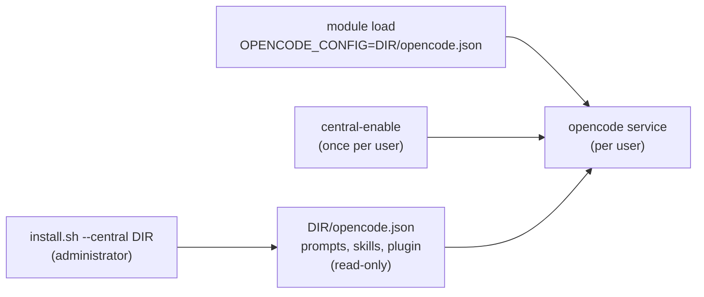

<!--
SPDX-FileCopyrightText: 2026 European Centre for Medium-Range Weather Forecasts (ECMWF)
SPDX-License-Identifier: Apache-2.0
-->

# Installing ecmwf-multi-agents

## Requirements

- opencode 2, tested on 2.0.29 (another 2.x version works with a warning). The installer finds
  it as `opencode` or `opencode2`. With only opencode 1 it stops: upgrade first with
  `opencode upgrade --major`.
- A POSIX shell and standard tools (`sed`, `grep`, `awk`, `cmp`, `readlink`). `jq` makes
  `doctor` more thorough when it is installed.
- Access to the models of the profile you choose. The default profile needs Anthropic and
  GitHub Copilot, connected with `opencode auth login`. The `inherit` profile works with any
  model.

The checkout already contains the generated files in `dist/`, so installing needs neither Bun
nor a build.

## Install for yourself

```sh
git clone <repository-url> ~/.local/share/ecmwf-multi-agents
cd ~/.local/share/ecmwf-multi-agents
./install.sh
```

Or with npm, which needs Node.js:

```sh
npm install -g @ecmwf.int/multi-agents
ecmwf-multi-agents
```

`ecmwf-multi-agents` runs `install.sh` from the installed package with the same commands and
options, so everywhere below `./install.sh` can be `ecmwf-multi-agents`, for example
`ecmwf-multi-agents doctor`. The files are then linked from the package folder.

This links the agents, commands, skills and the plugin folder into `~/.config/opencode/` (or
`$XDG_CONFIG_HOME/opencode/`), records what it installed in
`~/.config/opencode/ecmwf-multi-agents/installed.txt`, and creates your settings file
`~/.config/opencode/ecmwf-multi-agents.jsonc` if you do not have one. Restart opencode
afterwards.

Choose models and the review policy at install time, or later by editing the settings file:

```sh
./install.sh --profile anthropic --review always
```

The settings file can also change one agent's model, effort or step limit. Effort is how
hard a model thinks before it answers: `low`, `medium`, `high`, `xhigh` or `max`; more effort
is slower and costs more. For example, to let the builder think harder:

```jsonc
{
  "agents": { "builder": { "effort": "xhigh" } }
}
```

Effort applies only to an agent that has a model, so under the `inherit` profile it needs a
`model` in the same entry. Restart opencode after changing settings. `/guide` in opencode lists
the defaults, and [the architecture](architecture.md#settings) has the full reference.

The installer never overwrites a file it did not create. If one of your own files is in the
way, for example your own `commands/plan.md`, it is left alone and reported, the rest is
installed, and the installer exits with an error so you notice.

## Install for one project

```sh
./install.sh --project ~/code/my-repo
```

The files are copied into `~/code/my-repo/.opencode/`, so they keep working for everyone who
clones the project if you commit them. If you do not want to commit them, add `.opencode/` (or
the individual files) to the project's `.gitignore`.

A project settings file overrides your own settings, so the installer writes
`.opencode/ecmwf-multi-agents.jsonc` only when you pass `--profile` or `--review`, and then
with only those values.

## Switch it on per project

A project can also bring the harness without installing any file. Add one line to the
project's `opencode.json` (or `.opencode/opencode.json`), naming the npm package with a pinned
version:

```json
{
  "plugins": ["@ecmwf.int/multi-agents@0.6.0"]
}
```

or a checkout of this repository:

```json
{
  "plugins": ["{env:HOME}/.local/share/ecmwf-multi-agents"]
}
```

opencode installs the package itself, under its cache folder, the first time it opens the
project. A path is either absolute, relative to the config file (`./` or `../`), or starts with
`{env:HOME}/`; an entry starting with `~/` is read as a package name and does not work.

The plugin registers the agents, commands and skills and makes `lead` the default agent, in
that project only; other projects served by the same opencode are not affected. Agent files,
commands and skills of your own or of the project, and a `default_agent` in a config, still
win, as they do over installed files. Settings come from the same files as for an install:
`~/.config/opencode/ecmwf-multi-agents.jsonc` and the project's
`.opencode/ecmwf-multi-agents.jsonc`.

To update, change the version in the line and restart opencode; a pinned version never changes
on its own. With a checkout, `git pull` it. An entry without a version is checked against npm
once a day and reported as outdated, and updated only by `opencode plugin update`.

Use either the line or an install in `~/.config/opencode/`, not both: opencode loads the
installed copy first and ignores the project's as a "Duplicate plugin ID", so the line's
version has no effect. `doctor` warns about it. Files installed into the project with
`--project` next to a line also work, and the files win.

## Shared machines (central install)

On a shared machine, such as an HPC login node, an administrator can install the harness once
for everyone. Each user switches it on with one environment variable, usually from a module
file, and keeps their own opencode config.



### For the administrator

```sh
git clone <repository-url> /opt/ecmwf-multi-agents-src
/opt/ecmwf-multi-agents-src/install.sh --central /opt/ecmwf-multi-agents --review ask
```

This writes a folder of copies, not links, and makes it read-only:

- `opencode.json`: every agent and command of the harness, with their text in `prompts/`
  (through `{file:}`), the `skills/` folder and the plugin folder, all with absolute paths;
- `plugins/ecmwf-multi-agents/`, `skills/`, and `ecmwf-multi-agents/` with the profiles, the
  settings schema and the install record;
- `ecmwf-multi-agents.jsonc`, the site settings, only when you pass `--profile` or `--review`.

The folder's path goes into the config as it is, so it may contain only letters, digits and
`. _ / + @ -`. opencode writes nothing into the folder. The installer prints the module lines
for the folder; for `/opt/ecmwf-multi-agents` they are:

```lua
-- Lmod: ecmwf-multi-agents.lua
whatis("Multi-agent harness for opencode")
setenv("OPENCODE_CONFIG", "/opt/ecmwf-multi-agents/opencode.json")
if (mode() == "load") then
  LmodMessage("ecmwf-multi-agents: opencode's background service reads OPENCODE_CONFIG only when it starts. Run once: opencode service set env OPENCODE_CONFIG /opt/ecmwf-multi-agents/opencode.json")
end
```

```tcl
#%Module1.0
## Tcl: ecmwf-multi-agents
module-whatis "Multi-agent harness for opencode"
setenv OPENCODE_CONFIG /opt/ecmwf-multi-agents/opencode.json
if { [module-info mode load] } {
  puts stderr "ecmwf-multi-agents: opencode's background service reads OPENCODE_CONFIG only when it starts. Run once: opencode service set env OPENCODE_CONFIG /opt/ecmwf-multi-agents/opencode.json"
}
```

To update, `git pull` in the source checkout and run the same `--central` command again: it
makes the folder writable, replaces the harness files, removes those a release dropped, keeps
the site settings and makes the folder read-only again. To change the site settings, make the
file writable, edit it and make it read-only again. Check the folder with
`./install.sh doctor --central /opt/ecmwf-multi-agents`. To remove it, delete the folder
(`chmod -R u+w` first); `uninstall --central` only says so.

### For each user

Load the module, then once:

```sh
./install.sh central-enable /opt/ecmwf-multi-agents
```

`ecmwf-multi-agents central-enable` does the same from the npm package, and without the folder
it takes the one `OPENCODE_CONFIG` names. It runs
`opencode service set env OPENCODE_CONFIG /opt/ecmwf-multi-agents/opencode.json`, which works
without the installer too. opencode 2 runs one background service per user, which the TUI and
`opencode run` talk to, and that service reads environment variables only when it starts; the
setting makes it start with the variable every time, wherever it is started from.
`central-disable` (or `opencode service unset env OPENCODE_CONFIG`) undoes it.

Your own `~/.config/opencode/ecmwf-multi-agents.jsonc` overrides the site settings, and a
project's settings file overrides both. `./install.sh doctor` finds the central install through
`OPENCODE_CONFIG`, or through the service when the shell lacks it, and checks the folder, the
variable in your shell and in the service, the service's port, and what opencode loads from it.

### What wins

The central config sits above your global config folder and below the project:

1. your `~/.config/opencode/` (config, agent and command files);
2. the central `opencode.json`;
3. the project's `opencode.json` and `.opencode/`.

Agents merge field by field, so the central agents set every field the harness defines and
replace those of an agent of the same name in your global folder, while a project's own agent
file (`.opencode/agents/scout.md`) or command still wins over the central one. The exceptions
are as with a project's line (see the README): `/review` and `/progress` are the plugin's, and
the settings decide the harness agents' model, effort and step limit. The agents' own
permission rules come after your global `permissions`, so a global "allow every shell command"
does not loosen `scout`'s read-only rules, and `/review` and `/progress` answer in your own
session, as with any other install. With opencode 1
the central install won over projects too. A `default_agent` in any of your configs, or
`"default_agent": false` in the settings, still chooses the default agent. Do not install the
harness in `~/.config/opencode/` as well, nor name it in a project's `plugins` line: opencode
loads its plugin only once, and `doctor` warns about both.

### The shared port

Every user's service listens on `127.0.0.1:49374`. On a shared login node the first user's
service takes the port and the others' services cannot start. `doctor` and `central-enable`
warn when another user's process holds your service's port (they ask `ss`, so this check needs
Linux). Then either give your service a port of its own:

```sh
opencode service set port 50123
```

or turn the service off and run opencode with a private server each time:

```sh
opencode service set disabled true
opencode --standalone
```

`OPENCODE_CONFIG` is read by opencode but not documented by it yet; the integration tests pin
its behaviour on the tested version.

## Options

| Option | Effect |
|---|---|
| `--project DIR` | Install into `DIR/.opencode` (files copied) |
| `--central DIR` | A shared, read-only install in `DIR` (see "Shared machines") |
| `--profile NAME` | Models: `default`, `anthropic`, `copilot` or `inherit` |
| `--review WHEN` | When the reviewer checks work: `auto`, `ask`, `always` or `never` |
| `--link`, `--copy` | Link files to the checkout, or copy them |
| `--dry-run` | Show what would happen without changing anything |
| `--purge` | With `uninstall`: also remove the settings file |

## Updating

```sh
cd ~/.local/share/ecmwf-multi-agents
git pull
./install.sh
```

Linked files (the default for your own install) change as soon as you `git pull`; restart
opencode to load them. The plugin folder is linked as a whole, because opencode loads a plugin
folder only when its files really are inside it; a copied install copies it. Run `./install.sh` again when files were added or removed, which
`doctor` reports, and always for copied installs (projects). Re-running is safe: unchanged
files stay as they are.

An install made for opencode 1 by an earlier version is replaced by running `./install.sh`
again; `doctor` reports such an install as a FAIL until then.

With npm, run `npm install -g @ecmwf.int/multi-agents`, then `ecmwf-multi-agents`.

## Checking an installation

```sh
./install.sh doctor
./install.sh doctor --project ~/code/my-repo
```

Each line starts with OK, WARN or FAIL:

- the opencode version found, and whether the installed files are for opencode 2;
- every installed file present and still from the harness (a broken link means the checkout
  was moved, or an update removed the file: run `./install.sh` again);
- whether the checkout has files that are not installed yet, or the other way round;
- for a project switched on by a `plugins` line: the line, and for a checkout that it has the
  plugin folder; a WARN when an install in `~/.config/opencode/` masks the line;
- for a central install: the folder, `OPENCODE_CONFIG` in your shell and in your opencode
  service (a WARN naming `central-enable` when the service lacks it), and a WARN when another
  user holds your service's port;
- your settings files: the review value and the profile name;
- whether the models of your profile are available (a WARN with the provider to connect);
- what opencode itself loaded, asked through the plugin with
  `opencode api --standalone` from the project folder (or the current folder without
  `--project`): whether `lead` is loaded and is the harness's own, its `Review policy:` line,
  the default agent, and every problem the plugin found, such as an ignored settings file.
  When `lead` differs from the harness's, a WARN names the fields that differ and the
  `lead.md` files and opencode configs with an `agents.lead` entry it may come from. A FAIL
  saying the plugin is not active means opencode did not load it there: run `./install.sh`
  again or check the line, and look for errors with `opencode debug config` or
  `opencode --print-logs`.

`doctor` exits with an error only on FAIL lines.

## Removing

```sh
./install.sh uninstall
./install.sh uninstall --project ~/code/my-repo
```

This removes the files the installer put there and keeps your settings file; add `--purge` to
remove it too. Files you created yourself are never removed.

## Troubleshooting

- **opencode starts on `build`, not `lead`.** Your opencode config (or another plugin)
  names a different `default_agent`, or the plugin is not installed. Press Tab or type
  `/agents` to switch, or set `"default_agent": "lead"` in your `opencode.json`.
- **A model is not available.** Connect its provider with `opencode auth login`, or choose
  another profile in your settings file, then restart opencode.
- **Settings seem ignored.** Restart opencode; settings are read at startup. An invalid
  settings file is ignored as a whole; opencode shows why in a warning, and
  `./install.sh doctor` lists it too.
- **A project's `plugins` line has no effect.** The harness is also installed in
  `~/.config/opencode/`, whose copy wins: remove one of them. `doctor --project` says so.
- **On a shared machine, opencode has no `lead` although the module is loaded.** The service
  was started without `OPENCODE_CONFIG`: run `./install.sh central-enable DIR` once. If the
  service does not start at all, another user holds its port: see "The shared port".
- **Files were left alone.** They are not from the harness. Rename or move them and run
  `./install.sh` again.
