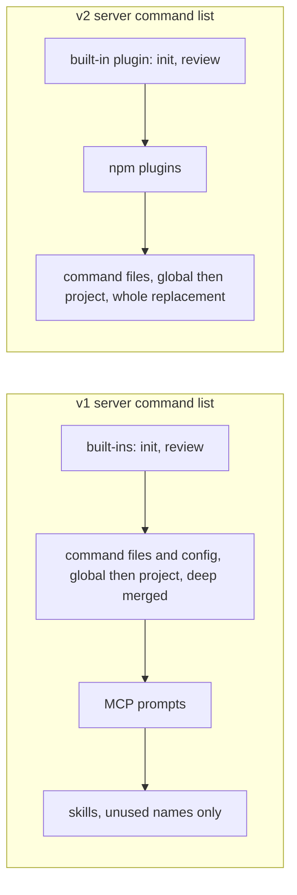

<!--
SPDX-FileCopyrightText: 2026 European Centre for Medium-Range Weather Forecasts (ECMWF)
SPDX-License-Identifier: Apache-2.0
-->

# Command and agent name clashes

This note checks the harness's names against opencode v1 1.18.35, v1 1.19.0 and v2 2.0.16,
against weave, and against the commands, agents and skills already in the user's configuration
and projects. Names checked:

- Commands: `onboard`, `plan`, `go`, `review`, `status`, `guide`.
- Agents: `lead`, `scout`, `scout-deep`, `builder`, `builder-deep`, `reviewer`.
- Skills: `ecmwf-multi-agents-plan`, `ecmwf-multi-agents-guide`.

## Summary

Findings:

1. `review` is a built-in server command in all three versions. A `commands/review.md` file
   replaces it completely: the command list keeps one `review` entry, with our description and
   template (run on 1.18.35, 1.19.0 and 2.0.16).
2. `status` is a built-in TUI command in all three versions ("View status", a dialog with MCP,
   LSP, formatter and plugin state). The server has no `status`, so ours loads, and the TUI then
   lists two `/status` rows. Enter runs the highlighted row: after typing `/st` or `/stat` that is
   the built-in; after `/statu` or `/status` the two rows score the same and the order comes from
   the fuzzy matcher's internal heap. This is derived from source plus a replay of the ranking
   function, not from a live TUI.
3. `onboard`, `plan`, `go` and `guide` clash with no built-in command, no TUI command, no weave
   name and nothing in the user's global configuration.
4. Three projects on the machine used for this check define a project-level `onboard` command.
   Project definitions override global ones, so in those projects `/onboard` never reaches ours.
   In v1 the override is a deep merge: fields the project file leaves out are inherited from the
   global file (verified).
5. No version has a built-in agent with any of our six names. opencode had a flag-gated built-in
   `scout` for a few weeks in May 2026; it was removed before all three tags, and setting the old
   flag does not bring it back. The docs at all three tags still describe it.
6. One local project defines a project-level agent named `scout` (a prior-art researcher with
   an open shell). In that project it overrides ours.
7. Built-in skills are `customize-opencode` (v1) and `opencode` and `report` (v2). No clash.
8. weave's agent and command names do not clash with ours. Both weave and this harness want to be
   the default agent.

Recommendations (details and alternatives in [Recommendations](#recommendations)):

| Ours | Recommendation | Reason |
|---|---|---|
| `onboard` | rename to `survey` | Project-level `onboard` commands in three local projects hide ours there |
| `plan` | keep | No clash; the built-in `plan` agent lives in another namespace and means the same thing |
| `go` | keep | No clash |
| `review` | keep, and override the built-in on purpose | Ours does the built-in's job and more |
| `status` | rename to `progress` | The TUI's own `/status` competes with ours when the user presses Enter |
| `guide` | keep | No clash |
| agent `scout` | keep, and document the exception | No built-in in the pinned versions; one local project shadows it |
| both skill ids | keep | No clash |

## Versions and sources

| Version | Binary and version check | Source tag | Commit |
|---|---|---|---|
| v1 1.18.35 | `opencode` on PATH; `opencode --version` prints `1.18.35` | `v1.18.35` | `53d1eabb61e2` |
| v1 1.19.0 | `bins/v1-1.19.0/node_modules/.bin/opencode`; `GET /global/health` returns `{"healthy":true,"version":"1.19.0"}` | `v1.19.0` | `733b2c627e5a` |
| v2 2.0.16 | `bins/v2-2.0.16/node_modules/.bin/opencode2`; `--version` prints `opencode v2.0.16` | `v2.0.16` | `3a103fe0aff7` |

Source is the `anomalyco/opencode` tarball at each tag. Paths below are relative to the tag root.
The v1 files that decide command, agent and skill names and the TUI prompt behaviour are identical
at both v1 tags (`diff -q` on `config/config.ts`, `config/paths.ts`, `config/command.ts`,
`command/index.ts`, `agent/agent.ts`, `skill/index.ts`, and the TUI's `autocomplete.tsx`,
`prompt/index.tsx` and `keymap.tsx`). Only `packages/tui/src/app.tsx` differs: 1.19.0 adds
`/update` and shifts line numbers.

## Built-in names

Bold names clash with ours.

### opencode v1 1.18.35 and 1.19.0

Server commands, agents and skills. The API output was the same on both versions:

| Name | Kind | Source (same at both tags) |
|---|---|---|
| `init` | server command, "guided AGENTS.md setup" | `packages/opencode/src/command/index.ts:70-78` |
| **`review`** | server command, "review changes [commit\|branch\|pr], defaults to uncommitted", `subtask: true` | `packages/opencode/src/command/index.ts:79-88` |
| `customize-opencode` | built-in skill, also listed as a server command with `source: "skill"` | `packages/core/src/plugin/skill.ts:21`, `packages/opencode/src/command/index.ts:134-152` |
| `build` | agent, primary, default | `packages/opencode/src/agent/agent.ts:141` |
| `plan` | agent, primary ("Plan mode. Disallows all edit tools.") | `packages/opencode/src/agent/agent.ts:156` |
| `general` | agent, subagent | `packages/opencode/src/agent/agent.ts:182` |
| `explore` | agent, subagent | `packages/opencode/src/agent/agent.ts:196` |
| `compaction`, `title`, `summary` | agents, primary, hidden | `packages/opencode/src/agent/agent.ts:219`, `:234`, `:250` |

```text
$ curl -s 127.0.0.1:47311/command | jq -c '.[] | {name, source, subtask}'
{"name":"init","source":"command","subtask":null}
{"name":"review","source":"command","subtask":true}
{"name":"customize-opencode","source":"skill","subtask":null}
$ curl -s 127.0.0.1:47311/agent | jq -c '.[] | {name, mode, native, hidden}'
{"name":"build","mode":"primary","native":true,"hidden":null}
{"name":"compaction","mode":"primary","native":true,"hidden":true}
{"name":"explore","mode":"subagent","native":true,"hidden":null}
{"name":"general","mode":"subagent","native":true,"hidden":null}
{"name":"plan","mode":"primary","native":true,"hidden":null}
{"name":"summary","mode":"primary","native":true,"hidden":true}
{"name":"title","mode":"primary","native":true,"hidden":true}
$ opencode debug skill | jq -r '.[].name'
customize-opencode
$ opencode debug agent scout
Agent scout not found, run 'opencode.exe agent list' to get an agent list
```

TUI slash commands, from `packages/tui/src` (paths relative to it). Some rows only appear in a
session view or when a condition holds:

| Name (aliases) | Condition | Source at v1.18.35 | Source at v1.19.0 |
|---|---|---|---|
| `/sessions` (`/resume`, `/continue`) | | `app.tsx:577-578` | `app.tsx:563-564` |
| `/new` (`/clear`) | | `app.tsx:588-589` | `app.tsx:574-575` |
| `/workspaces` | experimental workspaces flag | `app.tsx:616-617` | `app.tsx:602-603` |
| `/models` (`/mo`) | | `app.tsx:636-638` | `app.tsx:622-624` |
| `/agents` | | `app.tsx:683` | `app.tsx:669` |
| `/mcps` | | `app.tsx:692` | `app.tsx:678` |
| `/variants` | model has variants | `app.tsx:718-719` | `app.tsx:704-705` |
| `/connect` | | `app.tsx:744` | `app.tsx:730` |
| `/org` (`/orgs`, `/switch-org`) | more than one switchable org | `app.tsx:750-757` | `app.tsx:736-743` |
| **`/status`** | always | `app.tsx:765-773` | `app.tsx:751-759` |
| `/update` | 1.19.0 only, when an update is offered | | `app.tsx:760-770` |
| `/debug` | | `app.tsx:777` | `app.tsx:774` |
| `/themes` | | `app.tsx:786` | `app.tsx:783` |
| `/help` | | `app.tsx:814` | `app.tsx:811` |
| `/exit` (`/quit`, `/q`) | | `app.tsx:832-833` | `app.tsx:829-830` |
| `/editor`, `/skills`, `/move` | | `component/prompt/index.tsx:427`, `:519`, `:551` | same |
| `/warp` | experimental workspaces flag | `component/prompt/index.tsx:540-541` | same |
| `/share`, `/unshare` | sharing enabled; `/unshare` only when shared | `routes/session/index.tsx:471-473`, `:593` | same |
| `/rename`, `/timeline`, `/fork` | session view | `routes/session/index.tsx:511`, `:522`, `:544` | same |
| `/compact` (`/summarize`) | session view | `routes/session/index.tsx:566-567` | same |
| `/undo`, `/redo` | session view; `/redo` after an undo | `routes/session/index.tsx:615`, `:652` | same |
| `/timestamps` (`/toggle-timestamps`) | session view | `routes/session/index.tsx:699-700` | same |
| `/thinking` (`/toggle-thinking`) | session view | `routes/session/index.tsx:716-717` | same |
| `/copy`, `/export` | session view | `routes/session/index.tsx:921`, `:951` | same |
| `/diff` | built-in TUI plugin (`feature-plugins/builtins.ts:34`) | `feature-plugins/system/diff-viewer.tsx:1058` | same |

The built-in `/status` opens `DialogStatus`, which lists MCP servers, LSP servers, formatters and
plugins (`component/dialog-status.tsx:54`, `:97-100`, `:122`, `:144`).

The minimal client (`opencode --mini`, `opencode run` footer) has its own built-ins `/editor`,
`/new`, `/exit` and `/skills`, and hides server commands with those names
(`packages/opencode/src/cli/cmd/run/footer.prompt.tsx:411-452`, identical at both tags). None of
our names is among them.

### opencode v2 2.0.16

Server commands, agents and skills, from `GET /api/command`, `/api/agent` and `/api/skill` on a
sandboxed `opencode2 serve`:

| Name | Kind | Source at v2.0.16 |
|---|---|---|
| `init` | server command, "guided AGENTS.md setup" | `packages/core/src/plugin/command.ts:29-41` |
| **`review`** | server command, "review changes [commit\|branch\|pr], defaults to uncommitted" | `packages/core/src/plugin/command.ts:42-54` |
| `build` | agent, primary, default | `packages/core/src/agent.ts:18`, `packages/core/src/plugin/agent.ts:87` |
| `plan` | agent, primary ("Read-only agent for exploring the codebase and planning work before implementation") | `packages/core/src/plugin/plan.ts:12` |
| `general`, `explore` | agents, subagent | `packages/core/src/plugin/agent.ts:94`, `:105` |
| `compaction`, `title`, `summary` | agents, primary, hidden | `packages/core/src/plugin/agent.ts:133`, `:139`, `:147` |
| `opencode` | skill ("Use this skill for any question about OpenCode itself ...") | `packages/core/src/plugin/skill.ts:30` |
| `report` | skill ("Use when the user wants to report an opencode issue or bug ...") | `packages/core/src/plugin/skill.ts:39` |

```text
$ curl -s -u opencode:$PW "127.0.0.1:47313/api/command?location[directory]=<repo>" | jq -c .data
[{"name":"init","description":"guided AGENTS.md setup"},{"name":"review","description":"review changes [commit|branch|pr], defaults to uncommitted"}]
$ curl ... /api/agent | jq -c '.data[] | {id, mode, hidden}'     # output condensed
build primary false / general subagent false / explore subagent false / compaction primary true /
title primary true / summary primary true / plan primary false
$ curl ... /api/skill | jq -c '.data[] | {id, path}'
{"id":"opencode","path":"/builtin/opencode.md"}
{"id":"report","path":"/builtin/report.md"}
(plus the user's own skills from ~/.claude/skills, see Side findings)
```

v2 does not list skills as server commands. Its TUI offers skills under `@`, not `/`
(`packages/tui/src/component/prompt/autocomplete.tsx:541-546`).

TUI slash commands, from `packages/tui/src`. v2 shows each alias as its own row
(`component/prompt/autocomplete.tsx:475-483`):

| Name (aliases) | Condition | Source at v2.0.16 |
|---|---|---|
| `/sessions` (`/resume`, `/continue`) | | `app.tsx:720` |
| `/new`, `/clear` | | `app.tsx:730`, `:756` |
| `/open` (`/projects`, `/project`) | | `app.tsx:783` |
| `/models`, `/agents`, `/mcps` | | `app.tsx:859`, `:904`, `:913` |
| `/variants` (`/thinking`, `/effort`) | | `app.tsx:940` |
| `/connect`, `/settings` | | `app.tsx:965`, `:979` |
| **`/status`** | always | `app.tsx:985-993` |
| `/update` | when an update is offered | `app.tsx:994-1004` |
| `/pair` (`/web`) | | `app.tsx:1008` |
| `/restart` | connected to the background service | `app.tsx:1014-1019` |
| `/reload`, `/debug`, `/themes`, `/help` | | `app.tsx:1038`, `:1054`, `:1063`, `:1094` |
| `/exit` (`/quit`, `/q`) | | `app.tsx:1112` |
| `/cd` | takes arguments | `component/prompt/index.tsx:268` |
| `/editor`, `/skills`, `/worktrees` | | `component/prompt/index.tsx:552`, `:583`, `:622` |
| `/terminal` | session view | `component/session-frame.tsx:250` |
| `/share`, `/timeline`, `/fork`, `/unshare`, `/undo`, `/redo` | session view | `routes/session/index.tsx:871`, `:893`, `:908`, `:950`, `:957`, `:990` |
| `/rename` | session view, takes arguments | `routes/session/index.tsx:878` |
| `/compact`, `/copy`, `/export` | session view | `routes/session/index.tsx:925-926`, `:1153-1154`, `:1174-1175` |
| `/plugins`, `/stats`, `/diff` | built-in TUI plugins (`plugin/builtins.ts:15-30`) | `feature-plugins/system/plugins.tsx:346`, `stats.tsx:200`, `diff-viewer.tsx:1183` |
| `/btw` | built-in TUI plugin, takes arguments | `feature-plugins/prompt/btw.tsx:57` |

The v2 minimal client has `/editor`, `/settings`, `/new`, `/compact`, `/exit`, `/quit` and `/q`
and hides server commands with those names (`packages/tui/src/mini/footer.prompt.tsx:512-553`,
`mini/prompt.shared.ts:47`). None of our names is among them.

### Built-in agents: `scout` and the others

None of `lead`, `scout`, `scout-deep`, `builder`, `builder-deep`, `reviewer` exists in any of
the three versions (tables above). Two notes:

- opencode added a flag-gated `scout` subagent in May 2026 (commit `40d5ea1cf1`, "feat(core):
  add scout agent for repo research (#24149)") and removed it on 2026-06-02 (commit
  `a639fe7a08`, "chore(opencode): remove scout agent (#30435)"). All three tags contain the
  removal (`gh api repos/anomalyco/opencode/compare/a639fe7a08...<tag>` gives `behind_by=0` for
  each). With the old flags set, v1 still has no `scout`:

  ```text
  $ tools/sandbox.sh $S env OPENCODE_EXPERIMENTAL_SCOUT=true OPENCODE_EXPERIMENTAL=true opencode agent list
  build (primary) compaction (primary) explore (subagent) general (subagent) plan (primary) summary (primary) title (primary)
  ```

  The docs at all three tags are stale: `packages/web/src/content/docs/agents.mdx:39` says
  "three built-in subagents, General, Explore, and Scout", and `cli.mdx:733` (1.18.35) lists
  `OPENCODE_EXPERIMENTAL_SCOUT`. The v2 docs say the opposite:
  `services/www/src/docs/content/agents.mdx:156` at v2.0.16, "V2 has no built-in `scout` agent".
  `PLAN.md` still mentions "replacing the built-in `scout`". For the pinned versions there is
  nothing to replace.
- `builder` is close to the built-in `build`. The names differ, so nothing clashes, but typing
  `@buil` in the TUI should offer both (UNVERIFIED, not run).

## Precedence

### Server side: a command file against a built-in (verified)

Fixtures in the sandbox config directory `DIR/home/.config/opencode/commands/`:

| File | Frontmatter | Purpose |
|---|---|---|
| `review.md` | `description: CUSTOM-GLOBAL review from commands/review.md` | same name as a built-in server command |
| `status.md` | `description: CUSTOM-GLOBAL status from commands/status.md` | same name as a TUI-only command |
| `customize-opencode.md` | `description: CUSTOM-GLOBAL command named like the built-in skill` | same name as a skill-derived command |
| `onboard.md` | `description: CUSTOM-GLOBAL onboard`, `agent: plan`, `subtask: true` | global side of the project test |

and `DIR/proj/.opencode/commands/onboard.md` with only `description: CUSTOM-PROJECT onboard` and a
body. For v1, `DIR/proj` got a minimal hand-written `.git` (`HEAD`, `objects/`, `refs/heads/`) so
that `git rev-parse --show-toplevel` names it as the worktree and the upward search stops there.
The servers ran from the repo root, which has no `.opencode/`.

v1.18.35 (`opencode serve --port 47321`):

```text
$ curl -s 127.0.0.1:47321/command | jq -c '.[] | {name, source, description, subtask, template}'
{"name":"init","source":"command","description":"guided AGENTS.md setup","subtask":null,"template":"Create or update `AGENTS.md` for this repo"}
{"name":"review","source":"command","description":"CUSTOM-GLOBAL review from commands/review.md","subtask":null,"template":"CUSTOM-GLOBAL-REVIEW-TEMPLATE $ARGUMENTS"}
{"name":"customize-opencode","source":"command","description":"CUSTOM-GLOBAL command named like the built-in skil","subtask":null,"template":"CUSTOM-GLOBAL-CUSTOMIZE-TEMPLATE $ARGUMENT"}
{"name":"status","source":"command","description":"CUSTOM-GLOBAL status from commands/status.md","subtask":null,"template":"CUSTOM-GLOBAL-STATUS-TEMPLATE $ARGUMENTS"}
{"name":"onboard","source":"command","description":"CUSTOM-GLOBAL onboard","subtask":null,"template":"CUSTOM-GLOBAL-ONBOARD-TEMPLATE $ARGUMENTS"}
```

(Long strings were shortened by the `jq` filter. The `onboard` line is from the first run, before
`agent` and `subtask` were added to the global file; see the project test below.) v1.19.0 (port
29313) returned the same list. v2.0.16 (port 29312):

```text
$ curl -s -u opencode:$PW "127.0.0.1:29312/api/command?location[directory]=<repo>" | jq -c '.data[]'
{"name":"init","description":"guided AGENTS.md setup"}
{"name":"review","description":"CUSTOM-GLOBAL review from commands/review.md"}
{"name":"customize-opencode","description":"CUSTOM-GLOBAL command named like the built-in skill"}
{"name":"onboard","description":"CUSTOM-GLOBAL onboard"}
{"name":"status","description":"CUSTOM-GLOBAL status from commands/status.md"}
```

Results:

- A command file named like a built-in server command replaces it. Only one `review` remains and
  it is ours, in all three versions. In v1 nothing of the built-in survives: the file without
  `subtask` comes back with `subtask: null`, while the built-in had `subtask: true`. Our manifest
  sets `subtask: true` for `review`, so this does not bite.
- A command file named like a TUI-only command (`status`) loads as an ordinary server command.
  The server does not know the TUI's names. What the user then sees is decided in the TUI (below).
- In v1 a command file also beats a skill of the same name: `customize-opencode` turned into
  `source: "command"`.

Why, from source:

- v1 builds the list in this order: built-ins (`command/index.ts:70-88`), then every
  `cfg.command` entry assigned over them (`:90-103`), then MCP prompts (`:105-132`), then skills,
  which only fill names nobody has taken (`:134-135`, `if (commands[item.name]) continue`).
- v2 activates its built-in plugins first (`CommandPlugin` in `pre`,
  `packages/core/src/plugin/internal.ts:223`), then npm plugins, then the config loaders
  (`ConfigCommandPlugin` in `post`, `:254`; the ordering is in
  `packages/core/src/plugin/supervisor.ts:91-95`). Each `editor.add` is a `Map.set`
  (`packages/core/src/command.ts:57-62`), so the last writer wins.
  Command files therefore beat both built-ins and plugin-registered commands in v2.



Each arrow points to a later step, which overwrites a same-named entry, except the v1 skills step.

### Global against project (verified for v1, list-level for v2)

With `agent: plan` and `subtask: true` in the global `onboard.md` only:

```text
v1.18.35 $ curl -s 127.0.0.1:47321/command | jq -c '.[] | select(.name=="onboard")'
{"name":"onboard","description":"CUSTOM-GLOBAL onboard","agent":"plan","subtask":true,"template":"CUSTOM-GLOBAL-ONBOARD-TEMPLATE $ARGUMENTS"}
v1.18.35 $ curl -s "127.0.0.1:47321/command?directory=$DIR/proj" | jq -c '.[] | select(.name=="onboard")'
{"name":"onboard","description":"CUSTOM-PROJECT onboard","agent":"plan","subtask":true,"template":"CUSTOM-PROJECT-ONBOARD-TEMPLATE $ARGUMENTS"}
v2.0.16  $ curl ... "/api/command?location[directory]=$DIR/proj" | jq -c '.data[] | select(.name=="onboard")'
{"name":"onboard","description":"CUSTOM-PROJECT onboard"}
```

v1.19.0 gave the same two v1 lines. The project file wins in both versions. In v1 the result is a
deep merge: the project's description and template, plus `agent: plan` and `subtask: true`
inherited from the global file. v1 visits the global config directory first and the project's
`.opencode/` after it (`packages/opencode/src/config/paths.ts:23-41`), and merges each
directory's commands and agents with `mergeDeep` (`packages/opencode/src/config/config.ts:438-480`,
commands at `:473`, agents at `:474-475`). The same `mergeDeep` applies to agents, so a project
agent file inherits the fields it leaves out from a global agent of the same name, permission maps
included. This follows from the source and was not run for agents (UNVERIFIED).

v2 loads each config source separately and adds whole commands
(`packages/core/src/config/plugin/command.ts:28-33`, `:72-77`), with project directories after
the global one (`GET /api/config` listed the sandbox global directory, then
`~/.opencode`, then `DIR/proj/.opencode`). So no fields should carry over, but
`/api/command` shows only name and description, so this part is UNVERIFIED by a run.

### In the TUI: same name as a TUI command (from source)

No TUI sessions were run (out of scope for this check). The behaviour below comes from the source
at each tag, plus a replay of the TUI's ranking call. The relevant files are the same at both v1
tags.

v1 1.18.35 and 1.19.0 (`packages/tui/src`):

1. Autocomplete shows both. The list is every TUI slash command, then every server command except
   skill-derived ones, with no de-duplication, sorted by the displayed name
   (`component/prompt/autocomplete.tsx:447-474`). With our `status` installed, the user sees two
   `/status` rows: "View status" and "Show progress on the current plan".
2. Enter while the list is open selects the highlighted row (`config/keybind.ts:217`, `return`
   bound to `prompt.autocomplete.select`; `autocomplete.tsx:553-558`, `:611-618`). A TUI row runs
   at once (`keymap.tsx:272-288`, `dispatchCommand`). A server row puts `/status ` in the prompt
   (`autocomplete.tsx:455-462`), and a second Enter sends it.
3. With the list closed, for example after typing `/status ` with a space (the list hides on
   whitespace, `autocomplete.tsx:682`), the submit path sends any text whose first word is a
   server command name to the server (`component/prompt/index.tsx:1071-1091`). It does not
   check TUI names, so this runs ours.
4. Esc on a bare `/status` clears the input (`autocomplete.tsx:650-659`).
5. The highlighted row is the best fuzzy match: fuzzysort 3.1.0 (`bun.lock:3799`) over the
   displayed name, the description and the aliases. A displayed name that starts with the query
   doubles the score (`autocomplete.tsx:502-521`). fuzzysort rewards a row that matches on two
   keys (`fuzzysort.js:123-134` in 3.1.0), and the built-in row's description "View status"
   contains the query while ours does not.

Replay of that call (same options, fuzzysort 3.1.0) on a v1 session-view list: 25 TUI rows with
their source titles, plus `init` and our six commands, sorted as the TUI sorts them:

| Typed | First row (score) | Second row (score) |
|---|---|---|
| `/st` | built-in `/status` (1.822) | our `/status` (1.785) |
| `/stat` | built-in `/status` (1.862) | our `/status` (1.845) |
| `/statu` | our `/status` (1.882) | built-in `/status` (1.882), tie |
| `/status` | our `/status` (1.931) | built-in `/status` (1.931), tie |
| `/review`, `/plan`, `/go`, `/guide`, `/onboard` | ours, no competing row | |

On a tie the order comes from fuzzysort's internal heap. A two-row replay with the input order
reversed put the built-in first. So which `/status` runs depends on how far the user typed and on
heap order: easy to get wrong, and impossible to explain in plain words.

v2 2.0.16 (`packages/tui/src`) behaves the same way, with two differences. Aliases become rows of
their own (`component/prompt/autocomplete.tsx:474-504`); the ranking call is the same (`:552-572`,
fuzzysort 3.1.0 at `bun.lock:4081`). And at submit, TUI commands that take arguments (`/cd`,
`/rename`, `/btw`) win over a server command of the same name (`component/prompt/index.tsx:173-183`,
`:1127-1140`). Other text goes to the server if a server command has that name (`:1141-1144`).
`/status` takes no arguments, so v2 behaves like v1 for it.

## weave

There are two different projects called weave:

| Package | Version | Repository | Harness |
|---|---|---|---|
| `@weaveio/weave-adapter-opencode` | 0.2.0 (`latest`) | github.com/weave-io/weave, tag `opencode@0.2.0` (`058b617fa0c0`) | opencode v1 |
| `@weaveio/weave-adapter-opencode2` | 0.2.0 (`latest`), 0.3.0-next.0 (`next`) | github.com/weave-io/weave, tag `opencode2@0.2.0` (`24cee782d405`) | opencode v2 |
| `@opencode_weave/weave` | 0.9.1 (`latest`) | github.com/pgermishuys/opencode-weave | opencode v1; the one the user's configs name |

The weave-io monorepo also publishes `@weaveio/weave-cli` and
`@weaveio/weave-adapter-claude-code`. Names such as `@weaveio/opencode` do not exist (`npm view`:
E404). Source below is weave-io/weave `main` at `9c3fbb159363` (2026-10-03) and the published
bundles from `npm pack`.

Agent names, the same in all three packages: `loom`, `tapestry`, `shuttle`, `pattern`, `thread`,
`spindle`, `weft`, `warp` (weave-io `packages/config/src/builtins.ts:101-258`; the 0.2.0 bundles
carry the same source, e.g. `dist/plugin.js:6711-6848`). `@opencode_weave/weave` 0.9.1 registers
two of them under display names, "Loom (Main Orchestrator)" and "Tapestry (Execution
Orchestrator)" (`dist/index.js:1218-1227`).

Commands:

| Package | Commands | Source |
|---|---|---|
| `@weaveio/weave-adapter-opencode` 0.2.0 | `start-work`, `weave:start` | `dist/plugin.js:9583`, `:9588`; `packages/adapters/opencode/src/plugin.ts:292-302` |
| `@weaveio/weave-adapter-opencode2` 0.2.0 and 0.3.0-next.0 | server `weave:start`; TUI `/weave:start` (takes arguments) | `packages/adapters/opencode2/src/v2/commands.ts:26`, `:67-90`; `v2/plan-ui.tsx:291`; 0.2.0 `dist/tui.js:553` |
| same, `OpenCode2Adapter` class only | `weave:run`, `weave:status`, `weave:abort`, `weave:advance`, `weave:health` | `src/command-templates.ts:77-148`; 0.2.0 `dist/server.js:9830-9876`. The plugin entry (`src/server.ts`) re-exports `v2/plugin.ts`, which registers only `weave:start`; whether the others are ever registered is UNVERIFIED |
| `@opencode_weave/weave` 0.9.1 | `start-work`, `token-report`, `metrics`, `run-workflow`, `weave-health` | `dist/index.js:1423-1490`, `:5810-5816` |

None of these clashes with our command or agent names. Two interactions to know about:

- Default agent. The weave-io v1 adapter always sets `default_agent` to `loom` in its config
  hook (`dist/plugin.js:9577`; `src/plugin.ts:278-281`). `@opencode_weave/weave` 0.9.1 sets it
  only when nothing else has (`dist/index.js:10393-10394`). With both weave and this harness
  installed, the default agent depends on hook order.
- Overwrites. Both v1 packages write their commands and agents into the merged config from the
  config hook: `cfg.command["start-work"] = ...`, and in 0.9.1
  `config.command = { ...existingCommands, ...result.commands }` (`dist/index.js:10391-10392`). A
  same-named user command would lose to them in v1 (from source, UNVERIFIED). In v2, command
  files run after plugins and would win. Neither case affects our names.

On the machine used for this check, the global configuration had the weave plugin commented
out, and several local projects enabled `@opencode_weave/weave` in their own `opencode.json`.

## Names already in use on a typical machine

Global configuration (read only) on the machine used for this check:

| Place | Commands | Agents | Skills |
|---|---|---|---|
| `~/.config/opencode/command(s)/`, `agent(s)/` | none (directories absent) | none | |
| `~/.config/opencode/opencode.jsonc` | no `command` key | `agent` key only sets models for the built-in `plan` and `build` | |
| plugin `opencode-dir@1.0.10` | `cd`, `mv`, `add-dir` (`index.ts:72-83`) | | |
| plugin `opencode-gemini-auth@latest` (2.0.1 today) | `gquota` (`dist/index.js:3175`, `:3197-3198`) | | |
| plugin `@ex-machina/opencode-anthropic-auth@latest` (1.8.6) | none | none | |
| `~/.claude/skills/` | | | nine general-purpose skills (documents, spreadsheets and similar), none with our names |

The skill names come from the v2 `GET /api/skill` output, which read `~/.claude/skills` through
its upward walk (see Side findings). Whether v1 loads them in normal use was not checked
(UNVERIFIED), but none matches our names either way.

Projects. Twelve local projects have a `.opencode/` folder with their own commands, agents or
skills (`.opencode/command(s)/*.md`, `.opencode/agent(s)/*.md`, `.opencode/skill(s)/*/`). Three
of them define a command named `onboard`, and one defines an agent named `scout`. None defines
`plan`, `go`, `review`, `status`, `guide`, `lead`, `scout-deep`, `builder`, `builder-deep`,
`reviewer` or either skill id.

Shadows and what happens:

- `onboard` in three projects. Each sets `description` and `agent: plan` ("Onboard the agent to
  the ... project by reading the docs and surveying the code"). With our `onboard` installed
  globally, those projects keep running their own: the project file wins (v1, v2), and in v1 it
  inherits any field ours sets and theirs leaves out. Ours sets `agent`, which theirs overrides,
  and sets no `model`, `variant` or `subtask`, so today the result is just theirs. Our `lead`
  would never write `.ecmwf-multi-agents/context/onboard.md` in those projects, and advice to
  "run /onboard" would start the wrong command.
- `scout` in one project (`.opencode/agents/scout.md`: a subagent that checks the outside world
  for prior art, with `bash: {"*": allow, ...}`, `edit: deny`, `task: deny`). With our harness
  installed globally, the project agent wins there. `lead`'s hand-offs to `scout` would reach that
  prior-art researcher, with its own prompt, report format and open shell, instead of our
  read-only lookup helper. In v1 the two definitions are deep merged, so the result mixes both
  permission maps (UNVERIFIED, see above). A project install into that project would target the
  same path, `.opencode/agents/scout.md`. The installer must leave it alone (it has no
  `# managed by ecmwf-multi-agents` marker).

## Recommendations

Every candidate below was checked against all the lists above: server and TUI built-ins and their
aliases in the three versions, weave's commands and agents, plugin commands, local project
commands and agents, and skill names. None is a weather term.

`onboard`: rename to `survey`.

| Option | Trade-offs |
|---|---|
| `survey` (recommended) | Plain, and the verb our own description already uses ("Survey this repository ..."). Not shadowed in any local project. Some readers may first think of a questionnaire |
| `learn` | Very short and plain, but it does not say who learns what, and it sits close to `/guide` |
| keep `onboard` | Familiar, and the usual word for this job. But in the three projects above the project command runs instead, with `agent: plan`; the summary file is never written there; and v1 deep merge would leak any field we add later (`model`, `subtask`) into the project's command |

A rename means updating the manifest key, `src/commands/onboard.md`, the `lead` prompt and
`docs/architecture.md`. The file `context/onboard.md` can keep its name.

`status`: rename to `progress`.

| Option | Trade-offs |
|---|---|
| `progress` (recommended) | Says what it shows ("Show progress on the current plan"). Only neighbour: typing `/pro` in v2 also lists the `/project` and `/projects` aliases |
| `plan-status` | Unambiguous, but long, and it still contains "status", so `/status` lists it next to the built-in (no tie, since the names differ) |
| `where` | Very short, but vague for users who do not know the harness |

Overriding the built-in is not an option here: the built-in lives in the TUI and cannot be
replaced from a command file. Keeping `status` leaves two rows with the same name, where Enter
picks one by typed prefix and heap order. That would surprise users, and the built-in status
dialog is useful, so it should stay reachable as `/status`.

`review`: keep, and override the built-in on purpose. Ours does the same job (review uncommitted
changes, a branch or a pull request) and adds plan review by an independent agent on another
model. It runs as a subtask like the built-in, so the override is acceptable and should not
surprise anyone. Costs: while the harness is installed globally, the built-in `/review` prompt is
gone in every project (verified: one `review` entry, ours). Its output also changes from free-form
findings by the current agent to an APPROVE or REJECT verdict by `reviewer`. Say so in `/guide`
and the README. If overriding is not wanted:

| Option | Trade-offs |
|---|---|
| `check` | Short and plain, but the harness already uses "checks" for test and lint commands in briefs |
| `vet` | Short and free, but less common English for non-native speakers |
| `critique` | Clear, but longer and sounds harsher |

`plan`: keep. No command named `plan` exists in any version, TUI, weave or user project. The
built-in `plan` agent shares the word, but agents are chosen with a key (Tab in v1,
`packages/tui/src/config/keybind.ts:130`; Shift+Tab in v2, `keybind.ts:170`), with `/agents` or
with `@`, never with `/plan`. Both mean "plan before building", so the overlap helps more than it
confuses.

`go`: keep. No clash anywhere, and it does not prefix-match a TUI command or alias.

`guide`: keep. No clash. The TUI's `/help` is a different name.

Agent `scout`: keep. No built-in in the pinned versions, so users lose nothing that opencode
provides. The only clash is one project's own agent. There the user loses nothing either
(their agent wins), but the harness loses its `scout`, and `lead`'s hand-offs go to an agent
with an open shell. Document this as a known exception. If the harness must work in such a
project, rename the agent (for example `finder`). That is a larger change, since the name
appears in permissions and prompts.

Skills `ecmwf-multi-agents-plan` and `ecmwf-multi-agents-guide`: keep. In v1 every skill is also
listed as a server command with `source: "skill"` (`command/index.ts:134-152`, shown by
`customize-opencode` above). So both ids will appear in `GET /command` and the TUI `/skills`
dialog, and run if typed in full, though the TUI autocomplete hides them
(`autocomplete.tsx:451`). Neither v1's nor v2's skill `Info` schema has a `hidden` field
(v1 `packages/opencode/src/skill/index.ts:37-39`, v2 `packages/schema/src/skill.ts:27-30`). The
v1 and v2 mechanics notes cover what the manifest's `hidden: true` maps to.

## Side findings

- v2 sandbox leak. 2.0.16 searches every ancestor of the project directory up to `/` for
  `.claude`, `.agents`, `.opencode` and `opencode.json(c)`, with no stop at the worktree
  (`packages/core/src/config/discovery.ts:33-36`). A sandboxed `HOME` therefore does not hide
  the real `~/.claude`, `~/code/.claude` or `~/.opencode` when the sandbox lives under the real
  home directory. `GET /api/config` listed the real `~/.opencode` as a config source, and
  `GET /api/skill` listed the user's nine skills from the real `~/.claude/skills`. These were
  reads only: `find ... -newer <first download>` found no new files in `~/.config/opencode`,
  `~/.opencode`, `~/.claude/skills` or `~/code/.claude`. `opencode-v2.md` covers
  `OPENCODE_DISABLE_PROJECT_CONFIG=1` for isolation. `tools/sandbox.sh` cannot fix this alone.
- v1 outside git. Without a git worktree the worktree is `/`
  (`packages/opencode/src/project/project.ts:217`), so v1 also searches up to `/`, and it writes
  a `.gitignore` and installs `@opencode-ai/plugin` into every config directory it finds
  (`packages/opencode/src/config/config.ts:450-471`). With a cwd under the real home directory
  that would include the real `~/.opencode`. Run v1 checks from a git worktree, as done here.
- Ports. `serve` on ports in Linux's ephemeral range (32768-60999 here) can fail with
  "Failed to start server. Is port 47322 in use?" while nothing listens: `ss -tan` showed the port
  in `TIME-WAIT` as the source port of an outbound connection. Ports below 32768 worked.
- v2 `serve` prints a generated server password to stdout, and the HTTP API needs basic auth as
  user `opencode`. Treat the log as a secret. It is not reproduced here.
- v2 lists no commands for a few seconds after start, while plugins activate: the first
  `/api/command` call returned `[]`, and a call five seconds later returned `init` and `review`.
- v2 `debug agents` and `debug config` call `Service.ensure`, which starts the background service
  (`packages/cli/src/commands/handlers/debug/agents.ts:12`). This check used a foreground `serve`
  and HTTP instead.

## Method

All opencode binaries ran through `tools/sandbox.sh DIR <binary> ...` from the repo root, with
`DIR` from `mktemp -d <scratch>/clash-...-XXXX`. The repo root is a git worktree
without `.opencode/`; this was checked before most server starts and again at the end. No model
was called and no TUI was started. Every server was stopped by the PID that `ss -ltnp` showed for
its port, and nothing was left running.

```text
# sources and versions
gh api repos/anomalyco/opencode/git/ref/tags/{v1.18.35,v1.19.0,v2.0.16}
gh api repos/anomalyco/opencode/tarball/<tag>          # extracted under <scratch>/clash-src-Fsb4/
opencode --version; <v1.19.0>/opencode --version; <v2.0.16>/opencode2 --version
tools/sandbox.sh DIR opencode debug paths              # all paths inside DIR/home

# built-ins, v1 (1.18.35 port 47311, 1.19.0 port 47312)
tools/sandbox.sh DIR opencode serve --port P
curl -s 127.0.0.1:P/command | /agent | /skill | /global/health
tools/sandbox.sh DIR opencode debug skill | debug agent scout | agent list
tools/sandbox.sh DIR env OPENCODE_EXPERIMENTAL_SCOUT=true OPENCODE_EXPERIMENTAL=true opencode agent list

# built-ins, v2 (port 47313)
tools/sandbox.sh DIR opencode2 serve --port P
curl -s -u opencode:$PW "127.0.0.1:P/api/command?location%5Bdirectory%5D=<dir>"   # also /api/agent, /api/skill, /api/config

# precedence (v1.18.35 port 47321, v1.19.0 port 29313, v2.0.16 port 29312)
fixtures as listed under Precedence; same curl calls, with ?directory= (v1) or location[directory]= (v2)

# TUI, from source at each tag
grep -rn -E 'slashName: "|slash: \{' packages/tui/src
node -e '<fuzzysort.go replay with the TUI options>'   # a local fuzzysort 3.1.0 install, read only

# scout history
gh api -X GET search/commits -f q='scout repo:anomalyco/opencode'
gh api repos/anomalyco/opencode/compare/a639fe7a08...<tag>

# weave and plugins
gh api repos/weave-io/weave/tarball/main; gh api repos/weave-io/weave/git/ref/tags/<tag>
npm view <package> dist-tags
npm pack @weaveio/weave-adapter-opencode@0.2.0 @weaveio/weave-adapter-opencode2@0.2.0 \
  @weaveio/weave-adapter-opencode2@0.3.0-next.0 @opencode_weave/weave@0.9.1 opencode-dir@1.0.10 \
  opencode-gemini-auth@latest @ex-machina/opencode-anthropic-auth@latest

# inventory, read only
ls ~/.config/opencode ~/.opencode; grep -n on opencode.jsonc (credential-like lines filtered out)
ls ~/code/*/.opencode/{command,commands,agent,agents}/*.md ~/code/*/.opencode/{skill,skills}/*/
grep -n -E '"(command|agent|default_agent)"' ~/code/*/opencode.json* ~/code/*/.opencode/opencode.json*
find ~/.config/opencode ~/.opencode ~/.claude/skills ~/code/.claude -newer <first download>   # no output
```

## Addendum: `go` renamed `execute` (0.4.0)

`execute` is the name of opencode 2's Code Mode tool (`core/src/codemode/tool.ts` at v2.0.16)
and of the 1.x TUI's rendering of that tool. Commands and tools are separate namespaces on both
platforms: the command list (`packages/opencode/src/command/index.ts:70-88` at v1.18.35, the
built-in command plugin on 2.0.16) has no `execute`, and the 1.x TUI's slash commands do not
either. Checked with the same greps as above at both tags. A later version that adds a
built-in `/execute` command would be replaced by the harness's file on 1.x (as `review` is)
and would need the same decision as `review`.
