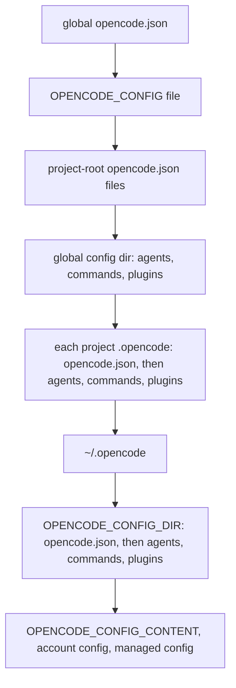

<!--
SPDX-FileCopyrightText: 2026 European Centre for Medium-Range Weather Forecasts (ECMWF)
SPDX-License-Identifier: Apache-2.0
-->

# opencode v1 mechanics

This note answers the questions about opencode 1.x that the generator, the plugin and the
installer depend on, for opencode 1.18.35 and 1.19.0. Each section gives the answer first and
the evidence after it. The last section lists what ecmwf-multi-agents does because of each
finding and what should change in the design contract.

## Method

Source: the `anomalyco/opencode` repository at tag `v1.18.35` (commit `53d1eab`) and tag
`v1.19.0` (commit `733b2c6`), downloaded with `gh api repos/anomalyco/opencode/tarball/<tag>`.
Source paths below are relative to `packages/` at `v1.18.35`. Between the two tags,
`diff -rq` over `packages/` reports changes in the upgrade and installation code, the TUI
update notice, the pty handlers, the Copilot chat converter, generated SDK files, the console
and web sites, and one config description string. Every source file cited here is identical in
both tags (checked with `cmp`), so the line numbers hold for both; the one web page cited is
the only exception and gives both line numbers.

Runtime: every command ran through `tools/sandbox.sh` in a fresh directory `$S` under a
scratch directory, once with `opencode` 1.18.35 (on the PATH) and once with the
1.19.0 build. `$C` is the sandbox config directory `$S/home/.config/opencode` and `$P` is the
test project `$S/proj`, a fresh git repository unless the text says otherwise. A command shown
as `opencode debug agent x` ran as `cd $P && tools/sandbox.sh $S $B debug agent x` for both
binaries `$B`. Both versions gave identical results everywhere; no section found a
difference.

No model was called. Where the request that opencode sends mattered (sections 3, 4, 5, 7, 10
and the step limit), the sandbox config defined a provider `mock` that uses the bundled
`@ai-sdk/openai-compatible` package with `baseURL` set to a small server on 127.0.0.1. That
server records each request body and answers with scripted text or tool calls. The config also
set `"enabled_providers": ["mock"]`, so no other provider could be reached. Sessions ran
through a sandboxed `opencode serve` on 127.0.0.1 and its HTTP API; every server was stopped
afterwards.

## Answers in one line

| # | Topic | Answer (1.18.35 and 1.19.0 alike) |
|---|---|---|
| 1 | Agent discovery | `agent/` and `agents/` in every config directory; later directories win field by field: global, project `.opencode/`, then `OPENCODE_CONFIG_DIR`; Markdown beats the global and project-root `opencode.json`, a `.opencode/opencode.json` beats global Markdown |
| 2 | Frontmatter | description, mode, model, variant, steps, color, permission, hidden, temperature, top_p, options, disable; unknown keys go to the provider as options; a `#` comment line is harmless; color is `#RRGGBB` or a theme name; one invalid value stops opencode from starting |
| 3 | Prompt | The body replaces opencode's provider prompt; the environment block, instruction files, MCP instructions and the skills list are always added |
| 4 | Permissions | Ordered map, last match wins; `X *` matches bare `X`; edit patterns match the path relative to the git root, `*` crosses `/`, and never match outside git; `question`, `todowrite`, `webfetch`, `websearch` take one action; agent rules override top-level rules; `task` and `skill` denies hide entries from the lists; `question` is denied for every agent except `build` and `plan` |
| 5 | Subagent `ask` | Shown in the root session's TUI view, which blocks input until the user answers |
| 6 | Built-in scout | None in either version; our `scout.md` defines the whole agent |
| 7 | Skills | Leaving out `description` hides a skill from the model's list; it still loads by exact name; only `name` and `description` are read |
| 8 | Plugins | `plugin/` and `plugins/`, `*.ts` and `*.js`; the `config` hook sees Markdown agents and can change or remove model, variant, steps, prompt and set `default_agent` |
| 9 | `OPENCODE_CONFIG_DIR` | Loads agents, commands, skills, plugins and `opencode.json(c)` from that directory, after global and project config, so it wins |
| 10 | Commands | description, agent, model, subtask; a command for a subagent runs as a subtask unless `subtask: false`; an empty `$ARGUMENTS` becomes an empty string |

## 1. Agent discovery and precedence

Answer. Every config directory is scanned for `agent/**/*.md` and `agents/**/*.md`; both names
work and subfolders are read. The path below that folder without `.md` is the agent name, so
`agents/sub/x.md` is the agent `sub/x`. The config directories are, in this order: the global
config directory, each project `.opencode/` from the project directory up to the git root,
`~/.opencode`, and `OPENCODE_CONFIG_DIR`. Each definition is deep-merged into what came before,
so a later file replaces only the fields it sets and earlier fields survive.

JSON `agent` entries are merged before any Markdown: first the global `opencode.json(c)`, then
the project-root `opencode.json(c)` files. A project `.opencode/opencode.json(c)` is merged
just before the Markdown of that same `.opencode/` directory. So:

- project `.opencode/agents/x.md` beats global `agents/x.md`, field by field;
- global `agents/x.md` beats `agent.x` in the global and the project-root `opencode.json`;
- `agent.x` in a project `.opencode/opencode.json` beats global `agents/x.md`.

With both `agent/x.md` and `agents/x.md` in one directory, `agents/` won in the test. The code
keeps whichever file the glob returns last, so this order is not guaranteed (UNVERIFIED beyond
this test).



Evidence, source:

- `opencode/src/config/config.ts:412-424` merges the global config, then `OPENCODE_CONFIG`,
  then project `opencode.json(c)` files; `:438-480` loops over the config directories, loads
  `opencode.json(c)` only for `.opencode` directories and `OPENCODE_CONFIG_DIR` (`:439-447`),
  then deep-merges commands, agents and modes (`:473-475`); `:482-548` merges
  `OPENCODE_CONFIG_CONTENT`, account and managed config last.
- `opencode/src/config/paths.ts:23-41` gives the directory order.
- `opencode/src/config/agent.ts:13` scans `{agent,agents}/**/*.md`; `:22` and
  `config/entry-name.ts:15-19` derive the name from the relative path.

Evidence, runtime. `$C/agents/g1.md`, `$C/agent/g2.md`, `$C/agents/sub/nested.md`,
`$C/agent/both.md` and `$C/agents/both.md`; `dup` in `$C/agents` (steps 7, color `#112233`) and
in `$P/.opencode/agents`; `mix` in `$C/agents` and the global `opencode.json` (steps 5,
temperature 0.3); `mix2` in `$C/agents` and `$P/opencode.json` (steps 9); `mix3` in `$C/agents`
and `$P/.opencode/opencode.json` (steps 11):

```text
$ opencode debug agent <name> | jq -c '{name, description, steps, temperature, color, prompt}'
{"name":"g1","description":"from global agents dir",...}
{"name":"g2","description":"from global agent dir (singular)",...}
{"name":"sub/nested","description":"nested in agents/sub",...}
{"name":"both","description":"same-name in agents/ (plural)",...,"prompt":"B"}
{"name":"dup","description":"dup from PROJECT md","steps":7,"color":"#112233","prompt":"PROJECT dup prompt"}
{"name":"mix","description":"mix from GLOBAL md","steps":5,"temperature":0.3,"prompt":"MIX md prompt"}
{"name":"mix2","description":"mix2 from GLOBAL md","steps":9,"prompt":"MIX2 md prompt"}
{"name":"mix3","description":"mix3 from PROJECT .opencode json","steps":11,"prompt":"MIX3 md prompt"}
```

## 2. Agent frontmatter

Answer. Recognised keys (`core/src/v1/config/agent.ts:12-60`):

| Key | Accepted values | Effect |
|---|---|---|
| `description` | string | Shown in the task tool's agent list and the UI |
| `mode` | `primary`, `subagent`, `all` | Custom agents default to `all` |
| `model` | `provider/model` | Split at the first `/` (`opencode/src/provider/provider.ts:2080-2086`) |
| `variant` | string | Used only while the agent runs on its own model and only if that model defines the variant (`opencode/src/session/prompt.ts:646-654`); otherwise ignored without a warning |
| `steps` (`maxSteps` is an old alias) | positive integer | Turn limit; see "Other findings" |
| `color` | `#` and six hex digits, any case, or `primary`, `secondary`, `accent`, `success`, `warning`, `error`, `info` | UI color |
| `permission` | see section 4 | Rules |
| `hidden` | boolean | Hides a subagent from the `@` menu only |
| `temperature`, `top_p` | numbers | Sampling |
| `options` | map | Provider options |
| `disable` | boolean | Removes the agent, built-ins included (`opencode/src/agent/agent.ts:268-271`) |
| `tools` | map of booleans | Old form of `permission` |
| `name` | string | Renames the agent |
| `prompt` | string | Ignored in Markdown files, where the body is the prompt |

Any other key is moved into `options` (`core/src/v1/config/agent.ts:62-66`). Agent options are
merged into the provider options of every request
(`opencode/src/session/llm/request.ts:91`, `opencode/src/session/llm.ts:316`), so a stray key
reaches the model provider. A YAML comment line is ignored: the frontmatter parser is
gray-matter (`core/src/config/markdown.ts:3-10`).

An invalid value in any agent file, for example `color: red`, `color: "#abc"` or
`color: "#0b5394ff"`, makes the whole configuration invalid. Every opencode command then fails,
including `debug agent build`, until the file is fixed.

The default profile's variants exist for their models in both versions: `opencode models
<provider> --verbose`, run in a sandbox whose config gives `anthropic` and `github-copilot` a
placeholder `apiKey` (no request is sent), lists the variants `high, low, max, medium, xhigh` for
`anthropic/claude-opus-5-5`, `anthropic/claude-sonnet-5-5` and `github-copilot/gpt-6.1-sol`. The
source agrees: Claude models after 4.7 get `low, medium, high, xhigh, max`
(`opencode/src/provider/transform.ts:657-675`).

Evidence, runtime. `$C/agents/fm1.md`:

```text
---
# managed by ecmwf-multi-agents
description: "Frontmatter probe: every documented field"
mode: primary
model: anthropic/claude-opus-5-5
variant: xhigh
steps: 15
color: "#0b5394"
temperature: 0.2
top_p: 0.9
hidden: false
foo: bar
reasoningEffort: high
permission:
  bash:
    "*": ask
    "git status *": allow
  question: allow
---
```

```text
$ opencode debug agent fm1 | jq '{model, variant, steps, color, temperature, topP, options, native}'
"model": {"providerID": "anthropic", "modelID": "claude-opus-5-5"},
"variant": "xhigh", "steps": 15, "color": "#0b5394", "temperature": 0.2, "topP": 0.9,
"options": {"foo": "bar", "reasoningEffort": "high"}, "native": false
$ opencode debug agent theme | jq -c '{color}'      # color: accent
{"color":"accent"}
$ opencode debug agent upper | jq -c '{color}'      # color: "#0B5394"
{"color":"#0B5394"}
$ opencode debug agent build                        # with color: red in another agent file
Error: Configuration is invalid at $C/agents/badcolor.md
↳ Expected a string matching the RegExp ^#[0-9a-fA-F]{6}$, got "red" color
↳ Expected "primary" | "secondary" | "accent" | "success" | "warning" | "error" | "info", got "red" color
```

## 3. Does the agent prompt replace opencode's prompt?

Answer. It replaces it. opencode sends its provider-specific prompt (for Claude models the one
that starts "You are OpenCode, the best coding agent on the planet.") only when the agent has
no prompt; an empty body therefore brings it back. The rest of the system message is added
for every agent, primary or subagent, in this order:

1. The model line and the `<env>` block: working directory, workspace root, whether it is a
   git repository, platform and date; plus configured project references.
2. Instruction files: the global `AGENTS.md` in the config directory (or `~/.claude/CLAUDE.md`),
   the first kind of project file found from the working directory up to the git root
   (`AGENTS.md`, then `CLAUDE.md`, then `CONTEXT.md`), and the config's `instructions`.
3. MCP server instructions, when servers provide them.
4. The skills list, unless the skill tool is disabled for the agent.

A per-request `system` text from the API, the structured-output instruction and, once `steps`
is reached, a "MAXIMUM STEPS REACHED" assistant message are added when they apply. A plugin can
rewrite the system prompt with `experimental.chat.system.transform`. The agents named `plan`
and `build` also get mode reminders, which do not apply to other names.

Evidence, source: `opencode/src/session/llm/request.ts:57-66`
(`...(input.agent.prompt ? [input.agent.prompt] : SystemPrompt.provider(input.model))`), `:69-73`
(plugin hook); `opencode/src/session/prompt.ts:1257-1268` (environment, instructions, MCP and
skills, in that order) and `:1281`; `opencode/src/session/system.ts:28-51` (provider prompts),
`:69-105` (environment), `:107-119` (skills); `opencode/src/session/instruction.ts:60-68`,
`:110-169` (instruction files); `opencode/src/session/reminders.ts:27-45`.

Evidence, runtime with the mock provider. `$C/agents/boss.md` has the body
`BOSS-PROMPT-MARKER`; `$C/AGENTS.md` and `$P/AGENTS.md` hold marker lines; the model id
contains `claude`. One message to `build` and one to `boss`:

```text
build: system message starts "You are OpenCode, the best coding agent on the planet."
boss:  system message (lines left out are marked ...):
BOSS-PROMPT-MARKER
You are powered by the model named claude-mock. The exact model ID is mock/claude-mock
Here is some useful information about the environment you are running in:
<env>
  Working directory: $S/proj
  Workspace root folder: $S/proj
  Is directory a git repo: yes
  ...
</env>
Instructions from: $C/AGENTS.md
GLOBAL-AGENTS-MD-MARKER

Instructions from: $S/proj/AGENTS.md
PROJECT-AGENTS-MD-MARKER

Skills provide specialized instructions and workflows for specific tasks.
Use the skill tool to load a skill when a task matches its description.
<available_skills>
  <skill>
    <name>customize-opencode</name>
    ...
  <skill>
    <name>flagged</name>
    ...
</available_skills>
boss: occurrences of "You are OpenCode": 0
helper (a subagent reached through the task tool): starts "HELPER-PROMPT-MARKER\nYou are powered by",
  both AGENTS.md markers present, skills list present
```

## 4. Permissions

### 4.1 Form and order

Answer. `permission` maps a key to an action (`allow`, `ask`, `deny`) or to an ordered map of
pattern to action; a bare action is short for `{"*": action}`. opencode turns the map into a
list, keys in written order and patterns in written order, and evaluates it with "last
matching rule wins"; with no match the answer is `ask`. Patterns that start with `~/` or
`$HOME` are expanded. A tool disappears from the model's tool list when the last rule for its
key is `"*": deny`; the `edit` key also governs `write` and `apply_patch`.

Evidence: `opencode/src/permission/index.ts:28-38` (`findLast`, default `ask`), `:178-198`
(expansion and map to list), `:204-214` (tool removal); `core/src/util/wildcard.ts:3-14`.

### 4.2 Does `git push *` match a bare `git push`?

Answer. Yes. A pattern that ends in a space and `*` also matches the text without the
trailing part. The shell tool checks each simple command of a command line separately, using
that command's own text. The match is on literal text: extra spaces or another spelling of the
same command do not match.

Evidence, source: `core/src/util/wildcard.ts:11` rewrites a trailing ` .*` as `( .*)?`;
`opencode/src/tool/shell.ts:392-410` adds one pattern per simple command.

Evidence, runtime. `debug agent --tool` runs a tool call through the agent's rules and fails
on `deny` (`opencode/src/cli/cmd/debug/agent.handler.ts:182-191`). Agent `perm1` has
`bash: {"*": allow, "echo hi *": deny}`:

```text
$ opencode debug agent perm1 --tool bash --params '{"command":"<cmd>","description":"t"}'
echo hi          -> denied ("The user has specified a rule which prevents you from using ...")
echo hi there    -> denied
ls && echo hi    -> denied
echo hix         -> ran
echo  hi         -> ran (two spaces)
```

### 4.3 How `edit` path patterns match

Answer. The edit, write and apply_patch tools check the file path relative to the project
worktree. The worktree is the git root; for a directory outside any git repository it is `/`.
`*` matches across `/`. So `.ecmwf-multi-agents/notes/*`:

- allows `notes/a.md` and `notes/deep/b.md` under the git root;
- does not allow `sub/.ecmwf-multi-agents/notes/x.md` when opencode runs in the subfolder
  `sub` of the repository;
- never matches in a directory outside git, because the path checked there is the absolute
  path without its leading `/`.

Adding `*/.ecmwf-multi-agents/notes/*` covers both gaps.

Evidence, source: `opencode/src/tool/write.ts:56`, `opencode/src/tool/edit.ts:104`,
`opencode/src/tool/apply_patch.ts:205` (`path.relative(instance.worktree, ...)`);
`opencode/src/project/project.ts:217` (worktree `/` outside git); `core/src/util/wildcard.ts:8`
(`*` becomes `.*`).

Evidence, runtime. Agent `notes` has `edit: {"*": deny, ".ecmwf-multi-agents/notes/*": allow}`;
`notes2` adds `"*/.ecmwf-multi-agents/notes/*": allow`. `$S/nogit` is not a git repository.

```text
$ opencode debug agent notes --tool write --params '{"filePath":"<abs path>","content":"x"}'
cwd proj      proj/.ecmwf-multi-agents/notes/a.md        -> written
cwd proj      proj/.ecmwf-multi-agents/notes/deep/b.md   -> written
cwd proj      proj/.ecmwf-multi-agents/plans/p.md        -> denied
cwd proj      proj/c.md                                  -> denied
cwd proj/sub  proj/sub/.ecmwf-multi-agents/notes/d.md    -> denied
cwd proj/sub  proj/.ecmwf-multi-agents/notes/e.md        -> written
cwd nogit     nogit/.ecmwf-multi-agents/notes/f.md       -> denied
$ opencode debug agent notes2 --tool write ...
cwd proj/sub  proj/sub/.ecmwf-multi-agents/notes/d.md    -> written
cwd nogit     nogit/.ecmwf-multi-agents/notes/f.md       -> written
cwd nogit     nogit/other.md                             -> denied
```

### 4.4 Keys that take one action only

Answer. `question`, `todowrite`, `webfetch`, `websearch` and `doom_loop` accept only an
action. A pattern map for any of them makes the whole configuration invalid. Every other key,
including `read`, `edit`, `glob`, `grep`, `list`, `bash`, `task`, `external_directory`, `lsp`,
`skill` and unknown keys, accepts both forms.

Evidence, source: `core/src/v1/config/permission.ts:17-36`. Runtime, one sandbox per key:

```text
$ opencode debug agent flatobj        # permission: {question: {"*": deny}}
Error: Configuration is invalid at $C/agents/flatobj.md
↳ Expected PermissionActionConfig | undefined, got {"*":"deny"} permission.question
(the same error for todowrite, webfetch, websearch and doom_loop)
```

### 4.5 Agent rules and top-level rules

Answer. An agent's list is opencode's defaults, then the top-level `permission` of the merged
config, then the agent's own rules. In a subagent session the session's rules come last: the
parent session's deny and `external_directory` rules, plus the `task` and `todowrite` denies of
section 4.8. Because the last match wins, an agent rule beats any top-level rule it matches.
That includes a broad `"*"` rule in the agent, which beats every specific top-level rule for
the same key.

Evidence, source: `opencode/src/agent/agent.ts:119-138` (defaults, top-level rules),
`:267-294` (agent rules appended), `:296-310` (one more `external_directory` allow for the
tool-output folder); `opencode/src/session/tools.ts:87` (agent rules, then session rules).

Evidence, runtime. Top-level `permission: {bash: {"echo top *": deny}}`; agent `perm2` has
`bash: {"echo top *": allow}`; agent `perm1` has `bash: {"*": allow, "echo hi *": deny}`:

```text
$ opencode debug agent perm2 --tool bash ... "echo top"   -> ran
$ opencode debug agent perm1 --tool bash ... "echo top"   -> ran (its "*" allow comes later)
$ opencode debug agent perm1 | jq -c '.permission[] | [.permission, .pattern, .action]'
["*","*","allow"] ["doom_loop","*","ask"] ["external_directory","*","ask"] ...
["question","*","deny"] ["plan_enter","*","deny"] ["plan_exit","*","deny"] ["read","*","allow"] ...
["bash","echo top *","deny"]          <- top-level
["bash","*","allow"] ["bash","echo hi *","deny"]          <- agent
["external_directory","$S/home/.local/share/opencode/tool-output/*","allow"]
```

### 4.6 Does `task: {"*": "deny", "scout": "allow"}` hide other subagents?

Answer. Yes. The task tool's description lists only agents that are not `primary` and that the
calling agent's `task` rules do not deny. A call to a denied agent fails. `hidden` does not
remove a subagent from this list. Two paths skip the `task` check on purpose: a user message
that mentions an agent with `@`, and a command that runs as a subtask.

Evidence, source: `opencode/src/tool/registry.ts:265-278`; `opencode/src/tool/task.ts:119-129`;
`opencode/src/session/prompt.ts:331` and `:1223` (`bypassAgentCheck`).

Evidence, runtime. Agent `boss` (primary) has `task: {"*": deny, helper: allow}`;
`plainprimary` has no rules. With `default_agent` set to each in turn,
`GET /experimental/tool?provider=anthropic&model=claude-opus-5-5` on `opencode serve` describes
the task tool for the default agent:

```text
default_agent=boss:          Available agent types ...: - helper
default_agent=plainprimary:  - explore - general - helper - notes - notes2 - perm1 - perm2
$ opencode debug agent boss --tool task --params '{"description":"d","prompt":"p","subagent_type":"general"}'
-> denied (explore: denied)
$ ... "subagent_type":"helper"
-> passes the check, then "TaskTool requires promptOps in ctx.extra" (the debug runner has no session loop)
```

The mock run shows the same list in the real request: boss's task tool lists `denier` and
`helper` only, while build's lists `denier`, `explore`, `general` and `helper`.

### 4.7 Do `skill` deny patterns hide skills?

Answer. Yes, from that agent's skills list, and the skill tool refuses to load them.

Evidence, source: `opencode/src/skill/index.ts:310-316` (list filtered by `skill` rules);
`opencode/src/tool/skill.ts:27-32` (check before loading). Runtime: with
`skill: {"*": allow, "visible-*": deny}`, boss's system message lists `customize-opencode` and
`flagged` but not `visible-skill`, while build's lists all three (mock run, section 3);
`opencode debug agent skiller --tool skill --params '{"name":"visible-skill"}'` is denied.

### 4.8 What does `question` default to?

Answer. `deny` for every agent except the built-in `build` and `plan`, so a custom primary
agent such as `lead` needs `question: allow`. Subagents are denied by the same default. A
subagent session also denies `task` and `todowrite` unless the subagent's own rules mention
those keys, and `subagent_depth` defaults to 1, so a subagent cannot start another one.

Evidence, source: `opencode/src/agent/agent.ts:126` (default `question: deny`), `:148` and
`:163` (`build` and `plan` allow it), `:273-280` (custom agents start from defaults and
top-level rules); `opencode/src/agent/subagent-permissions.ts:14-27`;
`opencode/src/tool/task.ts:111`, `:139-171`. Runtime:

```text
$ opencode debug agent <name> | jq -c '{question: .tools.question}'
plainprimary {"question":false}   helper {"question":false}   build {"question":true}
mock run, tools offered to helper inside a task: bash,edit,glob,grep,read,skill,webfetch,write
```

## 5. A subagent hits an `ask` rule

Answer. The request reaches the user. opencode publishes it with the child session's id and
waits. The TUI's session view collects pending requests of the root session and of its direct
child sessions, shows the first one as a prompt and disables the input until it is answered.
Inside a child session's own view the prompt is not shown; it appears in the root session's
view.

Evidence, source: `opencode/src/permission/index.ts:67-107`;
`tui/src/routes/session/index.tsx:206-241` (requests of the root and its children, input
disabled) and `:1297-1302` (prompt shown).

Evidence, runtime with the mock provider: `boss` calls the task tool for `helper`, whose
rules are `bash: {"*": ask}`, and `helper` calls `bash`:

```text
GET /permission
{"sessionID":"ses_..B06ffe..","permission":"bash","patterns":["echo hello-from-subagent"],"always":["echo *"]}
GET /session/<root>/children
{"id":"ses_..B06ffe..","parentID":"<root>","title":"probe task (@helper subagent)"}
POST /permission/<id>/reply {"reply":"reject"}  -> HTTP 200, nothing pending afterwards
```

"Allow always" is wider than it looks: see "Other findings".

## 6. The built-in `scout`

Answer. Neither version has a built-in `scout`. Upstream added one on 2026-05-09 (commit
`40d5ea1cf1`, "feat(core): add scout agent for repo research (#24149)") and removed it on
2026-06-02 (commit `a639fe7a08`, "chore(opencode): remove scout agent (#30435)"), both found
with `gh api search/commits`. The web docs at both tags still describe it
(`web/src/content/docs/agents.mdx:39`, `:87-91`) and list an `OPENCODE_EXPERIMENTAL_SCOUT` flag
(`web/src/content/docs/cli.mdx:733` at `v1.18.35`, `:740` at `v1.19.0`) that nothing in the code
reads. Our `scout.md` therefore defines the whole agent: `native` is `false` and nothing is
inherited except opencode's default rules, which every custom agent gets.

If a future 1.x adds a built-in with one of our names, the merge is field by field: our
description, prompt, model, variant, steps and color replace the built-in's, the built-in's
rules stay and ours follow them (so ours win), and `native` stays `true`. Overriding the
built-in `explore` shows this today.

Evidence, source: `opencode/src/agent/agent.ts:140-265` (built-ins: build, plan, general,
explore, compaction, title, summary) and `:267-294` (merge). Runtime:

```text
$ opencode debug agent scout                                  # before
Agent scout not found, run 'opencode.exe agent list' to get an agent list
$ OPENCODE_EXPERIMENTAL_SCOUT=1 OPENCODE_EXPERIMENTAL=1 opencode debug agent scout
Agent scout not found, ...
$ opencode agent list
build (primary) compaction (primary) explore (subagent) general (subagent) plan (primary) summary (primary) title (primary)

# after writing the emitV1 output for the manifest's scout to $C/agents/scout.md
$ opencode debug agent scout | jq -c '{name, mode, native, model, variant, steps, options}'
{"name":"scout","mode":"subagent","native":false,"model":{"providerID":"anthropic","modelID":"claude-sonnet-5-5"},
 "variant":"medium","steps":15,"options":{}}
tools: {"bash":true,"edit":false,"write":false,"task":false,"question":false,"todowrite":false,"skill":true}

# explore before and after $C/agents/explore.md (steps 15, bash {"*": deny, "ls *": allow})
{"native":true,"description":"Fast agent specialized ...","prompt":"You are a file search specialist...","steps":null,
 "rules":["* * allow","question * deny","* * deny","grep * allow",...,"websearch * allow"]}
{"native":true,"description":"OUR explore","prompt":"OUR EXPLORE PROMPT","steps":15,
 "rules":["* * allow","question * deny","* * deny","grep * allow",...,"websearch * allow","bash * deny","bash ls * allow"]}
```

## 7. Skills

Answer. Skills are read from `skill/**/SKILL.md` and `skills/**/SKILL.md` in every config
directory, from `.claude/skills` and `.agents/skills` in the home directory and in the folders
from the project up to the git root, and from `skills.paths` and `skills.urls` in the config.
Only two frontmatter keys are read: `name` (required; it is the skill's identity, whatever the
folder is called) and `description`.

A skill without `description` is left out of the model's skills list but still loads by its
exact name through the skill tool. Nothing else hides a skill: `hidden: true` is ignored. A
description-less skill still appears in the TUI's `/skills` dialog (without a description) and
can be run by typing `/name`. Skills never appear in the slash-command autocomplete. A
`skill` deny rule hides a skill from that agent's list and blocks loading it (section 4.7).

Evidence, source: `opencode/src/skill/index.ts:21-24` (patterns), `:53-58` (frontmatter
check), `:186-227` (locations), `:321-346` (`fmt` drops skills without a description);
`opencode/src/tool/skill.ts:23-32` (loads any known name);
`opencode/src/command/index.ts:134-152` (skills become commands);
`tui/src/component/prompt/autocomplete.tsx:451` (left out of autocomplete);
`tui/src/component/dialog-skill.tsx:21-48` (dialog lists every skill).

Evidence, runtime. `$C/skills/visible-skill` (name and description), `$C/skills/hidden-skill`
(name and the marker comment only), `$C/skills/flagged` (with `hidden: true`),
`$C/skill/singular`, and `$C/skills/dirname` whose name is `othername`:

```text
$ opencode debug skill | jq -c '.[] | {name, description}'
{"name":"singular",...} {"name":"flagged","description":"Has hidden true in frontmatter."}
{"name":"visible-skill",...} {"name":"hidden-skill","description":null} {"name":"othername",...}
$ opencode debug agent build --tool skill --params '{"name":"hidden-skill"}' | jq -r .result.output
<skill_content name="hidden-skill">
# Skill: hidden-skill

HIDDEN BODY
mock run, build's skills list: customize-opencode, flagged, visible-skill   (no hidden-skill)
```

## 8. Plugins

Answer. Every config directory is scanned for `plugin/*.ts`, `plugin/*.js`, `plugins/*.ts`
and `plugins/*.js`, without subfolders; `.mjs` files are not loaded. Two module shapes work:
named exports that are all plugin functions (`export const P = async (input) => hooks`), or
`export default { id, server }`, where a file plugin must give `id`. Plugins load before any
other service reads the config, and the `config` hook receives the live merged config, with
Markdown agents already in `cfg.agent` (model and variant as written, prompt as `prompt`).
Changes made there are what the agents and `debug config` show: the hook can set `model`,
`variant`, `steps` and `prompt`, delete `model` and `variant` (the agent then uses the session
model), add agents and set `default_agent`. This holds for `opencode debug` commands too,
because they run the same start-up.

The `permission.ask` hook is declared in the plugin types but v1 never calls it, so a plugin
cannot change a permission decision; `tool.execute.before` is called before every tool and can
stop one by throwing.

opencode writes a `.gitignore` into every config directory it reads and starts a background
npm install of `@opencode-ai/plugin` there, which writes `package.json`, `package-lock.json`
and `node_modules/` and needs network access. When plugins are configured, start-up waits for
that install (the first start in the sandbox took 18 seconds); short commands without plugins
exit before it finishes, and only the `.gitignore` appeared in those sandboxes. When none of `OPENCODE_CONFIG`,
`OPENCODE_CONFIG_DIR` and `OPENCODE_CONFIG_CONTENT` is set, opencode also creates
`opencode.jsonc` in the global config directory if no config file exists there.

Evidence, source: `opencode/src/config/plugin.ts:21`; `opencode/src/plugin/index.ts:88-124`
(shapes), `:244-252` (`config` hook); `opencode/src/plugin/shared.ts:272-323`;
`opencode/src/project/bootstrap.ts:36-38` ("Plugin can mutate config so it has to be
initialized before anything else."); `opencode/src/config/config.ts:450-471` (dependency
install), `:262-271` (seed file); `plugin/src/index.ts:225`, `:261`.

Evidence, runtime. `$C/agents/lead.md` (`anthropic/claude-opus-5-5`, `xhigh`, body ending
`Review policy: auto`), `$C/agents/scout.md` (`claude-sonnet-5-5`, `medium`, steps 15),
`$C/plugins/probe.ts` with a `config` hook that records what it sees, then sets lead's model,
variant, steps and prompt, deletes scout's model and variant, adds an agent and sets
`default_agent`; `$C/plugin/second.js`, `$C/plugins/third.mjs` and `$C/plugins/modshape.ts`
(default-export shape) write marker files:

```text
seen by the hook: {"agents":["lead","scout"],"default_agent":null,"lead_model":"anthropic/claude-opus-5-5","lead_variant":"xhigh"}
$ opencode debug agent lead | jq -c '{model, variant, steps, prompt}'
{"model":{"providerID":"github-copilot","modelID":"gpt-6.1-sol"},"variant":"high","steps":42,"prompt":"LEAD PROMPT\nReview policy: never"}
$ opencode debug agent scout | jq -c '{model, variant, steps}'
{"model":null,"variant":null,"steps":15}
$ opencode debug agent added-by-plugin | jq -c '{mode, prompt, native}'
{"mode":"subagent","prompt":"ADDED","native":false}
$ opencode debug config | jq -c '{default_agent, plugin}'
{"default_agent":"lead","plugin":[".../plugins/modshape.ts",".../plugins/probe.ts",".../plugin/second.js"]}
marker files written: modshape-loaded.txt, second-loaded.txt (none for third.mjs)
```

## 9. `OPENCODE_CONFIG_DIR`

Answer. The directory is treated like a project `.opencode/`: its `opencode.json(c)`, agents,
commands, skills and plugins are all loaded, in addition to the global config directory. It
comes after the global config directory, the project-root `opencode.json` and every project
`.opencode/`, so its values win field by field over all of them. Only
`OPENCODE_CONFIG_CONTENT`, account config and managed config come later.

Evidence, source: `opencode/src/config/paths.ts:39` (last directory);
`opencode/src/config/config.ts:439-447` (its `opencode.json(c)`), `:473-479` (agents, commands,
plugins); `opencode/src/skill/index.ts:205-208` (skills from every config directory).

Evidence, runtime. `lead` defined in `$C/agents` (steps 1), `$P/.opencode/agents` and
`$S/central/agents`; `default_agent` is `build` in the global `opencode.json`, `plan` in
`$P/opencode.json` and `lead` in `$S/central/opencode.json`. `$S/central` also holds an agent,
a command, a skill and a plugin. The variable is passed after the sandbox wrapper, which clears
it:

```text
$ opencode debug agent lead | jq -c '{description, steps, prompt}'
{"description":"lead from PROJECT .opencode","steps":1,"prompt":"PROJECT LEAD"}
$ opencode debug config | jq -c '{default_agent}'
{"default_agent":"plan"}
$ tools/sandbox.sh $S env OPENCODE_CONFIG_DIR=$S/central $B debug agent lead | jq -c ...
{"description":"lead from OPENCODE_CONFIG_DIR","steps":1,"prompt":"CENTRAL LEAD"}
... debug agent central-agent   -> {"name":"central-agent","description":"only in OPENCODE_CONFIG_DIR","steps":3}
... debug config                -> {"default_agent":"lead","central_cmd":{"description":"command from OPENCODE_CONFIG_DIR",
                                    "agent":"lead",...},"plugins":["central.ts"]}
... debug skill                 -> [{"name":"central-skill","description":"skill from OPENCODE_CONFIG_DIR"}]
central plugin marker file written
```

## 10. Commands

Answer. Commands are read from `command/**/*.md` and `commands/**/*.md` in every config
directory. Frontmatter keys: `description`, `agent`, `model`, `variant` and `subtask`; the body
is the template. `variant` passes validation but is not carried into the command, so it has no
effect. A command whose agent is a subagent runs as a subtask (a child session) unless it says
`subtask: false`; `subtask: true` also runs a primary agent's command in a child session. The
parent turn then stays with the current or default agent. A subtask receives the expanded
template text; `@` references in it are resolved again in the child session, while files the
user attached to the command are not passed on.

Arguments: `$ARGUMENTS` is replaced by the raw argument string, so with no arguments it becomes
an empty string. `$1`, `$2` and so on take single arguments, and the highest one used takes
the rest. A template without any placeholder gets non-empty arguments appended after a blank
line. A config command with the name of a built-in (`init` or `review`) replaces the built-in.

Templates have two side effects worth knowing. `` !`cmd` `` runs `cmd` in the user's shell
when the command expands, without permission checks. `@name` attaches the file or folder at
that path, or, when no such path exists and `name` is an agent, adds a mention of that agent.
Task prompts written by an agent go through the same `@` resolution.

Evidence, source: `core/src/v1/config/command.ts:5-12`; `opencode/src/config/command.ts:15`;
`opencode/src/command/index.ts:70-103` (built-ins, then config commands without `variant`);
`opencode/src/session/prompt.ts:1371-1395` (arguments), `:1397-1408` (shell substitution),
`:1439-1455` (subtask rule and parent agent), `:157-191` (`@` resolution);
`opencode/src/tool/task.ts:201`.

Evidence, runtime with the mock provider. Commands in `$C/commands`: `sub-cmd` (agent
`helper`, a subagent, no `subtask`, template `SUBCMD args=[$ARGUMENTS] one=[$1]`),
`primary-cmd` (agent `boss`, `subtask: true`), `plain-cmd` (agent `boss`, no placeholders) and
`nosub-cmd` (agent `helper`, `subtask: false`), run with `POST /session/<id>/command`:

```text
/sub-cmd ""        root: {"agent":"boss","parts":[{"type":"subtask","agent":"helper","text":"SUBCMD args=[] one=[]"}]}
                   child session "command whose agent is a subagent (@helper subagent)", agent helper
/sub-cmd "a b c"   child text: "SUBCMD args=[a b c] one=[a b c]"
/primary-cmd ""    root: {"type":"subtask","agent":"boss",...}; child session runs boss
/plain-cmd "extra words"  root text: "PLAINCMD no placeholders\n\nextra words", no child session
/nosub-cmd "x"     root: {"agent":"helper","parts":[{"type":"text","text":"NOSUBCMD args=[x]"}]}, no child session
```

## Other findings

Step limit. `steps` is a soft limit. From the turn that reaches it, opencode adds the "MAXIMUM
STEPS REACHED" message on every turn, but it still offers all tools and does not end the loop.
A model that ignores the message keeps going. Source: `opencode/src/session/prompt.ts:1178-1179`,
`:1281`. Runtime with the mock replying to every turn with the same bash call, agent
`looper` with `steps: 2`: the message appears from the second request on, with 10 tools still
offered, and the session ran 9 requests in 8 seconds (8 on 1.19.0) until aborted.

"Allow always" applies to every agent. Approvals given with "Allow always" are kept for the
whole opencode process, for all sessions and agents, and are checked after the agent's rules.
So they override a deny rule of any other agent until opencode restarts. Source:
`opencode/src/permission/index.ts:68-73` (`evaluate(..., ruleset, approved)`), `:145-151`;
the TUI says "This will allow ... until OpenCode is restarted"
(`tui/src/routes/session/permission.tsx:144-148`). Runtime with the mock provider, one server:

```text
denier (bash {"*": allow, "echo *": deny}) runs "echo hello-from-subagent"
  -> error: The user has specified a rule which prevents you from using this specific tool call
helper asks for the same command; reply "always" (always: ["echo *"])
denier runs it again in a new session -> completed: hello-from-subagent
```

Discovery outside git walks up to `/`. For a directory outside git the worktree is `/`, so the
searches for `.opencode/` directories, project `opencode.json` files, instruction files and
`.claude`/`.agents` skill folders continue up to the file system root. In one sandbox project
without git, a `.claude/skills` folder in a parent directory of the sandbox was picked up. The
integration test therefore sets `OPENCODE_DISABLE_PROJECT_CONFIG`,
`OPENCODE_DISABLE_EXTERNAL_SKILLS` and `OPENCODE_DISABLE_CLAUDE_CODE`. Source:
`opencode/src/config/paths.ts:28-32`, `opencode/src/skill/index.ts:196-202`.

Default agent. Without `default_agent`, `build` handles a message that names no agent, and the
agent list puts `build` first. Source: `opencode/src/agent/agent.ts:316-340`.
Runtime: with `default_agent` removed, `POST /session/<id>/message` without `agent` was handled
by `build`; `GET /agent` listed `build,boss,looper,plan`.

## Consequences for ecmwf-multi-agents

What the v1 emitter (`tools/emit-v1.ts`) does because of these findings:

- Writes `agents/<id>.md`, `commands/<id>.md` and `skills/<id>/SKILL.md`, the plural folder
  names, for any config directory (global, project `.opencode/` or `OPENCODE_CONFIG_DIR`).
  Ids must be single path segments, because a `/` would create a nested name (section 1).
- Writes only known frontmatter keys, because unknown ones reach the provider (section 2).
- Checks every value that could make opencode refuse to start: `steps` must be a positive
  integer, `model` must be `provider/model`, a `variant` needs a `model` (it is ignored
  otherwise), and a color is written only when it is `#RRGGBB` or a theme name; any other
  color is left out (section 2).
- Puts the marker comment first in the frontmatter of every file, which opencode ignores
  (sections 2 and 7).
- Refuses an empty agent prompt, because opencode would then send its own prompt (section 3).
- Maps actions `shell` to `bash`, `delegate` to `task`, `todo` to `todowrite`, the rest by
  name; groups rules per key in order of first appearance and keeps their order within a key;
  moves a repeated pattern to its latest position, which keeps "last match wins" exact; and
  refuses a pattern such as `"1"` that a JavaScript object would reorder (section 4.1).
- Writes `question`, `todowrite`, `webfetch` and `websearch` as one action, the last one
  given, and throws if a rule for them names a resource other than `*` (section 4.4).
- Writes `X *` patterns unchanged, since they already cover a bare `X` (section 4.2).
- Writes `subtask: true` when set, and `subtask: false` when a command for a subagent is not a
  subtask, because opencode would otherwise run it as one (section 10).
- Leaves out `description` for hidden skills (section 7).
- Sorts files by path and writes LF line endings with one final newline.

Proposed changes to `src/manifest.jsonc`:

1. `scout-deep`: add `{ "action": "edit", "resource": "*/.ecmwf-multi-agents/notes/*",
   "effect": "allow" }` after the existing notes rule. Without it, notes cannot be written when
   opencode runs in a subfolder of a repository or outside git (section 4.3).
2. `builder` and `builder-deep`: v1 denies `todowrite` in every subagent session unless the
   subagent's rules mention it (section 4.8), so "Todo list: user policy" does not hold.
   Either add `{ "action": "todo", "resource": "*", "effect": "allow" }` (this overrides a user's
   top-level deny), or leave builders without a todo list and change the architecture table.
3. Keep agent colors in `#RRGGBB`: the v2 emitter accepts only that form, and v1 treats any
   other value as a configuration error.

Proposed changes to `docs/architecture.md`:

1. Permissions: agent rules come after the user's top-level rules, so every `allow` or `ask` in
   an agent overrides the user's policy for what it matches. The exceptions are therefore
   wider than the three listed: also `scout-deep`'s notes edits, the reviewer's `gh pr` reads
   and the `ask` rules on `lead` (which turn a user's `allow` or `deny` for push, PR and merge
   into a question). Say so, or narrow those rules.
2. Permissions: "Allow always" in v1 lasts until opencode restarts and applies to every agent,
   overriding helper denies. The guide should tell users to answer "Allow once" for push, PR,
   merge and history rewrites. The plugin can add a `tool.execute.before` guard that stops
   git and `gh` writes in helper sessions; `permission.ask` cannot be used, because v1 never
   calls it.
3. Roles: steps are a soft limit in v1; they rely on the model obeying the
   "MAXIMUM STEPS REACHED" message.
4. Prompts: an agent prompt replaces opencode's own system prompt, so `lead` and the helpers
   get none of opencode's built-in guidance on tool use, safety or style; they do get the
   environment block, the user's `AGENTS.md` and `CLAUDE.md`, and the skills list. Budgets
   cover our text only.
5. Skills: hidden skills are missing from the model's list, and the skill tool's description
   says names come from that list. Prompts that need a hidden skill must name it exactly and say
   to load it with the skill tool.
6. Commands and briefs: avoid `` !`...` `` in command templates (it runs a shell command
   without permission checks) and `@name` in templates and briefs unless a file attachment or
   an agent mention is meant. `/review` replaces opencode's built-in `/review`.
7. Source and output: generated commands and skills carry the marker comment too, not only
   agents, so the installer can recognise all of its files.
8. Settings: without the plugin or a `default_agent` in config, `build` stays the default
   agent, so the installer or plugin must set `default_agent` for `lead`. The `config` hook can
   do everything the plugin needs: apply the profile and per-agent overrides, remove a model to
   fall back to the session model, rewrite the `Review policy:` line and set `default_agent`.
9. Profiles: under a profile that leaves a helper without a model, the task tool passes the
   parent message's variant to the helper, so helpers run at `lead`'s reasoning effort.
10. Install layout: agents in `OPENCODE_CONFIG_DIR` override the same fields in a project's
    `.opencode/agents/`, and its `opencode.json` overrides the project's. A central install
    there should therefore carry no `opencode.json` keys, and per-project changes should go
    through the settings file, which the plugin applies in the `config` hook after every config
    layer has loaded. opencode writes `.gitignore` into every config directory it reads and
    installs `@opencode-ai/plugin` there over the network (section 8). In a read-only
    directory these writes fail; the code logs the failure and carries on
    (`opencode/src/config/config.ts:309-326`, `:452-470`), so a plugin that imports nothing
    from `@opencode-ai/plugin` at run time should still load (UNVERIFIED: not tested on a
    read-only directory).
