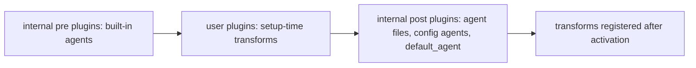

<!--
SPDX-FileCopyrightText: 2026 European Centre for Medium-Range Weather Forecasts (ECMWF)
SPDX-License-Identifier: Apache-2.0
-->

# opencode v2 (2.0.16) mechanics

This note answers the v2 questions behind the generator, plugin and installer. Every answer
was checked against opencode 2.0.16 itself; where the current v2 documentation at
<https://opencode.ai/v2/docs> differs from 2.0.16, the note says so.

## Method and conventions

- Binary: `@opencode/cli@2.0.16` from npm (`opencode2 --version` prints `opencode v2.0.16`).
  Plugin types: `@opencode/plugin@2.0.16`. v1 comparison binary: `opencode` 1.18.35.
- Source: repository `anomalyco/opencode`, tag `v2.0.16`, commit
  `3a103fe0aff726a4edc7492f03f7b88195d9e4c9` (root `package.json` says `"version": "2.0.16"`).
  `src:` paths below are relative to `packages/` at that commit. v1 source: tag `v1.18.35`,
  commit `53d1eabb61e21162157817bf677da0a4ad3332e3`, cited as `v1src:`.
- `types:` paths are relative to `node_modules/@opencode/` of the 2.0.16 npm install.
- Every binary ran through `tools/sandbox.sh DIR ...` with a fresh `DIR`. Config files went to
  `DIR/home/.config/opencode/`. Paths in excerpts are shortened to `DIR`.
- Inspection recipe (the integration test does the same):

  ```sh
  cd DIR/project
  OPENCODE_PASSWORD=<random> OPENCODE_DISABLE_PROJECT_CONFIG=1 OPENCODE_DISABLE_MODELS_FETCH=1 \
    tools/sandbox.sh DIR opencode2 serve --hostname 127.0.0.1 --port 0
  curl -u opencode:<random> "http://127.0.0.1:PORT/api/agent?location%5Bdirectory%5D=DIR/project"
  ```

  `/api/command`, `/api/skill`, `/api/plugin` and `/api/config` work the same way. Plugins
  activate after the server starts listening, so the first requests can return an empty list;
  poll until the agents appear. `opencode2 api --standalone GET /api/agent` hits that race
  (`{"location":{...},"data":[]}`). `opencode2 debug agents` and `debug config` exist but start
  a detached background service (`opencode.exe serve --service`) that must be stopped with
  `opencode2 service stop`.
- `OPENCODE_DISABLE_PROJECT_CONFIG=1` matters for isolation: without it, 2.0.16 walks from the
  working directory up to `/` and reads every `.opencode/`, `.claude/`, `.agents/` and
  `opencode.json(c)` on the way (`src: core/src/config/discovery.ts:33-50`), including ones
  above the sandbox.
- System prompt checks used a local stub that speaks the OpenAI chat-completions protocol on
  127.0.0.1 and records each request body. It was configured as provider `stub` with package
  `@opencode/ai/providers/openai-compatible`; one session per agent was created with
  `POST /api/session` and prompted once with `POST /api/session/:id/prompt`. No hosted model was
  contacted.

## 1. File-based agents

Answer:

- Locations: `agents/` or `agent/` (any depth; a nested path becomes part of the id, such as
  `nested/inner`) and `modes/` or `mode/` (top level only, always primary), inside every config
  directory: the global one (`$XDG_CONFIG_HOME/opencode`, default `~/.config/opencode`) and every
  `.opencode/` found on the walk from the working directory up to `/`.
- Format: Markdown with YAML frontmatter. The trimmed body becomes the agent's `system` prompt.
- Native frontmatter keys: `description`; `mode` (`primary`, `subagent` or `all`; a new custom
  agent defaults to `primary`); `model` as `provider/model` or `provider/model#variant` (a
  separate `variant` key is accepted only next to a string `model` without `#`, and is joined
  into it); `steps` (positive integer); `color` (`#RRGGBB` only); `hidden`; `disabled`;
  `request`; `permissions`, an ordered list of `{action, resource, effect}`.
- The comment line `# managed by ecmwf-multi-agents` is ignored by the YAML parser; the file
  still loads as a native agent.
- Unknown keys: one key outside the native set makes 2.0.16 read the whole file as a v1 agent.
  On that path unknown keys go into `request.body` (stored, not sent), and a native
  `permissions` list and a `#variant` model are both lost.
- Invalid values (`color: primary`, `steps: 0`) make 2.0.16 drop the whole file without a
  message.

Evidence:

- Loader: `src: core/src/config/plugin/agent.ts:21-24` (`{agent,agents}/**/*.md`,
  `{mode,modes}/*.md` with `primary: true`), `:180-185` (id from the relative path), `:186`
  (`legacy` when any key is not native), `:189-195` (variant joined as `model#variant`), `:203`
  (`system: body`), `:204` (`if (!agent) return`: invalid files vanish). Native schema:
  `src: schema/src/config/agent.ts:9-22`; model syntax `src: schema/src/config/model.ts:8-18`.
  v1 path: `src: core/src/v1/config/agent.ts:43-49` (unknown keys into `options`) and
  `src: core/src/v1/config/migrate.ts:141-163` (`options` into `request.body`, legacy model
  selection rejects `#` at `:181-182`).
- Sandbox with `agents/lead.md` (`model: "anthropic/claude-opus-5-5#xhigh"`, marker comment,
  `permissions` list), `agents/scout.md` (`model` plus `variant: medium`, `steps: 15`) and edge
  cases, read through `/api/agent`:

  ```text
  lead primary hidden=False model={'id': 'claude-opus-5-5', 'providerID': 'anthropic', 'variant': 'xhigh'} color=#0b5394 system='LEAD BODY LINE ONE.\nSecond line.'
  scout subagent model={'id': 'claude-sonnet-5-5', 'providerID': 'anthropic', 'variant': 'medium'} steps=15
  hidden-one subagent hidden=True
  nested/inner subagent
  unknownfield subagent steps=5 request={"body": {"foo": "bar"}}
  (badcolor with color: primary and badsteps with steps: 0 are absent)
  ```

- A native file with one extra key (`team: science`) next to `model: "...#high"` and a
  `permissions` list:

  ```text
  model= None body= {"team": "science", "permissions": [{"action": "edit", "resource": "*", "effect": "deny"}]}
  agent rules= [('shell', 'rm *', 'deny')]   (only the global rule; the agent's own rule is gone)
  ```

- `request.body` is not sent: an agent with `foo: bar-unknown-marker` was prompted through the
  stub; the recorded request keys were `['messages', 'model', 'store', 'stream',
  'stream_options', 'tools']` and the marker appeared in no request. The current agents page
  of the v2 docs says the same ("preserves these values but does not yet send them").

## 2. System prompt: replaced or added to

Answer: the agent body replaces opencode's base prompt (the "You are an AI agent running in
OpenCode" harness text with its tool guidance) and the model-specific prompts for Claude and
GPT models. Always added after it, in this order: a `# Your Model` block (model name, provider,
id), the environment block (`<env>` with session id, working directory, workspace root, git
yes or no, platform, temporary directory), today's date, a Code Mode section listing tools that
are only callable through the `execute` tool (unless `execute` is denied), global and project
`AGENTS.md` contents, the skill list, and a short worktree hint.

Evidence:

- `src: core/src/session/model-request.ts:84-90`: `input.agent.system ? input.agent.system :
  SessionSystemPrompt.make(...)`, followed by `input.initial` (environment, date,
  instructions, skills). Model prompts skip agents with their own system text:
  `src: core/src/plugin/optimize.ts:114`. Identity block: `src: core/src/plugin/identity.ts:21-27`.
  Environment and date: `src: core/src/instructions/builtins.ts:26-54`. `AGENTS.md`:
  `src: core/src/config/plugin/instruction.ts:37-49` (global file in the config directory, then
  project files from the working directory up to the project root). Skills:
  `src: core/src/skill/instructions.ts:73-80`.
- Stub capture of `lead` (body `LEAD SYSTEM BODY MARKER`, global `AGENTS.md` present):

  ```text
  LEAD SYSTEM BODY MARKER
  # Your Model
  - Name: Stub M1
  ...
  <env>
    Current conversation session ID: ses_...
    Working directory: DIR/proj
  ...
  Today's date: Sun Oct 11 2026
  # Code Mode
  Use the `execute` tool to call the tools listed below. ...
  Instructions from: DIR/home/.config/opencode/AGENTS.md
  GLOBAL AGENTS.md INSTRUCTIONS MARKER
  Skills provide specialized instructions and workflows for specific tasks.
  <available_skills> ... vis-skill ... </available_skills>
  ```

  The base prompt text did not appear. Sizes: the whole system message was 10,994 characters,
  of which the Code Mode section was 8,665. With `{action: execute, resource: "*", effect:
  deny}` on scout, its system message fell to 2,463 characters and the `execute` tool
  disappeared.

## 3. Permissions

Answer:

- Actions in 2.0.16: `read`, `edit` (also used by the `write` and `patch` tools), `glob`,
  `grep`, `shell`, `subagent`, `skill`, `question`, `webfetch`, `websearch`,
  `external_directory`, `execute` (Code Mode), `<server>_<tool>` for MCP tools, and
  `opencode_list_mcp_resources` and `opencode_read_mcp_resource`. There is no `list` action
  (the `read` tool lists directories) and no todo tool or action. Unknown action strings are
  accepted and have no effect.
- Evaluation: the last matching rule wins; no match means `ask`. Every agent starts with
  `* * allow`, `external_directory * ask`, asks for `.env` reads, then allows opencode's own
  data, temporary and config directories; built-in agents append their rules; then the global
  `permissions` from config; then the agent's own `permissions`; then session rules. So agent
  rules override global rules in both directions. Saved "always" approvals never override a
  configured `deny`.
- `git push *` matches bare `git push`: a pattern ending in a space and `*` also matches the
  command alone. It does not match `git pushx` or `git -C repo push`.
- Edit and read resources are paths relative to the session's working directory, with `/`
  separators (absolute for paths outside the working directory and its worktree). `*` matches
  any characters including `/`. `.ecmwf-multi-agents/notes/*` matches
  `.ecmwf-multi-agents/notes/a.md` and `.../notes/sub/a.md`, but not
  `../.ecmwf-multi-agents/notes/a.md`, which is what a session started in a subdirectory sees.
  `~` and `$HOME` are expanded for `read`, `edit` and `external_directory` resources only.
- Denying subagents hides them: the `subagent` tool lists only agents that are not primary, not
  hidden and not denied for the calling agent. Any tool whose last matching rule is
  `<action> * deny` is removed from the model's tool list.
- A `skill` deny hides the skill from the list and blocks loading it.
- Questions: allowed by default for every custom agent, primary or subagent, through the base
  `* * allow`. Built-ins add `question * allow` (build, plan) or deny it (general, and explore
  through its `* * deny`). Nested delegation is also blocked by default:
  `experimental.subagent_depth` defaults to 1.

Evidence:

- Tool actions: `src: core/src/tool/plugin/edit.ts:181`, `write.ts:79` and `patch.ts:197`
  (`action: "edit"`), `glob.ts:15`, `grep.ts:15`, `read.ts:15`, `shell.ts:22,132-140`,
  `skill.ts:10`, `subagent.ts:17,138-151`, `question.ts:10,62-70`, `webfetch.ts:12`,
  `websearch.ts:12`; Code Mode switch `src: core/src/tool.ts:238`. The tool directory has no
  todo or list tool (`ls src: core/src/tool/plugin/`).
- Evaluation: `src: core/src/permission.ts:87-97` (`findLast`, default `ask`), `:158-163` (agent
  rules then session rules), `:173-176` (deny decided before saved approvals are added). Base
  rules: `src: schema/src/agent.ts:39-53` and `src: core/src/agent.ts:59-64`. Global then agent:
  `src: core/src/config/plugin/agent.ts:84-104,121-123`.
- Rule list of a file agent as returned by `/api/agent` (global config denied `rm *`):

  ```text
  * | * | allow
  external_directory | * | ask
  read | *.env | ask ... (5 base rules, 4 opencode directory allows)
  shell | rm * | deny          <- global config
  question | * | allow         <- agent file, in file order
  subagent | * | deny
  subagent | scout | allow
  shell | git push * | ask
  ```

- Matching: `src: core/src/util/wildcard.ts:3-14`. A verbatim copy run with bun:

  ```text
  "git push"                           "git push *"                   true
  "git push origin main"               "git push *"                   true
  "git pushx"                          "git push *"                   false
  "git -C repo push"                   "git push *"                   false
  ".ecmwf-multi-agents/notes/sub/a.md" ".ecmwf-multi-agents/notes/*"  true
  "../.ecmwf-multi-agents/notes/a.md"  ".ecmwf-multi-agents/notes/*"  false
  "ecmwf-multi-agents-plan"            "ecmwf-multi-agents-*"         true
  ```

  Resource form: `src: core/src/file-access.ts:100-110`.
- Hiding: `src: core/src/tool/plugin/subagent.ts:282-306` (list filter at `:291-293`) and
  `src: core/src/tool.ts:228-232,292-295`. Stub capture for `lead` with `subagent * deny`, then
  allows for `scout` and for a hidden agent: the tool description ended with
  `Available subagents:` and only `- scout: SCOUT DESC MARKER`; the denied `reviewer` and the
  hidden helper were not listed. For `scout` with `edit`, `question` and `subagent` denied the
  tool list was `['glob', 'grep', 'read', 'shell', 'skill', 'webfetch', 'websearch',
  'execute']`, against `['edit', 'glob', 'grep', 'question', 'read', 'shell', 'skill',
  'subagent', 'webfetch', 'websearch', 'write', 'execute']` for `lead`.
- Skills: `src: core/src/skill.ts:33-34` and `src: core/src/tool/plugin/skill.ts:51-58`; in the
  stub capture `denied-skill` (denied for lead) was missing from lead's list and present in
  scout's.
- Questions: `src: core/src/plugin/agent.ts:91,99-102`, `src: core/src/plugin/plan.ts:38`;
  depth limit `src: core/src/tool/plugin/subagent.ts:129-133`.

## 4. Commands

Answer: Markdown files under `commands/` or `command/` (any depth; nested paths give `a/b`
names) in every config directory; the trimmed body is the template. Frontmatter keys:
`description`, `agent`, `model` (`provider/model#variant`), `subagent` (boolean) and `subtask`
(deprecated alias; `subagent` wins). Unknown keys are ignored. A command runs in a background
child session when `subagent` is true, or when it is left out and the command's agent has mode
`subagent`; the child uses the command model, else the agent's model, else the parent's, and
its result is delivered back to the parent when it finishes. Otherwise the current session
switches to the command's agent (and to that agent's model when it has one) and the template
is submitted there. So a command whose `agent` names a subagent runs as a background child
unless `subagent: false`. Templates support `$ARGUMENTS`, `$1`, `$2` and `` !`cmd` `` shell
interpolation. 2.0.16 has built-in `init` and `review` commands; a file command with the same
name replaces the built-in.

Evidence: `src: schema/src/config/command.ts:7-14`; `src: core/src/config/plugin/command.ts:75`
(`subagent ?? subtask`), `:98-123` (child session, `background`), `:124-134` (switch agent and
model, then prompt), `:156-187` (discovery and decode); built-ins `src: core/src/plugin/command.ts:29-53`.
`/api/command` in a sandbox with `commands/go.md` and `commands/review.md`:
`[{"name":"init",...},{"name":"review","description":"Review"},{"name":"go",...}]`; without the
file, `review` is `"review changes [commit|branch|pr], defaults to uncommitted"`.

## 5. Skills

Answer: `skill/` and `skills/` in every config directory, `.claude/skills` and
`.agents/skills` (global and on the project walk), and the paths or URLs in the config
`skills` array. A source holds `*.md` files at its root or `SKILL.md` files at any depth. The
id is the directory name (or the file name for a root `*.md`); `name` is only a display label
and defaults to the id. Frontmatter: `name`, `description`, `metadata`. A skill is listed to
the model only if it has a description, is not denied, and does not set
`metadata.opencode/autoinvoke` to false (boolean, or the string `"false"`). A hidden skill can
still be loaded by id: the `skill` tool checks only the `skill` permission. 2.0.16 does not
read `disable-model-invocation`; the current v2 docs describe it, so it arrived later.

Evidence: `src: core/src/config/plugin/skill-file.ts:9-13` (frontmatter), `:21-32` (boolean or
string), `:40-44` (id and autoinvoke); `src: core/src/config/plugin/skill.ts:86-101,121`;
`src: core/src/config/plugin/compatibility.ts:40-41`; `src: core/src/tool/plugin/skill.ts:47-58`.
`/api/skill` with `metadata: { opencode/autoinvoke: "false" }` on `hid-skill` and
`disable-model-invocation: true` on `dmi-skill`:

```text
[('opencode', None), ('report', None), ('dmi-skill', None), ('hid-skill', False), ('vis-skill', None)]
```

The stub capture of lead's system prompt listed `opencode`, `report` and `vis-skill`, not
`hid-skill`.

## 6. Plugin API

Answer:

- Discovery: `.ts` and `.js` files and directories directly under `plugin/` or `plugins/` of
  every config directory, loaded with empty options; plus the config `plugins` array: package
  names (installed from npm), `{ "package": ..., "options": {...} }`, and `-id` to disable. In
  2.0.16 a configured local path must be a directory; a file path is skipped with the warning
  `configured plugin path must be a directory` (the current docs also allow files). A directory
  plugin's entry is its `server` or `index` module, or its package exports.
- Shape: `export default { id, setup(ctx) }` (promise API) or `{ id, effect }` (Effect API).
  `Plugin.define` returns its argument. A package import such as `@opencode/plugin` must
  resolve from the plugin's own directory; a type-only import needs nothing at run time.
- `ctx.agent.transform(callback)` gives an editor with `list`, `get`, `default(id)`,
  `update(id, fn)` and `remove(id)` over `Agent.Info`: `id`, `name`, `model?: { id, providerID,
  variant? }`, `request`, `system?`, `description?`, `mode`, `hidden`, `color?`, `steps?`,
  `permissions`. A plugin can therefore set or delete the model (deleting it makes a subagent
  use the parent session's model), change the variant, `steps`, `system` and rules, and set the
  default agent.
- Order matters. User plugins activate after opencode's internal "pre" plugins and before its
  "post" plugins, and the loader for agent files and config `agents` is a "post" plugin.
  Transforms run in registration order on every rebuild. A transform registered during
  `setup` therefore sees only the built-in agents, and every field an agent file sets (model,
  system, description, steps, color; rules are appended) overrides what the plugin wrote. A
  transform registered after activation runs last and wins.
- Options: `ctx.options` (`Readonly<Record<string, any>>`) carries the `options` of a
  `{ package, options }` entry; auto-discovered files get `{}`.
- Session hooks such as `context` can edit the system prompt parts of each request.



Evidence:

- Types: `types: plugin/dist/promise/index.d.ts:44-78` (`Context` with `options` at `:47` and
  `agent` at `:48`; `interface Plugin { id; setup }` at `:74-77`; `define` at `:78`),
  `types: plugin/dist/promise/agent.d.ts:5-15` (`AgentEditor`, `transform`, `reload`),
  `types: plugin/dist/options.d.ts:1`, `types: plugin/dist/promise/registration.d.ts:12`,
  `types: schema/dist/agent.d.ts:11-88` (`Agent.Info`), `types: plugin/dist/promise/session.d.ts:29-35,129-142`
  (context hook with editable `system`), `plugin/dist/promise/plugin.js:1-3` (`define` returns
  its argument).
- Loading: `src: core/src/plugin/source-directory.ts:7-33`, `src: core/src/config/plugin/source.ts:134-157`,
  `src: core/src/plugin/module.ts:60-73,107-115,131` (`options: operation.options`),
  `src: plugin/src/host.ts:17-44`. Order: `src: core/src/plugin/supervisor.ts:91-95`,
  `src: core/src/plugin/internal.ts:213,250-253`, `src: core/src/state.ts:172-194`.
- Probe plugin `plugins/probe.ts` (setup-time transform sets lead's model, steps and system,
  sets a model on `nomodel`, deletes scout's model, calls `editor.default("plan")`; a second
  transform registered 1.5 s after setup appends `+LATE` to lead and deletes scout's model
  again), with agent files for `lead` (model `#xhigh`), `scout` (model, `steps: 15`) and
  `nomodel` (no model), plus a configured directory plugin with options:

  ```text
  plan | primary                                         (listed first: the default)
  probe-seen | seen=[build,general,explore,compaction,title,summary,plan] options={}
  lead | model={'id': 'claude-opus-5-5', ..., 'variant': 'xhigh'} | steps=7 | system='LEAD FILE BODY +LATE' | desc=Lead from file.
  nomodel | model={'id': 'plugin-model', 'providerID': 'plugin-provider'}
  scout | model=None | steps=4
  probe-dir | dir options={"profile":"anthropic","review":"always"}
  probe-late | late seen=[build,...,probe-seen,lead,nomodel,scout,probe-dir]
  ```

  The file's model, description and system beat the setup-time transform; `steps` (not set in
  the lead file) and the model of `nomodel` survived; the late transform overrode the file.
- UNVERIFIED: registering the late transform on the first `plugin.updated` event instead of a
  timer. The event is published at the end of each activation (`src: core/src/plugin.ts:121,175`),
  so it should be a deterministic trigger.

## 7. Sharing `~/.config/opencode` between v1 and v2

Answer: neither version crashes on the other's agent files, but only v2 reads the other format
correctly. v2 migrates v1 agents, commands and config. v1 reads v2 agent files without error and
gets them wrong: their `permissions` list is not enforced, and `provider/model#variant` becomes
a model id containing `#variant`. v1 refuses to start when an `opencode.json` it reads contains
v2 `permissions`. v2-format files must therefore stay out of every directory v1 reads.

(a) v2 2.0.16 reading v1 files, one sandbox (v1 had run first and written `package.json` and
`node_modules/` into the config directory):

| v1 input | v2 result |
|---|---|
| `agents/v1agent.md`: `permission` map with `bash`, `task`, `todowrite`, `question`; `model` plus `variant: high`; `steps: 12`; `color` | model `anthropic/claude-sonnet-5-5` with variant `high`, steps 12, color kept; rules `edit * deny`, `shell * deny`, `shell git log * allow`, `subagent * deny`, `todowrite * deny` (inert), `question * deny` |
| `opencode.json`: `agent.jsonagent` | agent `jsonagent` with `edit * deny` |
| `opencode.json`: `permission.bash."git push *": ask` | global rule `shell git push * ask` on every agent |
| `opencode.json`: `default_agent: lead` | `lead` selected |
| `plugins/v1style.js` (named export, `config` hook) | plugin listed as `failed`: "Plugin must export a default definition with an id and an effect or setup function."; its `config` hook never runs |
| `opencode.json`: `plugin: ["file://.../plugin.js"]` | skipped, WARN `configured plugin path must be a directory` |
| `commands/v1cmd.md` with `subtask: true` | loaded (`subtask` is an alias) |

(b) v1 1.18.35 reading v2 files in the same sandbox:

| v2 input | v1 result |
|---|---|
| `agents/v2agent.md` with `permissions` list and `model: ...#high` | loads; `permission: {}`; the list moved to `options.permissions` (which v1 passes to the provider); model `{'modelID': 'claude-sonnet-5-5#high'}`, `variant: None`; only v1 default rules apply |
| `agents/lead.md` with `question * allow` | v1 rules for lead contain `question * deny` and no allow |
| `commands/v2cmd.md` with `subagent: true` | key ignored (no `subtask`) |
| `skills/v2skill` with `metadata.opencode/autoinvoke` | loads; metadata ignored |
| `plugins/v2plugin.ts` (`export default { id, setup }`) | ERROR `failed to load plugin ... must default export an object with server()`; v1 continues |
| `opencode.json` with v2 `permissions` | exit 1: `Configuration is invalid ... V2 permissions are not supported by OpenCode V1. Use V1 "permission" rules or run opencode2.` |

Also found:

- One plugin file can serve both: `export default { id, setup(ctx) {...}, server: async () =>
  ({ ... }) }` loaded in v1 (its `server` hooks ran) and in v2 (its `setup` ran, status
  `active`).
- Both versions use the same data directory, `opencode.db` and `log/opencode.log`. v2 migrates
  v1 sessions inside that database (`src: core/src/database/v1-migration.bun.ts`); after v2 ran,
  `opencode session list` (v1) still worked. Wider data compatibility is UNVERIFIED.
- v1 writes `package.json`, `package-lock.json` and `node_modules/` into config directories;
  2.0.16 writes `service.json` (server password) and `cli.json` into the global config directory.
- v1, unlike v2 with `OPENCODE_DISABLE_PROJECT_CONFIG=1`, still read skills from `.claude/skills`
  above the sandbox until `OPENCODE_DISABLE_CLAUDE_CODE=1` and
  `OPENCODE_DISABLE_EXTERNAL_SKILLS=1` were set.

Evidence: v2 migration `src: core/src/config/normalize.ts:131-164,179-190`,
`src: core/src/v1/config/migrate.ts:96-122` (`bash` to `shell`, `task` to `subagent`, `write`
and `patch` to `edit`). v1: `v1src: opencode/src/config/agent.ts:11-32` (agent files skip the
v2 compatibility layer), `v1src: core/src/v1/config/agent.ts:43,65` (unknown keys into
`options`), `v1src: opencode/src/config/v2-compat.ts:95-113` and `config.ts:188-198` (the hard
error for config documents), `v1src: opencode/src/config/plugin.ts:18-30`,
`v1src: opencode/src/plugin/shared.ts:272-304`. Commands: `opencode debug config`,
`opencode debug agent v2agent`, `opencode debug agent lead`, `opencode session list` (v1) and the
inspection recipe (v2), all in one sandbox.

## 8. Central install

Answer: v2 has `OPENCODE_CONFIG_DIR`, but it replaces the global config directory instead of
adding one: the user's own `~/.config/opencode` is then not read at all, and `service.json` and
`cli.json` are kept in the replacement, so it has to be writable. The additive mechanism is
`OPENCODE_CONFIG=/path/opencode.json`: an extra config file loaded after the global directory
and before project files. It can hold everything the harness needs: `agents` with the prompt
inline as `system`, `commands` with inline `template`, `skills` paths, `plugins` with options,
and `default_agent`. `OPENCODE_CONFIG_CONTENT` (inline JSON, loaded last) is another option.
v1 reads the same variable names with different meanings and fails on v2 `permissions`, so
they must be set only for v2 processes.

Evidence: `src: util/src/global.ts:77-80`, `src: cli/src/index.ts:117`,
`src: cli/src/server-process.ts:36,108-115`, `src: cli/src/services/service-config.ts:90-99`;
load order `src: core/src/config.ts:220-237`. Sandbox with `useragent` in the normal global
directory:

```text
OPENCODE_CONFIG_DIR=DIR/central-dir   agents: [('centraldiragent', ...)]            (useragent missing)
OPENCODE_CONFIG=DIR/central/opencode.json
  agents: [('lead', 'CENTRAL LEAD SYSTEM'), ('central-plugin-agent', ''), ('useragent', 'USER AGENT')] first= lead
  lead {'id': 'claude-opus-5-5', 'providerID': 'anthropic', 'variant': 'xhigh'} [('question', '*', 'allow')]
  central-plugin-agent options={"profile":"default"}
  commands: ['init', 'review', 'plan']
  skills: [('opencode', None), ('report', None), ('central-skill', False)]
  config entries: [('directory', 'DIR/home/.config/opencode'), ('document', 'DIR/central/opencode.json')]
```

## 9. Default agent

Answer: `default_agent` in any config file (the last document that sets it wins), or
`editor.default(id)` from a plugin transform; config wins because its loader runs later. The
choice must be an agent with mode `primary` or `all` that is not hidden; otherwise 2.0.16
falls back to `build`, then to the first selectable agent. Agent files cannot set it.

Evidence: `src: schema/src/config.ts:35-37`, `src: core/src/config/plugin/agent.ts:88-89`,
`src: core/src/agent.ts:92-104`. `/api/agent` lists the selected default first: `lead` with
`"default_agent": "lead"`; `build` with `"default_agent": "scout"` (a subagent); `plan` after the
probe plugin's `editor.default("plan")` with no `default_agent` set.

## 10. Binary and installation

Answer: the npm package `@opencode/cli` installs two names for one binary, `opencode` and
`opencode2`. Exact version: `npm install -g @opencode/cli@2.0.16`, or the v2 script
`curl -fsSL https://opencode.ai/v2/install | bash -s -- --version 2.0.16`, which installs
`~/.opencode/bin/opencode` plus an `opencode2` shim. That is the same path the v1 script uses,
and the v1 npm package (`opencode-ai`) also installs a binary called `opencode`, so on a
machine with both, `opencode2` is the reliable v2 name. To stay on 2.0.16, turn off updates
with `"update": "disable"` in the global config or `OPENCODE_DISABLE_AUTOUPDATE=1`. Plugin types
come from `@opencode/plugin@2.0.16`.

Evidence: `types: cli/package.json` (`"bin": {"opencode": "./bin/opencode.exe", "opencode2":
"./bin/opencode.exe"}`); repository `install` script at the tag, lines 24-25 (usage), 69
(`INSTALL_DIR=$HOME/.opencode/bin`) and 358-379 (shim); v1 script line 68 has the same
`INSTALL_DIR`; `src: cli/src/services/updater.ts:428`, `src: schema/src/config.ts:38-40`.

## Consequences for ecmwf-multi-agents

### Emitter (`tools/emit-v2.ts`)

- Writes `agents/<id>.md`, `commands/<id>.md` and `skills/<id>/SKILL.md` relative to
  `dist/opencode-v2/`, the layout of a v2 config directory (question 1, 4, 5). Output is sorted
  by path.
- Agent frontmatter uses native keys only: `description`, `mode`, `model`, `steps`, `color`,
  `permissions`. The variant is joined as `provider/model#variant`; no separate `variant` key
  and nothing else, because any unknown key sends the file down the v1 path, which drops the
  rules and the `#variant` model (question 1). The body is the prompt.
- It rejects, at build time, everything 2.0.16 would drop or ignore silently: colours that are
  not `#RRGGBB`, `steps` that are not positive integers, models that are not `provider/model`,
  a variant containing `#` or given without a model, an empty prompt (2.0.16 would fall back to
  its own prompt), ids that are not one path segment, and two outputs for one path.
- Rules keep their order. `shell` and the other shared names map to themselves, `delegate`
  maps to `subagent`. `todo` and `list` have no 2.0.16 action and are left out, each recorded as
  a frontmatter comment such as `# no todo action in opencode 2.0.16, rule left out: todo "*"
  deny` (question 3). Mapping `list` onto `read` was rejected because it would change file reads.
- The marker is the first frontmatter line of every generated file, agents, commands and skills,
  so the installer can recognise all of them (question 1 shows the comment is harmless).
- Commands: `subagent: true` when `subtask` is true; `subagent: false` when `subtask` is false
  but the agent is a harness subagent, so the neutral meaning holds; otherwise the key is left
  out (question 4). The template is the body.
- Skills: `name` is the id; hidden skills get `metadata: { opencode/autoinvoke: "false" }`
  (question 5). The string form keeps `metadata` a string map as the Agent Skills format
  expects, and 2.0.16 reads it as false.
- Tests: `tools/emit-v2.test.ts` (23 tests) and `tools/emit-v2.integration.test.ts` (opt-in with
  `ECMWF_MULTI_AGENTS_INTEGRATION=1`, binary from `OPENCODE_V2_BIN`), which loads the output
  into a sandboxed `opencode2 serve` and checks agents, models, rules, commands and skills
  through the API.

### Plugin (v2 entry)

- Ship it as a directory with an `index` module and `export default { id, setup }`, configured
  through `plugins: [{ "package": "<dir>", "options": {...} }]` when options are needed, or
  dropped into `plugins/` (options are then `{}`). Use type-only imports so it needs no
  `node_modules`. A single file that also exports `server` works under v1 too (question 7).
- Profiles and per-agent overrides cannot be applied by a transform registered in `setup`,
  because the agent files load afterwards and their `model` wins. Register the transform after
  activation (on `plugin.updated`, and again after later activations so it stays last), or ship
  agent files without `model`, which breaks the "works without the plugin" rule (question 6).
- Within that transform: set `model` (with `variant`) or delete it for the session model, set
  `steps`, and call `default("lead")` when the settings ask for it. A `default_agent` in a
  config file overrides `default()` (question 9).
- The review policy line can be rewritten either in the late transform (`system`) or per
  request in the `context` session hook (question 2, 6).
- Settings files: the global directory is `$XDG_CONFIG_HOME/opencode`, or `OPENCODE_CONFIG_DIR`
  when set; the project directory is the `.opencode/` of `ctx.location`.

### Installer

- Never put v2-format files where v1 reads them (question 7). v1 would run the helpers without
  their restrictions and with wrong model ids, and would refuse to start if a shared
  `opencode.json` gained v2 `permissions`. Both versions read `~/.config/opencode/` and every
  `.opencode/`, so on a machine with both installed the installer has two safe choices: install
  only the v1 output in the shared directories (2.0.16 migrates it correctly, as measured in
  question 7), or give v2 its own location through `OPENCODE_CONFIG` set only for v2. Shared
  `opencode.json` files may contain `default_agent` (same key in both) but no v2-only keys.
- Central install (question 8): for v2, generate one `opencode.json` with the agents
  (prompts inline as `system`), commands (inline `template`), `skills` pointing at the shared
  skills directory, the plugin directory with its options, and `default_agent`, and set
  `OPENCODE_CONFIG` to it in a v2-only wrapper or shell function. Do not use
  `OPENCODE_CONFIG_DIR` for a read-only shared copy: it hides the user's own config and
  2.0.16 writes `service.json` there.
- Default agent (question 9): write `"default_agent": "lead"` into the v2 global config, the
  central config file, or leave it to the plugin; agent files cannot set it.
- Version detection and pinning (question 10): look for `opencode2` first, check
  `opencode2 --version` for `2.0.16`, and recommend `"update": "disable"` or
  `OPENCODE_DISABLE_AUTOUPDATE=1`. Warn that the v2 curl installer replaces a curl-installed v1
  at `~/.opencode/bin/opencode`.
- Tests and `doctor` must set `OPENCODE_DISABLE_PROJECT_CONFIG=1` (and for v1 also
  `OPENCODE_DISABLE_CLAUDE_CODE=1` and `OPENCODE_DISABLE_EXTERNAL_SKILLS=1`), because both
  versions otherwise read config above the sandbox.

### Proposed changes elsewhere

- `docs/architecture.md`, Permissions: "Agent rules only narrow what the user's own policy
  allows" does not hold on 2.0.16. Agent rules come after global rules and the last match wins,
  so an agent `ask` or `allow` overrides a user's global `deny` for the same action and resource
  (lead's `ask` on `git push *` turns a global deny into a prompt; the scouts' read-only
  `allow` list overrides a global deny of `git log`). Either state this, or let the plugin drop
  agent rules that are weaker than the user's matching global rule.
- `docs/architecture.md`, last paragraph: commands and skills carry the marker too.
- `docs/architecture.md`, Permissions table: the Todo list row does not apply to opencode
  2.0.16, which has no todo tool. Helpers are also blocked from nesting by
  `experimental.subagent_depth` (default 1).
- `docs/architecture.md`, Profiles: on v2 the plugin must apply profiles after agent files load
  (see Plugin above).
- `docs/architecture.md`, Work files: the `.ecmwf-multi-agents/notes/*` allow only matches when
  the session's working directory is the repository root; a session started in a subdirectory
  sees `../.ecmwf-multi-agents/notes/...` and is denied. Safe, but worth stating, or add a
  second rule `*/.ecmwf-multi-agents/notes/*`.
- Prompts: a v2 agent body replaces opencode's base prompt and its model-specific prompts, so
  the harness prompts must carry any general tool guidance they rely on.
- `src/manifest.jsonc`: the header comment says `todo -> todowrite`; on opencode 2.0.16 todo
  rules are dropped. The `/review` command replaces the 2.0.16 built-in `/review` (input for
  `docs/research/command-clashes.md`). Consider a neutral action for Code Mode (`execute` on v2)
  so helpers can deny it: that removes about 8,700 characters (about 2,200 tokens) of tool
  catalog from every helper request.
- `tools/types.ts`: if the Code Mode action is adopted, add it to `ACTIONS` (v1 would drop it).
  Document on `ResolvedAgent` that `variant` requires `model`; the v2 emitter rejects a variant
  without a model. Nothing else is needed.
- `tools/frontmatter.ts`: no change needed. Its quoting of values with `#`, `*` or a leading `.`
  produced files that 2.0.16 parsed as intended in every sandbox run.

## Addendum: 2.0.28

The harness moved its opencode 2 pin from 2.0.16 to 2.0.28 in 0.5.2. Checked against tag
`v2.0.28` of `anomalyco/opencode`, cited as `v2.0.28:` with paths relative to `packages/`, and
the `@opencode/cli@2.0.28` binary.

- Agent files: the agent and model config schemas the emitter checks against are unchanged
  apart from their regular expressions gaining the `u` flag (`v2.0.28:
  schema/src/config/agent.ts`, `schema/src/config/model.ts`), and the permission action names
  are the same. The emitter's output loads as on 2.0.16.
- Plugin API: `setup`, the agent and tool transforms, the `execute.before` tool hook and the
  event names the plugin reads are unchanged (`v2.0.28: plugin/src/promise/plugin.ts:60-63`,
  `plugin/src/promise/tool.ts`, `schema/src/session-event.ts`). The `context` session hook and
  `session.synthetic`, which the plugin uses since 0.5.1, exist at both versions.
- Permissions: an agent now starts with `* * allow` and the three `.env` read rules only
  (`v2.0.28: schema/src/agent.ts:46-51`, `core/src/agent.ts:62-66`). 2.0.16 also gave every
  agent `external_directory * ask` and allows for opencode's own data, temporary and config
  folders (`src: schema/src/agent.ts:46-52`, `core/src/agent.ts:59-64` and `:74-82`). So on
  2.0.28 nothing asks before an agent reads or edits a file outside the project, which
  opencode's own tests expect (`v2.0.28: core/test/agent.test.ts:205`). Measured with opencode's
  evaluator (`POST /api/session/:id/permission`) for each harness agent: `external_directory`
  on `/etc/*` is `ask` on 2.0.16 and `allow` on 2.0.28; opencode's own folders are allowed on
  both. The harness keeps each platform's default and sets no `external_directory` rule.
- A truncated tool result is saved under opencode's data folder (`v2.0.28:
  core/src/tool-output.ts:55` and `:86-90`), and so is shell output (`core/src/shell.ts:136`
  and `:246-247`). Reading either checks `external_directory` on the file's folder, then `read`
  (`core/src/file-access.ts:112-121` and `:144-159`), which 2.0.28 allows, so a helper in the
  background never waits on a prompt for them.
- opencode's browser plugin appends `browser * deny` after every agent's own rules, so the
  desktop browser's tools stay hidden until a browser attaches and allows them for its session
  (`v2.0.28: plugin-browser/src/connection.ts:25-53`, `core/src/plugin/internal.ts:255-256`).
  The harness's agents do not use them; the emitter's integration test expects the rule.
- The emitter, plugin, background helper and installer integration suites pass on 2.0.28.
